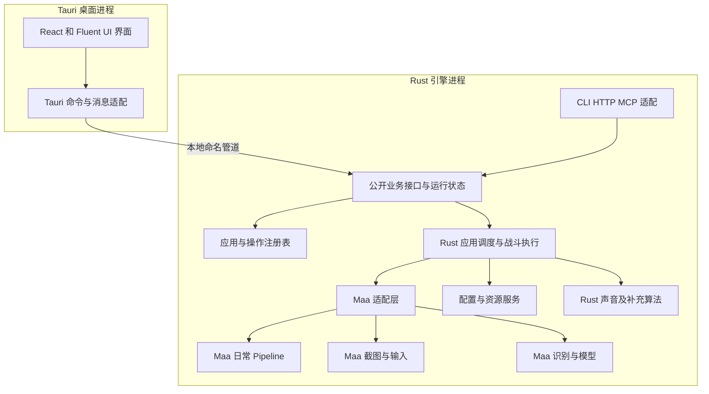

# zzz auto 的 Rust Tauri 和 MaaFramework 迁移计划

将绝区零一条龙迁移为不依赖 Python 的 Windows 应用。桌面界面采用 Tauri，Rust 负责业务、配置和调度，MaaFramework 负责通用截图、输入和识别，适合界面操作的日常流程逐步采用 Maa Pipeline。保留现有模型、画面资料、模板和战斗规则，验证行为后替代现有版本。

Tauri、Rust、MaaFramework 和移除 Python 是确定的技术方向。本文是待实施的 roadmap，所有阶段尚未完成；Maa 对现有模型、战斗时序和暂停行为的兼容性需在原型阶段确认。React、进程划分、目录布局和排期是本计划采用的实施方案，调整时记录原因与影响。

## 1 目标与范围

最终交付满足以下要求：

- 用户无需安装 Python、uv、Node.js 或 Rust，安装后即可使用已迁移功能。
- 桌面端采用 Tauri 2，界面采用 React、TypeScript、Vite 和 Fluent UI React v9。
- 使用 MaaFramework 官方 Rust 绑定接入原生 SDK，不通过 Python 或 Node.js 服务调用框架。
- Rust 引擎可以脱离界面运行，提供 CLI、HTTP 和 MCP 入口。
- 内置应用、自动战斗、设置界面、开发工具和发布工具完成迁移；每项功能都有明确的验收记录。
- 用户的账号实例配置、应用组顺序、运行记录、战斗脚本和路线可以导入新版本。
- 正式发行包、资源构建和正式验证流程移除 Python 依赖。迁移期间旧版本仅作为开发对照。

MaaFramework 本体及 OpenCV、ONNX Runtime 等原生依赖可以继续使用。移除 Python 不要求把底层 C++ 库改写为 Rust。Tauri 使用 WebView 展示 Web 界面，Windows 上使用 WebView2；前端构建工具仅供开发和 CI 使用。[Tauri 概述](https://tauri.app/start/)、[Windows 开发前提](https://tauri.app/start/prerequisites/)

运行基准继续采用项目既有的 1080p 坐标和画面配置。首版面向 Windows x64，不在迁移过程中新增跨平台或分辨率适配任务。

## 2 现有项目与迁移原则

2026 年 10 月 12 日的源码统计为 848 个 Python 文件、约 12.1 万行，包含空行、注释和生成代码；应用目录包含 30 个工厂文件。这些数字用于判断规模，不直接换算成工期。当前组件关系见[一条龙整体架构](../docs/develop/one_dragon/one_dragon_architecture.md)。

| 当前部分 | MaaFramework 方案中的处理方式 |
| --- | --- |
| 通用配置、应用组和运行记录 | Rust 保留数据含义与业务规则 |
| Windows 截图、键鼠和手柄控制 | 优先采用 Maa 控制器，Rust 封装坐标、动作和生命周期 |
| OCR、模板、颜色和特征匹配 | 优先采用 Maa 识别接口，转换资源并对照结果 |
| YOLO 和闪光分类 | 先验证 Maa 神经网络识别，必要时使用 Rust 自定义识别扩展 |
| 日常界面操作 | 适合的流程转为 Maa Pipeline，由 Rust 统一启动和收尾 |
| 战斗调度、声音闪避、视角和路线 | Rust 实现，通用截图及输入通过 Maa 适配层调用 |
| 绝区零应用和 Operation | 维护应用与操作标识，按流程特点选择 Pipeline 或 Rust 实现 |
| Qt 界面、浮窗和开发工具 | 重写为 Tauri 窗口与 Web 组件 |
| Python 插件、反射和动态模块加载 | 改为显式注册及新的插件协议 |
| 源码更新、依赖清单和 PyInstaller 打包 | 改为二进制发布、资源版本管理和原生依赖清单 |
| 战斗脚本合并、翻译编译等 Python 构建工具 | 改为 Rust 工具或前端构建步骤 |

实施遵循以下原则：

1. 每个阶段交付可独立运行的 Rust 功能，不将 Python 封装成 Tauri 的执行依赖。
2. 先验证 Maa 的 Windows 控制、模型、异步队列与停止行为，再展开大量业务迁移。
3. 共用一份引擎实现；GUI、CLI、HTTP 和 MCP 只提供不同调用入口。
4. 用户配置与战斗脚本继续采用 YAML；Maa 原生 Pipeline 采用框架的 JSON 协议。不同用途分别维护，同一份具体数据只有一个来源。
5. 用旧实现的结果验证新实现，同时人工检查关键分支，避免复制旧代码中的错误。
6. 涉及游戏流程的实现，继续按项目开发流程先阅读玩法、画面、screen_info 和相关代码；发现知识缺失时先补档。

Maa 的适配问题按组件处理，Rust 补充实现必须说明缺失能力或不兼容行为。若截图、输入或 OCR 等核心能力无法通过 M1，先修正集成方案，不带着未经验证的前提批量迁移，也不自动恢复为重写全部基础组件。

## 3 技术选型

| 能力 | 采用的方案 | 选择原因与实施要求 |
| --- | --- | --- |
| 桌面壳 | Tauri 2 | 提供窗口、托盘、系统集成和发布能力 |
| Web 界面 | React、TypeScript、Vite | 适合设置表单、运行列表和开发工具；发布为静态资源 |
| 界面组件 | [Fluent UI React v9](https://github.com/microsoft/fluentui) | 延续 Fluent Design；复杂图像编辑组件单独实现 |
| Rust 工具链 | Windows MSVC 目标、Cargo workspace | 与 Windows 原生库构建和分发配合，锁定工具链和依赖版本 |
| 自动化基础 | [MaaFramework](https://github.com/MaaXYZ/MaaFramework) 与[官方 Rust 绑定](https://github.com/MaaXYZ/maa-framework-rs) | Controller、Resource、Tasker 和自定义扩展封装在一个适配模块中 |
| 截图与基础输入 | Maa Win32、Gamepad 控制器 | 验证现有前后台、按住释放和摇杆行为，不默认兼容游戏 |
| 通用识别与模型 | Maa 识别接口和神经网络识别 | 先复用现有模型及资源，验证颜色、预处理、字典和后处理 |
| 日常流程 | Maa Pipeline | 实现界面识别、点击、等待和错误分支；Rust 负责应用级调度 |
| 战斗与复杂游戏流程 | Rust 业务引擎和 Maa 自定义扩展 | 保留状态时间窗、优先级、动作抢占、转向和路径判断 |
| Windows 补充能力 | [windows-rs](https://github.com/microsoft/windows-rs) | 负责进程、权限、控制权和 Maa 未覆盖的操作 |
| 额外图像与模型算法 | Rust 自定义识别，必要时使用 ort 或 opencv | 仅为 Maa 未满足的行为引入，单独验证原生依赖和推理调度 |
| 音频采集 | [wasapi-rs](https://github.com/HEnquist/wasapi-rs) | 支持 Windows 输出音频回录，信号处理由 Rust 实现 |
| 配置与协议 | Serde、YAML 解析库、JSON | Rust 校验配置与协议；YAML 库在原型阶段按兼容语料和维护情况确定 |
| 并发与网络 | Tokio、专用工作线程 | 网络异步执行；推理、截图、音频和动作执行使用明确的线程与队列 |
| HTTP 与 MCP | Axum、官方 [rmcp](https://github.com/modelcontextprotocol/rust-sdk) | 复用公开业务接口，保持现有 Streamable HTTP 接入方式 |
| 发布与更新 | NSIS 安装包、Tauri updater、资源下载服务 | 程序与资源分别管理版本，发布前校验依赖完整性 |

前端状态分为服务端运行快照和本地编辑状态。运行结果、账号实例、配置版本和应用组由 Rust 引擎维护；前端只保存尚未提交的编辑内容、导航和展示状态。

Maa Rust 绑定与原生 SDK 锁定为经过验证的兼容组合，API 使用以该版本为准。SDK 采用受控的 DLL 加载与发布目录，不因为系统 PATH 上存在其他版本就自动使用。社区项目 [MXU](https://github.com/MistEO/MXU)可作为 Tauri 接入和配置展示的参考，项目界面与业务仍按本 roadmap 实现。

不承诺整体性能提升倍数或安装包大小。推理和许多图像运算在现有版本中已经由原生库执行，迁移收益需要通过同机对照测量。

## 4 目标架构

### 4.1 进程与模块

采用 Tauri 桌面进程和独立 Rust 引擎进程。桌面进程负责 WebView、系统界面和引擎管理；引擎持有游戏上下文与 Maa 实例，完成全部自动化。Maa 原生库在引擎内加载，异常可以与界面隔离，引擎也可以作为无界面服务单独运行。

独立引擎作为 Tauri 的随附可执行程序发布，不安装常驻系统服务。Tauri 支持打包此类外部可执行程序；命名管道协议、权限提升和引擎生命周期由本项目实现。[外部程序打包](https://tauri.app/develop/sidecar/)

引擎默认使用普通权限。游戏以管理员权限运行、导致输入权限不匹配时，由桌面端明确提示并按需提升引擎权限。权限提升前后的通信、停止和退出必须在原型阶段验证，避免默认提升整个 WebView 进程。

### 4.2 游戏控制权与生命周期

一个引擎统一管理当前账号实例和运行任务。GUI、CLI、HTTP、MCP 发起的任务进入同一个运行槽，即只能容纳一个自动化任务的调度位置；例如自动战斗运行期间，日常任务不能另行开始。Maa Tasker 执行日常流程和 Rust 执行战斗也遵守这个约束。

Windows 侧增加按交互会话和游戏进程确定的控制权互斥。第二个引擎发现相同游戏已被控制时拒绝取得控制权，并返回可解释的错误。旧 Python 版本无法自动遵守新互斥协议，迁移期间的实机对照必须分开运行。现有进程边界见[后端架构](../docs/develop/zzz/backend/architecture.md)。

Maa 控制器由适配层唯一持有，Rust 动作与 Pipeline 不能分别创建不受协调的输入入口。切换执行方式时先取消旧任务、等待控制器操作结束并释放输入，再交给新任务。Tasker 的异步停止响应不能被当作动作队列已经清空。

桌面托管模式下，主窗口关闭默认隐藏到托盘；选择退出时先停止任务、释放输入，再结束引擎。桌面异常退出或管道失联时，引擎停止自动化并退出。独立服务模式由 CLI 管理生命周期，不依赖桌面存活。

正常停止、暂停、异常返回和退出均清理已按下的键与手柄状态。原生进程崩溃时不能依靠 Rust 析构保证清理，需验证桌面监督端的独立输入恢复路径及其权限；恢复失败时显示停止使用和恢复输入的方法，禁止自动恢复之前的动作。

### 4.3 前后端通信

进程间通信采用 Windows 本地命名管道，使用有长度边界的 JSON 消息。引擎限制消息大小、连接来源和请求权限，校验当前用户、会话及配对信息。该协议独立于 Tauri，也不对外开放任意命令执行或任意文件访问。

| 消息 | 内容与约定 |
| --- | --- |
| 请求 | 协议版本、请求 ID、命令、账号实例、参数；重复请求需要明确的去重规则 |
| 响应 | 请求 ID、结果或结构化错误；启动任务返回运行 ID，不等待任务执行完毕 |
| 运行事件 | 运行 ID、事件序号、状态、节点、结果；终态由引擎保存，可重新查询 |
| 配置提交 | 实例 ID、应用组 ID、配置修订号、修改字段；冲突返回最新版本 |
| 状态快照 | 当前实例、任务和最近结果；连接恢复先获取快照再继续订阅 |

Rust 协议结构作为类型源，通过构建工具生成 TypeScript 类型。错误包含机器可识别的代码、用户可读的中文说明和可选详情；密码等敏感值不进入事件、日志或普通状态快照。

Web 界面通过 Tauri 命令调用桌面 Rust 适配器；日志和进度使用有序 Channel，少量界面通知使用事件。官方文档说明，普通事件不适合低延迟或大吞吐传输，Channel 更适合有序流式数据。[前端调用 Rust](https://tauri.app/develop/calling-rust/)、[Rust 推送前端](https://tauri.app/develop/calling-frontend/)

截图、OCR、闪光检测和音频判断的循环全部留在引擎内部。前端按需接收压缩预览与识别结果，不逐帧接收原始图像或参与动作定时。展示队列有容量限制，日志可以合并或丢弃旧项并显示数量；任务终态和配置提交结果通过可查询状态保证可恢复。

主窗口、预览窗口和浮窗分别配置 Tauri 权限。自定义命令也要显式限制可调用窗口，不能只配置插件权限后假定业务命令已受限制。远程公告和帮助内容不取得游戏控制权限。[Tauri Capabilities](https://tauri.app/security/capabilities/)

### 4.4 建议代码布局

`zzz-auto/docs/ROADMAP.md` 是迁移计划的唯一来源。工程目录按下表创建；参考项目的 `src/`、`assets/` 和 `config/` 继续作为迁移输入，不移动或共同写入。

| 目录 | 职责 |
| --- | --- |
| `zzz-auto/Cargo.toml` | 新版本的 Rust workspace 与共享依赖 |
| `zzz-auto/crates/od-core/` | 配置、应用调度、条件操作、事件及运行结果 |
| `zzz-auto/crates/od-protocol/` | 本地通信、请求与响应结构、版本协商 |
| `zzz-auto/crates/maa-adapter/` | Maa 绑定、实例生命周期、Controller、Recognition 和 Tasker 适配 |
| `zzz-auto/crates/od-platform/` | 音频、权限、进程、控制权和必要的 Windows 补充操作 |
| `zzz-auto/crates/zzz-engine/` | 绝区零上下文、战斗、路线、应用及 CLI、HTTP、MCP 入口 |
| `zzz-auto/crates/od-tools/` | YAML 资源转换、战斗脚本合并、翻译转换、类型生成和发布清单 |
| `zzz-auto/apps/desktop/src/` | React 页面、组件、编辑器和状态展示 |
| `zzz-auto/apps/desktop/src-tauri/` | Tauri 入口、引擎通信、系统集成和发布配置 |
| `zzz-auto/resources/pipeline/` | 原生 Maa 日常流程定义，采用 JSON 协议 |
| `zzz-auto/resources/generated/` | 构建生成的 Maa 资源包，不手工修改 |
| `zzz-auto/sdk/` | 本地固定版本的 Maa SDK 缓存，不作为源码提交 |

通用核心不依赖 Tauri、React 或 Maa 的具体句柄。业务层通过适配层使用控制和识别，避免 Maa 类型散落在各应用中。补充识别算法先放在业务或适配模块中，确有复用需要时再拆独立 crate。复杂业务保留 Rust 实现，不为迁移而将全部逻辑改造成 Pipeline。

## 5 模块迁移要求

### 5.1 流程引擎与运行结果

应用和复杂 Rust 操作使用显式注册，取代 Python 反射与动态导入。菜单识别、点击和画面等待优先交给 Maa Pipeline，Rust 不再重写同用途的通用流水线；需要计算或业务判断的操作保留 Rust 实现。对外运行含义需要对齐[Operation 模块](../docs/develop/one_dragon/modules/operation.md)。

Rust 操作验收覆盖四种轮次结果、精确状态边与兜底边、子操作、超时和失败收尾。Pipeline 应用不逐节点机械复制装饰器，而是验证完整路径、错误分支及应用级结果。等待不能误消耗项目约定的重试次数，暂停不能让恢复后的任务立即超时。

区分操作结果和应用运行结束原因，保留正常完成、失败、主动停止和未启动的区别。停止请求的响应表示已经收到请求，不表示任务已经退出。内部增加停止中的状态，旧 HTTP 或 MCP 接口通过兼容适配保持既有返回含义。

Maa 的 `post_stop` 是异步停止请求，不能当作暂停接口。M1 验证 Pipeline 的安全暂停方式，M2 落实：停止投递新动作，取消并等待在途动作，释放输入并保存业务状态；继续时重新识别画面，从可恢复步骤开始。不可重复的领取或提交步骤必须先检查是否已经生效。框架阻塞或回调不可取消时单独记录，不用重新启动整个任务来假装实现原位继续。[Maa Tasker 接口](https://docs.rs/maa-framework/latest/maa_framework/tasker/struct.Tasker.html)

使用单调时钟计算动作间隔与运行超时，使用日历时间处理每日重置和运行记录。录像回放、模拟时钟和随机数种子可由独立测试程序注入，便于复现时序问题。

### 5.2 Windows 输入与截图

优先使用 Maa Win32 控制器截图与输入，分别验证前台和后台组合。M1 先选择与当前行为接近的截图方式，再比较框架提供的其他方式；截图方式的选择不能改变关键区域或游戏窗口行为。[Maa 控制方式](https://github.com/MaaXYZ/MaaFramework/blob/main/docs/zh_cn/2.4-控制方式说明.md)

适配层统一声明尺寸、颜色顺序、行跨度和截图时间，显式保持 1080p 基准并验证 RGB 与 BGR 转换。旧区域的 `[x1, y1, x2, y2]` 转为 Maa ROI 的 `[x, y, w, h]`，点击结果通过同一坐标转换返回控制器。截图失败、窗口失效、后台模式和权限不匹配应形成可诊断结果。[Maa ROI 定义](https://github.com/MaaXYZ/MaaFramework/blob/main/docs/zh_cn/3.1-任务流水线协议.md#directhit)

输入适配层维护当前持有的键与手柄状态，区分动作已经投递和已经执行；停止与切换后禁止旧任务的排队动作继续生效。全局启停快捷键进入同一个引擎控制接口，避免由前端 JavaScript 定时器执行战斗动作。控制器、Tasker 和回调句柄的销毁顺序由适配层统一管理。

手柄优先采用 Maa Gamepad 控制器，分别验证 Xbox 与 DS4 的按键、方向、摇杆、按住时长和释放。Maa 仍依赖 ViGEmBus，换框架不能移除驱动依赖。转向还需验证键鼠与手柄的位移定义及现有灵敏度参数；Maa 相对鼠标位移的启用条件不能被当成现有转向接口的等价行为。[Maa 控制方式](https://github.com/MaaXYZ/MaaFramework/blob/main/docs/zh_cn/2.4-控制方式说明.md)、[项目转向说明](../docs/develop/zzz/turn_sensitivity.md)

### 5.3 识别与推理

OCR、模板、颜色和特征匹配优先使用 Maa 识别。适配层可以单独执行识别，不必为每次调用启动完整 Pipeline。使用相同输入、资源和执行设备对照文字、位置、置信度及后续业务判断，不能用换了 OCR 模型的结果直接证明兼容。

现有 YOLO 与闪光 ONNX 模型先验证 Maa 的 `NeuralNetworkDetect` 与 `NeuralNetworkClassify`。若预处理、后处理或输出结构无法对齐，用 Rust 自定义识别扩展补充；只有确有需要才额外引入 ort 或 opencv，避免默认维护两套完整识别引擎。[Maa 识别协议](https://github.com/MaaXYZ/MaaFramework/blob/main/docs/zh_cn/3.1-任务流水线协议.md)

保持项目当前对 DirectML 多会话的保守限制。Maa 内部会话不能直接由 Python GPU 执行器管理，需要在 Rust 适配层限制 GPU 使用时段；异步操作真正完成后才能交给另一条推理路径。M1 先用 CPU 验证结果，再验证 Maa DirectML，禁止默认同时运行 Maa GPU 与额外 Rust GPU 推理。自定义回调中的推理也要避免等待同一个已经被占用的工作队列。现有约束见 [`gpu_executor.py`](../src/one_dragon/utils/gpu_executor.py)。

Maa GPU 会话的具体设置以选定 SDK 实现为准；额外 ORT 会话遵守其执行提供程序限制，不能因使用 Rust 就假定并发安全。[ONNX Runtime DirectML 配置](https://onnxruntime.ai/docs/execution-providers/DirectML-ExecutionProvider.html)

Maa 覆盖的步骤由框架执行，项目的图像处理流水线及组合算法按[CV 流水线架构](../docs/develop/one_dragon/modules/cv_pipeline_architecture.md)逐项核对。保留未被覆盖的处理步骤和编辑能力，不将 Maa Pipeline 调试工具误认为既有 CV 编辑器的完整替代。

### 5.4 自动战斗与声音闪避

战斗调度采用 Rust，保留现有 YAML 脚本的状态名、时间窗、模板引用、优先级和动作参数，不把高频战斗规则整体改写为 Maa 日常 Pipeline。解析器、状态记录、场景选择、抢占、按住与释放对照[条件操作模块](../docs/develop/one_dragon/modules/conditional_operation.md)。脚本语法错误需要定位到文件和字段，不能静默执行部分脚本。

角色、目标、按钮与闪光识别优先通过 Maa 适配层提供结果；不兼容的识别由 Rust 补充。识别节流、兜底、状态时间戳和决策仍由战斗层维护，详见[自动战斗说明](../docs/develop/zzz/auto_battle.md)。原型实测调用排队、旧截图和任务取消对动作时序的影响。

声音闪避仍由 Rust 重写输出音频回录、单声道转换、采样率转换、滤波、标准化、FFT 相关性计算与去重。算法对照见 [`auto_battle_dodge_context.py`](../src/zzz_od/auto_battle/auto_battle_dodge_context.py)。不能只换一个近似滤波器并直接沿用旧阈值；接近触发阈值的样本必须单独验证。声音线程与 Maa 识别只向统一状态服务提交结果，不直接竞争输入控制权。

### 5.5 配置与用户数据

建立唯一的数据目录服务，统一定位配置、模板、模型、路线、日志和运行记录。便携版继续使用程序工作目录；安装版使用可写的用户数据目录，导入时显式选择旧目录，不能依赖进程当前目录。

配置仍以 YAML 为主。Rust 引擎负责字段校验、默认值、账号实例与应用组隔离，前端提交具体字段修改。普通设置由结构化字段定义生成表单，复杂战斗和路线编辑器单独实现。

用户 YAML、旧 screen_info 和模板描述不直接当作 Maa 资源包加载。`od-tools` 转换坐标、资源名称、路径和识别参数，输出框架需要的目录与 JSON；模型和字典按选定 SDK 的要求校验。源文件保持一处维护，生成资源禁止手工修补。Maa 原生日常流程在 `resources/pipeline/` 编写，不为同一新流程再创建另一份自有通用流水线。

数据迁移先只读检查，再生成转换预览、备份和新目录。保存使用临时文件与完整替换，迁移步骤可以重复执行。已知字段的含义及未知字段的保留策略都要明确；无法转换的内容逐项报告。

在停止状态切换账号实例，重新创建或清理实例级缓存，不允许旧任务继续持有新实例配置。配置修订号用于检测并发编辑。旧版本和新版本使用各自的数据副本，禁止共同写入同一份配置。

### 5.6 应用与界面

应用 ID、配置入口、应用组顺序和运行记录优先保持稳定，按[应用插件系统](../docs/develop/one_dragon/modules/application_plugin_system.md)建立迁移清单。以下分组覆盖当前 30 个应用工厂；登记清单应记录每个应用的设置、公共操作、资源、采用 Pipeline 或 Rust 的原因，以及测试前提。

| 顺序 | 应用与能力 |
| --- | --- |
| 基础日常 | 咖啡店、邮件、活跃度奖励、丽都城募、刮刮卡 |
| 外部服务与附属功能 | 每日签到、兑换码、通知、丽都周纪 (领奖励)、卦象集录、吼吼饼铺、情报板 |
| 配置检查 | 预备编队角色识别、鼠标灵敏度检测 |
| 战斗与资源 | 闪避助手、自动战斗、体力刷本、恶名狩猎、式舆防卫战、真·拿命验收、驱动盘拆解 |
| 探索与经营 | 枯萎之都、迷失之地、锄大地、委托助手、录像店营业、随便观 |
| 编排与工具 | 一条龙、闪避截图、指令调试 |

中文展示名称以注册信息为准，清单中同时记录源码目录和应用 ID，避免只按名称识别功能。复杂应用的迁移顺序允许按实际公共依赖调整。

Tauri 界面分批实现：

1. 首页、环境状态、账号实例、模型管理和运行日志。
2. 一条龙列表、应用设置、启动、暂停、继续、停止和结束后动作。
3. 战斗脚本、队伍、路线与经营设置，以及资源下载和通知。
4. 截图与区域标注、模板工具、图像处理流水线、操作调试、路线记录和战斗浮窗。

延续 Fluent Design，但不要求像素级复制 Qt。基础表单复用 Fluent UI，图像标注使用 Canvas 或 SVG；长日志使用有容量限制的缓存和列表虚拟化。中文输入法、键盘导航、明暗主题、系统缩放和多窗口行为列入界面验收。[Fluent UI](https://github.com/microsoft/fluentui)

### 5.7 插件与服务接口

内置应用在 Rust 注册表中显式登记。旧 Python 插件和 Qt 设置扩展需要移植，不承诺原样兼容；旧插件扫描结果用于生成待迁移清单，不能在运行时通过嵌入 Python 继续执行。

新扩展优先复用 Maa 资源包、Rust 自定义识别与动作；需要独立进程时使用官方 Rust AgentClient 和 AgentServer，避免再实现一套同用途的插件通信。Maa 扩展与本项目的应用注册、设置和运行记录由适配层关联，不能因为能执行自定义动作就视为旧插件已经兼容。[Maa Rust 扩展接口](https://docs.rs/maa-framework/latest/maa_framework/index.html)

插件不能另行取得输入控制权，不能与主任务并发操作游戏；停止、超时、Agent 断线和崩溃均由引擎收尾。普通插件设置使用字段描述生成表单，复杂界面由随应用发布的前端组件提供。Agent 使用本地连接，启动、协议版本和插件清单由宿主管理，避免绕开统一控制器。

首个公开试用版可以先提供内置应用，但必须明确第三方插件尚未迁移。正式替代版应提供新插件 SDK、示例和迁移说明，并登记已知旧插件的处理结果。WASM 插件不作为本轮迁移完成的前提。

HTTP 与 MCP 调用同一份 Rust 业务接口和运行槽，不直接把任意 Maa 句柄或 Pipeline 名称暴露为可执行权限。保留现有公开路径、参数和结果含义；Python 模块路径形式的 Operation ID 通过明确映射到 Rust 操作或 Maa 任务。变化较大的接口提供版本区分。能力边界继续参照[后端服务层](../docs/develop/zzz/backend/README.md)和[设计原则](../docs/develop/zzz/backend/design-principles.md)。

通知与遥测同时登记迁移项，保留既有用户设置与数据范围。网络请求失败不能阻止主流程启动、停止或退出；日志和上报中排除账号密码及用户截图。

## 6 实施阶段

各阶段以验收条件推进。2026 年 10 月 12 日已开始 M0 清单和 M1 原型，实现与证据见[首轮验收记录](migration/acceptance.md)；两阶段尚未通过全部条件，M2 至 M7 待开始。先接入 Maa 控制和识别，再完成一个日常 Pipeline，最后展开复杂业务；不先重写整套基础引擎。前端在 M1 建立骨架，之后按稳定协议实现，但界面演示不能代替引擎验收。

2026 年 10 月 13 日用户实机反馈：窗口连接、当前方式截图、无输入健康检查正常结束及停止后再次运行、游戏重启后的手动重连、托盘退出、双实例互斥均正常。M1 的基础连接和无输入生命周期已有局部实测证据；前后台真实输入、权限提升、异常恢复、模型及 CPU / DirectML 对照和延迟仍待完成，M0 / M1 不整体标记通过。

下一步已推进到 0.1.2 的 M1 输入诊断：桌面和 CLI 共用前台 / 后台键盘与 Xbox / DS4 数字按键探针，提供启动延时、取消、输入释放与计时结果，并在独立测试仓覆盖真实 Maa 队列的顺序及失败清理。游戏响应、真实残留动作、鼠标、摇杆与权限场景仍需实机验证，证据见[验收记录](migration/acceptance.md)。

0.1.2 输入实测反馈为 Xbox 正常、前台 / 后台键盘 W 未响应；测试位于可自由移动的大世界，游戏由启动器启动，尚未确认进程权限。0.1.3 增加按键名称下拉、权限与前台检查及 Maa 键盘兼容方式，继续收集键盘实机证据，M1 不整体标记通过。

0.1.3 后续反馈为前台键盘输入正常，两种后台键盘消息方式均未生效；进一步测试确认前台键盘持有期间停止、停止后无残留动作，以及游戏处于后台时的 Xbox 数字按键均正常。迁移采用前台键盘、后台 Xbox 数字按键路径，窗口消息键盘保留为当前环境不兼容的诊断方式。计时与通过范围见[验收记录](migration/acceptance.md)，鼠标、摇杆 / 扳机、DS4、带输入 Pipeline 与异常恢复等 M1 条件仍待完成。

0.1.4 用户反馈鼠标按键及 Xbox / DS4 摇杆与扳机测试正常，登记当前场景基础响应通过，具体条件与证据见[验收记录](migration/acceptance.md)。下一步推进真实模型的 CPU / DirectML 对照；输入的具体前后台组合、中途停止、异常恢复与性能基线继续验收，M0 / M1 保持进行中。

2026 年 10 月 14 日已固定四个默认模型并完成 9 个固定图案例的 Maa CPU / DirectML 对照，各案预热 5 次、正式采样 30 次，设备输出在登记容差内一致。已确认闪光的 softmax / 缩放及 YOLO 补边等差异，旧版完整输出、正例和同机性能基线仍待补齐，不能据此批量迁移业务。实现入口见[模型对照说明](develop/recognition-validation.md)，结果见[验收记录](migration/acceptance.md)。

本轮进一步实现闪光分类适配：生成固定 logits 模型，复用 SDK OpenCV 进行旧版的等比缩放与右下补边，再由 Maa 完成一次 softmax。已知概率及阈值两侧通过真实 SDK 验证，固定战斗图的 CPU / DirectML 输出一致。另复现 Maa JSON 六位小数造成的阈值舍入；距阈值不超过 0.000001 时拒绝给出普通判定。真实红光 / 黄光、旧输出、原始浮点边界及 YOLO 差异继续待验收，下一步补这些证据和必要的原生补充接口，M0 / M1 保持进行中；详见[闪光适配方案](develop/recognition-validation.md#闪光分类适配方案)与[验收记录](migration/acceptance.md)。

已新增 `LegacyFlashRaw`，复用固定 SDK 的 ONNX Runtime 直接读取 float32 概率，按参考 NumPy 2 规则比较阈值，补上 JSON 舍入无法判定的边界。阈值前后相邻值及相等边界在 CPU / DirectML 原始推理回归中通过，6 案原生 / logits / 原始输出设备对照通过；没有增加或替换原生 DLL。debug 张量转换及 CPU 单线程路径的耗时仍需 release 和旧版基线评估，不能作为性能通过。下一步继续补真实正例 / 旧输出及 YOLO 适配，原始推理停止 / 取消和其他 M1 条件仍待验收；见[原始浮点输出方案](develop/recognition-validation.md#原始浮点输出方案)。

已新增 `LegacyYoloDetect`，复用 SDK 原始张量补上旧版的缩放补边、类别过滤、严格阈值、按类别 NMS、越界框与迷失之地头像遮罩。确认空洞模型实际输入为 736×416，迷失之地为 736×736；6 案原生 / 适配 / 过滤对照的 CPU / DirectML 正式采样通过，新增 11 项 YOLO 回归通过。没有修改模型或新增 DLL；同分重叠 NMS 返回排序歧义错误。真实正例、同机旧输出、release 性能、原始推理停止 / 取消及 OCR 差异仍待验收，下一步继续补齐这些 M1 条件；详见 [YOLO 适配方案](develop/recognition-validation.md#yolo-适配方案)和 [验收记录](migration/acceptance.md#2026-年-10-月-14-日-yolo-原始张量与旧后处理)。M0 / M1 保持进行中。

原始闪光和 YOLO 现已接入独立取消对象、在途 ORT 停止请求、阶段检查与结果丢弃；CLI 支持 Ctrl+C 和定时取消。新增 7 项回归、完整 70 项 Rust 回归通过，三个真实模型的 CPU / DirectML 在途取消后均能复用缓存会话。CPU 可退出在途推理，DirectML 在本机样本中完成已提交计算后返回，接口始终等待收尾。此项只验收离线原始推理，完整游戏停止、长期稳定性和性能仍待补齐；下一步继续真实正例 / 旧输出、release 性能和 OCR 差异，M0 / M1 保持进行中。具体约定见[原始推理的取消](develop/recognition-validation.md#原始推理的取消)，证据见[验收记录](migration/acceptance.md#2026-年-10-月-14-日原始推理取消与会话复用)。

2026 年 10 月 15 日已核对测试仓现有截图，复用六个文件补 12 个识别案例：8 个 OCR、迷失之地事件标记正 / 负例、空洞跨画面负例与一个无闪光案例。CPU / DirectML 共 720 个正式样本稳定，12 组设备输出一致，各设备 11 / 12 项符合人工预期；空洞模型在城市导航画面误检为安全区，保留未通过并等待旧版对照及调用画面约束判断。OCR 素材与迷失之地正例已有，接下来优先补旧版输出导出与新旧自动比较；另需空洞电视格子地图正例、明确红光 / 黄光帧及边界样本。M0 / M1 保持进行中，具体证据见[存档截图验收记录](migration/acceptance.md#2026-年-10-月-15-日复用存档截图扩充识别案例)。

随后已补入 24 个红光 / 黄光 PNG，去除重复计数后为 23 个独立帧；新增 `flash-sequence-cases.json`，按全帧、原模型与 0.9 阈值完成 CPU / DirectML 的 1380 个正式样本。23 组设备输出一致，各设备 19 / 23 个符合人工标注，4 个颜色识别差异继续保留，等待旧版实际输出判定原因。红光 A 的出现前文件与出现 1 完全相同，不作为无闪光负例。红黄光素材已具备，下一步集中补旧版输出与新旧比较；真实阈值附近、出现前帧和空洞地图正例仍待补，M0 / M1 保持进行中；详见[红黄光真实帧记录](migration/acceptance.md#2026-年-10-月-15-日红黄光真实帧对照)。

同日已完成这 23 帧的旧版实际输出采集和 Rust 自动比较。隔离的 Python 3.11.9 环境调用固定参考仓原分类器，旧版与新版各完成 CPU / DirectML 的 1380 个正式样本，46 项同设备新旧比较全部通过；全部概率的最大差值为 CPU 约 1.19×10⁻⁷、DirectML 为 0。四个人工标注差异在旧版中同样存在，保留未通过，不作为迁移回归或人工预期通过。比较命令无需 Python 或 SDK，新程序正式验证链继续不依赖 Python。下一步补 OCR / YOLO 旧输出、release 性能与真实边界语料；M0 / M1 保持进行中，详见[旧版闪光输出记录](migration/acceptance.md#2026-年-10-月-15-日旧版闪光实际输出与自动比较)。

随后扩展 OCR / YOLO 旧版采样与自动比较，复用 15 个案例，旧版和新版 release 各采集 CPU / DirectML 的 900 个正式样本。YOLO 两设备各 7 / 7 项输出一致，空洞模型在城市导航的误检确认旧版也存在；OCR 各 5 / 8 项一致，标题及同 ROI 负例有 3px 框宽差异，旧版检测不到的「400」在新版正确识别，保留比较失败。OCR 负例同时比较过滤前结果，避免两边未命中掩盖差异。release CPU YOLO 的延迟偏高，单线程与旧版默认线程池及计时范围差异需继续评估；性能不标为通过。下一步优先对齐测量范围与 CPU 线程策略，明确 OCR 差异及业务影响，并补真实边界 / 出现前 / 空洞地图正例。M0 / M1 保持进行中，详见[OCR / YOLO 验收记录](migration/acceptance.md#2026-年-10-月-15-日-ocr-yolo-旧版输出与-release-采样)。

同日已完成原始 YOLO 的统一边界计时与 CPU 线程实验。保持模型与参数不变，对照 1 / ORT 默认 / 2 / 4 / 8 线程；默认和 8 线程的 7 案全部达标，改用与旧版一致的 ORT 默认策略，保持顺序执行、关闭自旋与 DirectML 原设置。新旧各 420 个正式样本确认 7 / 7 项输出一致，release CPU P95 为旧版的约 69%～92%，均不超过 110%；23 帧闪光的 CPU / DirectML 新旧输出仍为 46 / 46 一致。本结论仅覆盖离线完整 BGR 帧到标准识别结果，游戏截图、动作、停止及长期性能仍待验收。下一步优先处理 OCR 差异与业务调用要求，再补真实边界 / 出现前 / 空洞地图正例及完整游戏链路。M0 / M1 保持进行中；详见[CPU 线程验收记录](migration/acceptance.md#2026-年-10-月-15-日原始-yolo-cpu-线程与统一计时)。

| 阶段 | 前置 | 主要交付物 | 进入下一阶段的条件 |
| --- | --- | --- | --- |
| M0 清单与基线 | 无 | 应用、界面、插件、资源及接口清单；Maa 替换与 Rust 保留范围；截图和音频语料 | 30 个工厂完成登记；每个应用确定执行方式；基线和测试前提可复现 |
| M1 Maa 集成原型 | M0 | 固定 SDK 与 Rust 绑定；截图、键鼠、手柄、OCR 和代表模型；Tauri 预览；引擎通信 | CPU 和 Maa DirectML 验证通过；前后台、权限、排队延迟、停止和退出实测；明确暂停及模型补充方案 |
| M2 首个 Pipeline 与适配层 | M1 | 邮件领奖等完整简单流程；资源转换；运行结果、取消和安全暂停；Maa 回调转事件 | 成功、失败、超时、恢复及重复执行通过验证；图像和坐标一致；没有停止后的残留动作 |
| M3 应用运行与桌面基础 | M2 | 账号、配置、应用组、运行记录；咖啡等首批日常；Tauri 列表、表单、日志和资源下载 | 导入旧配置后可运行首批应用；实例隔离、配置冲突和统一控制权验证通过 |
| M4 Rust 战斗与 Maa 控制 | M1、M3 | Rust 条件操作与战斗脚本；Maa 识别和动作适配；声音闪避、转向、手柄；战斗界面 | 状态及动作回放正确；输入延迟、抢占与释放满足目标；GPU 无跨路径重叠；长时间运行稳定 |
| M5 剩余游戏应用 | M3、M4 | 其余日常 Pipeline，以及探索、路径和经营等 Rust 流程；账号与应用组编排 | 全部剩余工厂有验收记录；Rust 与 Pipeline 可安全交接；关键分支和画面推进测试完整 |
| M6 工具与外部能力 | M3 至 M5 的稳定接口 | 图像、路线和战斗调试工具；Maa 调试接入；CLI、HTTP、MCP、Rust Agent 插件 | 资源可编辑并被引擎读取；公开接口兼容；插件超时、断线和停止不绕过控制权 |
| M7 发布与替代 | M0 至 M6 完成 | Maa SDK 及依赖打包；安装、更新、导入和恢复；无 Python 构建与验证链；迁移说明 | 干净 Windows 环境通过验收；SDK 与资源版本兼容；失败可恢复；满足全部完成条件 |

### 6.1 每阶段的验证方式

M0 准备独立测试仓及必需资源，固定截图、模型、模板、音频、配置、随机种子与模拟时间。登记应用采用 Pipeline 或 Rust 的边界，记录旧实现结果和已知问题；结果相同不代表旧错误应保留。

M1 通过 Maa 原生 SDK 跑通截图、OCR、闪光分类和代表 YOLO 模型，比较识别结果与完整延迟。逐项检查旧坐标、颜色、默认缩放、输入模式和模型参数，验证权限提升、窗口失效与引擎失联。记录 SDK 版本及补充算法理由；核心阻碍解决后才批量迁移。

M2 用完整简单日常流程验证 Maa Pipeline、资源转换、事件与运行结果适配。确认回调中不会阻塞等待自己所属的 Tasker，暂停恢复不重复领取或提交，Rust 任务和 Pipeline 共用取消、输入清理与终态规则。

M3 至 M5 按[测试方法论](../docs/develop/testing/README.md)覆盖 Rust 操作分支及 Pipeline 的识别、错误和超时路径，并验证连续画面推进。战斗重点检查时间窗、动作抢占、旧帧丢弃和停止后的队列处理。涉及新画面或玩法时先补档。

M6 验证桌面、CLI、HTTP、MCP 与 Agent 同时请求操作的冲突处理。Maa 调试器只用于 Maa 任务检查，现有图像编辑、路线记录与战斗时间线仍需逐项迁移。开发工具生成的资源必须能由正式引擎读取。

M7 在无开发环境的 Windows 机器验证 SDK 加载、首次运行、导入、离线模型、升级、恢复和卸载。检查 Maa SDK、Rust 绑定和资源清单的兼容性，普通包及完整包都要验收；卸载不得默认删除用户数据。

### 6.2 排期与人员

建议至少安排两个 Rust 开发职责和一个前端开发职责：一人负责 Maa 集成、原生兼容和发布，一人负责资源转换、应用与战斗业务，一人负责 Tauri、界面及开发工具。测试和实机验证贯穿各阶段。

以熟悉本项目和相应技术、三个职责均能持续投入为假设，阶段历时的初步预算如下。Maa 减少通用组件重写，但资源转换、暂停恢复、复杂业务和测试仍有投入；下列区间不是已经测得的提效幅度，M1 完成后按兼容结果重新估算。

| 阶段 | 初步历时 |
| --- | --- |
| M0 | 1 至 2 周 |
| M1 | 2 至 4 周 |
| M2 | 2 至 3 周 |
| M3 | 2 至 4 周 |
| M4 | 4 至 7 周 |
| M5 | 5 至 8 周 |
| M6 | 3 至 5 周 |
| M7 | 2 至 3 周 |

按阶段顺序计算约 21 至 36 周。前端和工具工作可以按依赖并行，但不在原型前承诺整体工期按固定比例缩短。游戏更新、Maa 不兼容行为、截图不足和第三方插件移植会增加时间；未知插件的逐个移植不包含在预算中。

## 7 测试与验收

### 7.1 测试代码归属

继续遵守独立测试仓约定，`zzz-auto/` 不新增测试目录或 Rust 内联测试模块。建议在测试仓建立 `test/zzz_auto/rust/` 和 `test/zzz_auto/frontend/`：Rust 测试作为独立 Cargo 工程通过路径依赖调用 `zzz-auto/` 组件；前端与桌面流程测试从测试仓调用主仓模块和打包程序。

测试路径、依赖安装和运行入口在 M0 确定。固定图片可以使用 Maa 调试控制器，录制数据可使用框架回放能力；依赖点击后换帧的流程仍需要测试仓的可反应模拟控制器，不能只循环播放截图就视为完整流程测试。截图、音频、模型索引与预期结果由测试仓维护，新测试不依赖 Python 辅助脚本。[Maa 控制器接口](https://github.com/MaaXYZ/MaaFramework/blob/main/docs/zh_cn/2.2-集成接口一览.md)

主仓和测试仓使用同名分支；实现与验证同步推进。涉及两仓时使用配对提交、互相关联的 PR，并按测试仓先、主仓后的顺序合并，详见[开发流程](../docs/develop/development_workflow.md)。

### 7.2 功能与稳定性

| 范围 | 必须验证的结果 |
| --- | --- |
| 流程 | Rust 与 Maa 任务的应用结果一致；暂停恢复不重复执行不可逆步骤；超时和停止不会遗留任务 |
| 识别 | 固定语料的关键文字、画面、分类、状态和后续动作一致；坐标及浮点容差按算法分别登记 |
| 声音 | 包含触发、未触发和接近阈值的样本；标准化与边界处理一致 |
| 输入 | Maa 队列与 Rust 决策按序交接；按住、释放、抢占、前后台、转向及手柄状态符合预期 |
| 数据 | 导入可重复执行；默认值、账号隔离、应用组顺序和运行记录保持正确；失败后可恢复 |
| 界面 | 中文输入法、主题、系统缩放、托盘、浮窗、图像编辑和大量日志可以使用 |
| 服务 | 并发启动只允许一个任务取得控制权；停止响应与任务终态区分明确 |
| Maa 适配 | 坐标、色彩、识别结果、回调生命周期、SDK 版本、Agent 断线及销毁顺序符合约定 |
| 发布 | 未安装 Python 和 Node.js 的机器可运行；程序、Maa SDK、DLL、模型和资源版本兼容 |

初始稳定性目标：连续两小时代表战斗场景运行，以及至少一百轮启动、暂停、继续与停止，不出现持续增长的句柄或内存、悬挂输入、丢失终态或无法退出。资源变化允许模型缓存等可解释的增长，需要与无界增长区分。

### 7.3 性能基线

同机、同一游戏场景、相同模型和尽量一致的截图方式比较旧版本与 Maa 方案，分别记录 CPU 与 DirectML。单独计量 SDK 入队、执行与结果回调，至少记录启动、空闲 CPU、内存、截图、识别、动作及停止完成时间。切换截图方式或算法的结果单列，不能混入直接兼容对照。

P50 表示一半样本不超过该值，P95 表示百分之九十五的样本不超过该值；例如识别 P95 用于发现少量明显变慢的帧。记录样本数量、预热方式与测试环境，不只比较平均值。

默认目标为关键识别与动作链的 P95 不超过旧版本的百分之一百一十，正常可控动作的停止与输入释放在 250 毫秒内完成。这些是设计目标，M0 根据基线登记适用范围，M1 验证可实现性；原生阻塞、设备异常及崩溃恢复单独记录，不能隐藏在平均值中。未达目标时解释原因并修正实现，不因改用 Rust 就默认验收通过。

## 8 构建 发布与更新

### 8.1 构建与原生依赖

锁定 Rust 工具链、Cargo、前端依赖、Maa Rust 绑定和原生 SDK，优先使用经过验证的官方 Windows x64 SDK。开发机和 CI 使用同一套可重复获取、校验与打包脚本，支持缓存或镜像；不默认自行构建框架已提供的 OpenCV、ONNX Runtime 等原生库。

发布清单记录业务版本、Maa SDK、Rust 绑定、Pipeline 协议、可执行程序及 DLL 的架构、版本和校验值。校验实际加载路径、CPU 回退与依赖完整性，不依赖开发机 PATH、Python `.pyd` 或虚拟环境。SDK 缓存在 `zzz-auto/sdk/`，下载内容与生成资源在工程建立时配置忽略规则，发行包仍按清单收集所需内容。

只有 Maa 无法满足的算法才引入额外原生库。额外 ORT 或 OpenCV 与 Maa SDK 的同名 DLL、版本和加载路径需要一起验证，禁止把两套不兼容 DLL 放入同一发布目录。如果需要隔离进程，仍须统一输入与 GPU 使用时段，不能只靠进程隔离假定行为正确。

现有[运行资源构建工作流](../.github/workflows/build-running-resources.yml)包含战斗脚本合并、翻译编译和 Python 依赖清单生成。`od-tools` 保留合并与翻译语义，增加旧 YAML 到 Maa 资源的转换和生成检查，以原生发布清单替代 Python 模块清单。正式构建链不再需要 Python，也不依赖社区工具的 Python 脚本完成必需步骤。

CI 顺序为 SDK 校验、类型与格式检查、资源转换、独立测试仓验证、Windows 打包和发布包检查。测试与发行包使用同一批生成资源，避免测试转换结果和发布内容不同。当前 Python CI 在迁移期间继续服务旧版本，新链路通过后再移除。

### 8.2 程序与资源版本

| 更新对象 | 更新方式 |
| --- | --- |
| Tauri 程序、Rust 引擎、Maa SDK 和原生 DLL | 作为一个兼容组合通过安装包更新，升级前停止引擎；不单独在线替换 Maa DLL |
| 模型、模板、Maa Pipeline、转换后的 screen_info 和规则 | 独立资源包，记录内容版本、校验值、Pipeline 协议及最低引擎和 SDK 版本 |
| 用户配置与运行记录 | 本地数据，不被程序或资源更新覆盖；格式升级前生成快照 |
| 插件与 Rust Agent | 记录宿主和 Maa 扩展接口兼容范围，显式安装与更新，失败保留旧版本 |

程序更新采用 Tauri updater 的签名验证，发布签名凭据由 CI 管理，不进入仓库或客户端。更新签名与 Windows 可执行文件签名是不同机制，应分别配置。[Tauri updater](https://tauri.app/plugin/updater/)

资源下载到临时位置，完整校验后，在任务停止并解除旧资源使用后切换启用。资源包与用户配置升级独立处理，不将 Git 源码更新作为 Rust 功能升级方式。升级失败保留上一套兼容资源与配置快照；程序恢复使用上一版安装包，不能假定 Tauri updater 自动提供全部回滚能力。

### 8.3 Windows 发行方式

首版以 NSIS 安装包为主要升级入口，提供普通包和包含模型的完整包。WebView2 缺失时由安装程序处理；离线完整包包含离线安装所需内容并单独统计体积，不能假设所有机器已经安装 WebView2。[Windows Installer](https://tauri.app/distribute/windows-installer/)

便携版用于兼容现有使用方式，先提供完整压缩包和手动程序替换，资源仍由引擎管理。不能直接假定安装包 updater 适用于便携程序；若需要便携版程序自动更新，单独实现和验证 Rust 更新器，并复用签名、版本及数据恢复规则。

## 9 主要风险与处理

| 风险 | 处理与验证 |
| --- | --- |
| Maa SDK 与 Rust 绑定版本不匹配 | M1 固定兼容组合，检查实际 API 和 DLL，主干文档不代替版本验证 |
| 原生依赖冲突或 SDK 加载失败 | 优先使用官方 SDK，在干净 Windows 环境验证；额外算法库单独审计 DLL |
| OCR 或声音算法细微差异改变流程 | 固定语料、边界样本和实际动作结果共同验收，登记算法容差 |
| Maa 与额外推理同时使用 DirectML | M1 先验证单一路径，统一 GPU 使用时段；未确认安全前禁止重叠 |
| 界面或日志阻塞自动化 | 独立引擎、专用工作线程、有容量限制的展示队列 |
| Maa 队列在停止后继续执行旧动作 | 区分投递和完成，取消后等待并清理输入，切换任务前验收 |
| 停止被当作暂停导致重复操作 | 保存业务状态，继续前重新识别，不重新执行已经生效的领取或提交 |
| 转换资源改变坐标或识别结果 | 固定 1080p、坐标转换和色彩规则，用同一批输入与模型对照 |
| 原生崩溃后输入未释放 | 输入状态记录、独立恢复路径与权限验证，禁止自动重跑旧动作 |
| 旧插件不能使用或 Agent 断线 | 登记旧插件，提供 Rust 扩展示例，验证超时与统一取消 |
| 数据转换使用户无法返回旧版本 | 独立数据副本、导入预览、备份与恢复验证 |
| 程序与模型资源更新不兼容 | 版本范围、校验值、最低引擎版本和完整替换 |
| 迁移期间游戏持续变化 | 维护旧版本必要修复，按应用迁移；玩法与画面资料保持单一来源 |
| 完成主流程却遗漏开发工具或构建工具 | M0 登记完整清单，M6 与 M7 分别验收工具及无 Python 构建链 |

## 10 首轮任务

按以下顺序开始，先形成 Maa 集成原型，不批量翻译业务代码。此清单仅列待实施工作。

- [ ] 在独立测试仓准备所需截图、音频、模型索引、代表配置和现有结果；已补固定模型清单、存档扩展、真实闪光案例及设备报告，23 帧闪光及 15 个 OCR / YOLO 案例的旧版实际输出与自动比较已完成；更多类别、空洞地图正例、真实闪光阈值边界与出现前帧、声音边界录音待补。
- [x] 登记 30 个应用工厂、设置、开发工具及插件，逐项确定 Maa 替换和 Rust 保留范围；清单见 `resources/catalog/applications.json` 与 `docs/migration/inventory.json`。
- [x] 在 `zzz-auto/` 建立 workspace、Tauri 骨架与 Maa 适配模块，连接独立测试入口。
- [x] 固定 Maa SDK 与 Rust 绑定，准备受控加载目录、忽略规则和原生文件清单；组合为 SDK / sys 5.14.3、绑定 1.25.2，正式发布验收仍属 M7。
- [ ] 验证 Maa 截图、前后台键鼠、Xbox 和 DS4，测量入队、执行和停止后的残留动作；当前截图方式、前台键盘持有期间停止与无残留、实际后台 Xbox 数字按键已有基础实机反馈，两种后台键盘消息方式未生效；0.1.4 鼠标按键及 Xbox / DS4 摇杆与扳机已有基础响应通过反馈，具体前后台组合、DS4 数字按键、停止残留和异常场景继续验收，见[验收记录](migration/acceptance.md)。
- [ ] 对照 OCR、闪光分类及代表 YOLO 模型，先 CPU 后 Maa DirectML，记录不兼容项；已完成固定图设备对照、闪光 logits / 缩放适配、SDK 原始概率及 YOLO 原始张量后处理，23 帧闪光及 7 个 YOLO 案例的 CPU / DirectML 新旧输出一致，7 个 YOLO 离线 CPU 识别调用的 P95 已同机达标，8 个 OCR 案例已记录 3 处差异，合成边界、YOLO 过滤 / NMS / 遮罩及离线原始推理取消回归通过；OCR 差异与完整旧行为、更多真实正例、完整游戏链路性能、同分 NMS 排序和完整游戏停止仍待验收。
- [ ] 实现旧区域和模板到 Maa 资源的转换，核对 1080p、ROI、颜色及模型字典。
- [ ] 跑通引擎通信、Tauri 预览、权限提升、失联和退出，确认控制权唯一；用户实机确认手动重连、托盘退出和双实例互斥正常，权限提升、实机异常失联及真实输入收尾待验证。
- [ ] 完成邮件领奖的完整 Pipeline，验证成功、失败、超时、暂停恢复和重复执行。
- [ ] 根据原型结果更新排期，再迁移首批日常、Rust 战斗及复杂流程。

## 11 迁移完成条件

只有同时满足以下条件，Rust 版本才作为现有版本的正式替代：

- 全部内置应用、设置、运行编排与开发工具完成登记和验收，没有未说明的功能缺失。
- 自动战斗、输入释放、账号切换、应用结果和配置导入通过验证。
- Maa SDK、Rust 绑定、坐标和资源转换验证通过；日常 Pipeline 与 Rust 战斗安全交接，GPU 使用路径不会未经验证地重叠。
- HTTP、MCP、CLI 和桌面端共用引擎与游戏控制权管理，旧公开接口有明确兼容方式。
- 基于 Maa 扩展与 Rust Agent 的插件示例及迁移说明可用，已知旧插件的迁移或不兼容情况可查询。
- 安装、首次运行、普通及完整资源包、升级失败恢复和数据保留通过干净环境验证。
- 正式发行包不包含或启动 Python；正式构建与验证链完成 Python 依赖移除。
- 记录性能及稳定性验收结果，并更新开发指南和用户可见的安装、升级、插件说明。

现有架构、玩法和画面文档继续维护各自的具体知识；`zzz-auto/docs/ROADMAP.md` 记录迁移决策、阶段和验收要求。阶段完成后记录验收结果与实际版本，开发文档索引只保留链接，避免维护第二份路线图。
