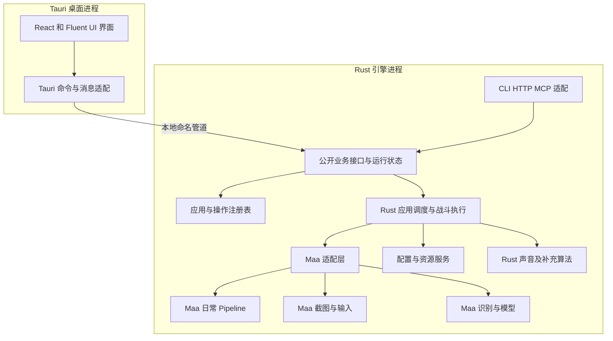

# zzz auto 的 Rust Tauri 和 MaaFramework 迁移计划

将绝区零一条龙迁移为不依赖 Python 的 Windows 应用。桌面界面采用 Tauri，Rust 负责业务、配置和调度，MaaFramework 负责通用截图、输入和识别，适合界面操作的日常流程逐步采用 Maa Pipeline。保留现有模型、画面资料、模板和战斗规则，验证行为后替代现有版本。

Tauri、Rust、MaaFramework 和移除 Python 是确定的技术方向。截至 2026 年 10 月 27 日，M0 已完成，M1 待验证，M2 主流程通过，边界待验收，M3、M4 **开发完成，待验收**，M5 开发进行中，M6 至 M7 待开始。M3 首批日常固定为邮件、咖啡、活跃度奖励、丽都城募和刮刮卡，见[首批日常说明](develop/basic-daily-runs.md)。按用户要求，M4 完成 Rust 条件脚本、Maa 战斗识别与输入、声音闪避、转向、手柄及桌面入口开发，保留全部验收，见[Rust 战斗说明](develop/rust-combat.md)。真实素材采集、游戏串联、暂停与异常收尾等验收继续保留，应用清单的正式可用标记不提前修改。Maa 对现有模型、战斗时序和暂停行为的兼容性继续在对应阶段确认。React、进程划分、目录布局和排期是本计划采用的实施方案，调整时记录原因与影响。

## 1 目标与范围

最终交付满足以下要求：

- 用户无需安装 Python、uv、Node.js 或 Rust，安装后即可使用已迁移功能。
- 桌面端采用 Tauri 2，界面采用 React、TypeScript、Vite 和 Fluent UI React v9。
- 使用 MaaFramework 官方 Rust 绑定接入原生 SDK，不通过 Python 或 Node.js 服务调用框架。
- Rust 引擎可以脱离界面运行，提供 CLI、HTTP 和 MCP 入口。
- 内置应用、自动战斗、设置界面、开发工具和发布工具完成迁移；每项功能都有明确的验收记录。
- 用户的账号实例配置、应用组顺序、运行记录、战斗脚本和路线可以导入新版本。
- 正式发行包、资源构建和正式验证流程移除 Python 依赖。迁移期间旧版本仅作为开发对照。

MaaFramework 本体及 OpenCV、ONNX Runtime 等原生依赖可以继续使用。移除 Python 不要求把底层 C++ 库改写为 Rust。Tauri 使用 WebView 展示 Web 界面，Windows 上使用 WebView2；前端构建工具仅供开发和 CI 使用。[Tauri 概述](https://tauri.app/start/)、[Windows 开发前提](https://tauri.app/start/prerequisites/)

运行基准继续采用项目既有的 1080p 坐标和画面配置。首版面向 Windows x64，不在迁移过程中新增跨平台或分辨率适配任务。

## 2 现有项目与迁移原则

2026 年 10 月 12 日的源码统计为 848 个 Python 文件、约 12.1 万行，包含空行、注释和生成代码；应用目录包含 30 个工厂文件。这些数字用于判断规模，不直接换算成工期。当前组件关系见[一条龙整体架构](../docs/develop/one_dragon/one_dragon_architecture.md)。

| 当前部分 | MaaFramework 方案中的处理方式 |
| --- | --- |
| 通用配置、应用组和运行记录 | Rust 保留数据含义与业务规则 |
| Windows 截图、键鼠和手柄控制 | 优先采用 Maa 控制器，Rust 封装坐标、动作和生命周期 |
| OCR、模板、颜色和特征匹配 | 优先采用 Maa 识别接口，转换资源并对照结果 |
| YOLO 和闪光分类 | 先验证 Maa 神经网络识别，必要时使用 Rust 自定义识别扩展 |
| 日常界面操作 | 适合的流程转为 Maa Pipeline，由 Rust 统一启动和收尾 |
| 战斗调度、声音闪避、视角和路线 | Rust 实现，通用截图及输入通过 Maa 适配层调用 |
| 绝区零应用和 Operation | 维护应用与操作标识，按流程特点选择 Pipeline 或 Rust 实现 |
| Qt 界面、浮窗和开发工具 | 重写为 Tauri 窗口与 Web 组件 |
| Python 插件、反射和动态模块加载 | 改为显式注册及新的插件协议 |
| 源码更新、依赖清单和 PyInstaller 打包 | 改为二进制发布、资源版本管理和原生依赖清单 |
| 战斗脚本合并、翻译编译等 Python 构建工具 | 改为 Rust 工具或前端构建步骤 |

实施遵循以下原则：

1. 每个阶段交付可独立运行的 Rust 功能，不将 Python 封装成 Tauri 的执行依赖。
2. 先验证 Maa 的 Windows 控制、模型、异步队列与停止行为，再展开大量业务迁移。
3. 共用一份引擎实现；GUI、CLI、HTTP 和 MCP 只提供不同调用入口。
4. 用户配置与战斗脚本继续采用 YAML；Maa 原生 Pipeline 采用框架的 JSON 协议。不同用途分别维护，同一份具体数据只有一个来源。
5. 用旧实现的结果验证新实现，同时人工检查关键分支，避免复制旧代码中的错误。
6. 涉及游戏流程的实现，继续按项目开发流程先阅读玩法、画面、screen_info 和相关代码；发现知识缺失时先补档。

Maa 的适配问题按组件处理，Rust 补充实现必须说明缺失能力或不兼容行为。若截图、输入或 OCR 等核心能力无法通过 M1，先修正集成方案，不带着未经验证的前提批量迁移，也不自动恢复为重写全部基础组件。

## 3 技术选型

| 能力 | 采用的方案 | 选择原因与实施要求 |
| --- | --- | --- |
| 桌面壳 | Tauri 2 | 提供窗口、托盘、系统集成和发布能力 |
| Web 界面 | React、TypeScript、Vite | 适合设置表单、运行列表和开发工具；发布为静态资源 |
| 界面组件 | [Fluent UI React v9](https://github.com/microsoft/fluentui) | 延续 Fluent Design；复杂图像编辑组件单独实现 |
| Rust 工具链 | Windows MSVC 目标、Cargo workspace | 与 Windows 原生库构建和分发配合，锁定工具链和依赖版本 |
| 自动化基础 | [MaaFramework](https://github.com/MaaXYZ/MaaFramework) 与[官方 Rust 绑定](https://github.com/MaaXYZ/maa-framework-rs) | Controller、Resource、Tasker 和自定义扩展封装在一个适配模块中 |
| 截图与基础输入 | Maa Win32、Gamepad 控制器 | 验证现有前后台、按住释放和摇杆行为，不默认兼容游戏 |
| 通用识别与模型 | Maa 识别接口和神经网络识别 | 先复用现有模型及资源，验证颜色、预处理、字典和后处理 |
| 日常流程 | Maa Pipeline | 实现界面识别、点击、等待和错误分支；Rust 负责应用级调度 |
| 战斗与复杂游戏流程 | Rust 业务引擎和 Maa 自定义扩展 | 保留状态时间窗、优先级、动作抢占、转向和路径判断 |
| Windows 补充能力 | [windows-rs](https://github.com/microsoft/windows-rs) | 负责进程、权限、控制权和 Maa 未覆盖的操作 |
| 额外图像与模型算法 | Rust 自定义识别，必要时使用 ort 或 opencv | 仅为 Maa 未满足的行为引入，单独验证原生依赖和推理调度 |
| 音频采集 | [wasapi-rs](https://github.com/HEnquist/wasapi-rs) | 支持 Windows 输出音频回录，信号处理由 Rust 实现 |
| 配置与协议 | Serde、YAML 解析库、JSON | Rust 校验配置与协议；YAML 库在原型阶段按兼容语料和维护情况确定 |
| 并发与网络 | Tokio、专用工作线程 | 网络异步执行；推理、截图、音频和动作执行使用明确的线程与队列 |
| HTTP 与 MCP | Axum、官方 [rmcp](https://github.com/modelcontextprotocol/rust-sdk) | 复用公开业务接口，保持现有 Streamable HTTP 接入方式 |
| 发布与更新 | NSIS 安装包、Tauri updater、资源下载服务 | 程序与资源分别管理版本，发布前校验依赖完整性 |

前端状态分为服务端运行快照和本地编辑状态。运行结果、账号实例、配置版本和应用组由 Rust 引擎维护；前端只保存尚未提交的编辑内容、导航和展示状态。

Maa Rust 绑定与原生 SDK 锁定为经过验证的兼容组合，API 使用以该版本为准。SDK 采用受控的 DLL 加载与发布目录，不因为系统 PATH 上存在其他版本就自动使用。社区项目 [MXU](https://github.com/MistEO/MXU)可作为 Tauri 接入和配置展示的参考，项目界面与业务仍按本 roadmap 实现。

不承诺整体性能提升倍数或安装包大小。推理和许多图像运算在现有版本中已经由原生库执行，迁移收益需要通过同机对照测量。

## 4 目标架构

### 4.1 进程与模块

采用 Tauri 桌面进程和独立 Rust 引擎进程。桌面进程负责 WebView、系统界面和引擎管理；引擎持有游戏上下文与 Maa 实例，完成全部自动化。Maa 原生库在引擎内加载，异常可以与界面隔离，引擎也可以作为无界面服务单独运行。

独立引擎作为 Tauri 的随附可执行程序发布，不安装常驻系统服务。Tauri 支持打包此类外部可执行程序；命名管道协议、权限提升和引擎生命周期由本项目实现。[外部程序打包](https://tauri.app/develop/sidecar/)

引擎默认使用普通权限。游戏以管理员权限运行、导致输入权限不匹配时，由桌面端明确提示并按需提升引擎权限。权限提升前后的通信、停止和退出必须在原型阶段验证，避免默认提升整个 WebView 进程。

### 4.2 游戏控制权与生命周期

一个引擎统一管理当前账号实例和运行任务。GUI、CLI、HTTP、MCP 发起的任务进入同一个运行槽，即只能容纳一个自动化任务的调度位置；例如自动战斗运行期间，日常任务不能另行开始。Maa Tasker 执行日常流程和 Rust 执行战斗也遵守这个约束。

Windows 侧增加按交互会话和游戏进程确定的控制权互斥。第二个引擎发现相同游戏已被控制时拒绝取得控制权，并返回可解释的错误。旧 Python 版本无法自动遵守新互斥协议，迁移期间的实机对照必须分开运行。现有进程边界见[后端架构](../docs/develop/zzz/backend/architecture.md)。

Maa 控制器由适配层唯一持有，Rust 动作与 Pipeline 不能分别创建不受协调的输入入口。切换执行方式时先取消旧任务、等待控制器操作结束并释放输入，再交给新任务。Tasker 的异步停止响应不能被当作动作队列已经清空。

桌面托管模式下，主窗口关闭默认隐藏到托盘；选择退出时先停止任务、释放输入，再结束引擎。桌面异常退出或管道失联时，引擎停止自动化并退出。独立服务模式由 CLI 管理生命周期，不依赖桌面存活。

正常停止、暂停、异常返回和退出均清理已按下的键与手柄状态。原生进程崩溃时不能依靠 Rust 析构保证清理，需验证桌面监督端的独立输入恢复路径及其权限；恢复失败时显示停止使用和恢复输入的方法，禁止自动恢复之前的动作。

### 4.3 前后端通信

进程间通信采用 Windows 本地命名管道，使用有长度边界的 JSON 消息。引擎限制消息大小、连接来源和请求权限，校验当前用户、会话及配对信息。该协议独立于 Tauri，也不对外开放任意命令执行或任意文件访问。

| 消息 | 内容与约定 |
| --- | --- |
| 请求 | 协议版本、请求 ID、命令、账号实例、参数；重复请求需要明确的去重规则 |
| 响应 | 请求 ID、结果或结构化错误；启动任务返回运行 ID，不等待任务执行完毕 |
| 运行事件 | 运行 ID、事件序号、状态、节点、结果；终态由引擎保存，可重新查询 |
| 配置提交 | 实例 ID、应用组 ID、配置修订号、修改字段；冲突返回最新版本 |
| 状态快照 | 当前实例、任务和最近结果；连接恢复先获取快照再继续订阅 |

Rust 协议结构作为类型源，通过构建工具生成 TypeScript 类型。错误包含机器可识别的代码、用户可读的中文说明和可选详情；密码等敏感值不进入事件、日志或普通状态快照。

Web 界面通过 Tauri 命令调用桌面 Rust 适配器；日志和进度使用有序 Channel，少量界面通知使用事件。官方文档说明，普通事件不适合低延迟或大吞吐传输，Channel 更适合有序流式数据。[前端调用 Rust](https://tauri.app/develop/calling-rust/)、[Rust 推送前端](https://tauri.app/develop/calling-frontend/)

截图、OCR、闪光检测和音频判断的循环全部留在引擎内部。前端按需接收压缩预览与识别结果，不逐帧接收原始图像或参与动作定时。展示队列有容量限制，日志可以合并或丢弃旧项并显示数量；任务终态和配置提交结果通过可查询状态保证可恢复。

主窗口、预览窗口和浮窗分别配置 Tauri 权限。自定义命令也要显式限制可调用窗口，不能只配置插件权限后假定业务命令已受限制。远程公告和帮助内容不取得游戏控制权限。[Tauri Capabilities](https://tauri.app/security/capabilities/)

### 4.4 建议代码布局

`zzz-auto/docs/ROADMAP.md` 是迁移计划的唯一来源。工程目录按下表创建；参考项目的 `src/`、`assets/` 和 `config/` 继续作为迁移输入，不移动或共同写入。

| 目录 | 职责 |
| --- | --- |
| `zzz-auto/Cargo.toml` | 新版本的 Rust workspace 与共享依赖 |
| `zzz-auto/crates/od-core/` | 配置、应用调度、条件操作、事件及运行结果 |
| `zzz-auto/crates/od-protocol/` | 本地通信、请求与响应结构、版本协商 |
| `zzz-auto/crates/maa-adapter/` | Maa 绑定、实例生命周期、Controller、Recognition 和 Tasker 适配 |
| `zzz-auto/crates/od-platform/` | 音频、权限、进程、控制权和必要的 Windows 补充操作 |
| `zzz-auto/crates/zzz-engine/` | 绝区零上下文、战斗、路线、应用及 CLI、HTTP、MCP 入口 |
| `zzz-auto/crates/od-tools/` | YAML 资源转换、战斗脚本合并、翻译转换、类型生成和发布清单 |
| `zzz-auto/apps/desktop/src/` | React 页面、组件、编辑器和状态展示 |
| `zzz-auto/apps/desktop/src-tauri/` | Tauri 入口、引擎通信、系统集成和发布配置 |
| `zzz-auto/resources/pipeline/` | 原生 Maa 日常流程定义，采用 JSON 协议 |
| `zzz-auto/resources/generated/` | 构建生成的 Maa 资源包，不手工修改 |
| `zzz-auto/sdk/` | 本地固定版本的 Maa SDK 缓存，不作为源码提交 |

通用核心不依赖 Tauri、React 或 Maa 的具体句柄。业务层通过适配层使用控制和识别，避免 Maa 类型散落在各应用中。补充识别算法先放在业务或适配模块中，确有复用需要时再拆独立 crate。复杂业务保留 Rust 实现，不为迁移而将全部逻辑改造成 Pipeline。

## 5 模块迁移要求

### 5.1 流程引擎与运行结果

应用和复杂 Rust 操作使用显式注册，取代 Python 反射与动态导入。菜单识别、点击和画面等待优先交给 Maa Pipeline，Rust 不再重写同用途的通用流水线；需要计算或业务判断的操作保留 Rust 实现。对外运行含义需要对齐[Operation 模块](../docs/develop/one_dragon/modules/operation.md)。

Rust 操作验收覆盖四种轮次结果、精确状态边与兜底边、子操作、超时和失败收尾。Pipeline 应用不逐节点机械复制装饰器，而是验证完整路径、错误分支及应用级结果。等待不能误消耗项目约定的重试次数，暂停不能让恢复后的任务立即超时。

区分操作结果和应用运行结束原因，保留正常完成、失败、主动停止和未启动的区别。停止请求的响应表示已经收到请求，不表示任务已经退出。内部增加停止中的状态，旧 HTTP 或 MCP 接口通过兼容适配保持既有返回含义。

Maa 的 `post_stop` 是异步停止请求，不能当作暂停接口。M1 验证 Pipeline 的安全暂停方式，M2 落实：停止投递新动作，取消并等待在途动作，释放输入并保存业务状态；继续时重新识别画面，从可恢复步骤开始。不可重复的领取或提交步骤必须先检查是否已经生效。框架阻塞或回调不可取消时单独记录，不用重新启动整个任务来假装实现原位继续。[Maa Tasker 接口](https://docs.rs/maa-framework/latest/maa_framework/tasker/struct.Tasker.html)

使用单调时钟计算动作间隔与运行超时，使用日历时间处理每日重置和运行记录。录像回放、模拟时钟和随机数种子可由独立测试程序注入，便于复现时序问题。

### 5.2 Windows 输入与截图

优先使用 Maa Win32 控制器截图与输入，分别验证前台和后台组合。M1 先选择与当前行为接近的截图方式，再比较框架提供的其他方式；截图方式的选择不能改变关键区域或游戏窗口行为。[Maa 控制方式](https://github.com/MaaXYZ/MaaFramework/blob/main/docs/zh_cn/2.4-控制方式说明.md)

适配层统一声明尺寸、颜色顺序、行跨度和截图时间，显式保持 1080p 基准并验证 RGB 与 BGR 转换。旧区域的 `[x1, y1, x2, y2]` 转为 Maa ROI 的 `[x, y, w, h]`，点击结果通过同一坐标转换返回控制器。截图失败、窗口失效、后台模式和权限不匹配应形成可诊断结果。[Maa ROI 定义](https://github.com/MaaXYZ/MaaFramework/blob/main/docs/zh_cn/3.1-任务流水线协议.md#directhit)

输入适配层维护当前持有的键与手柄状态，区分动作已经投递和已经执行；停止与切换后禁止旧任务的排队动作继续生效。全局启停快捷键进入同一个引擎控制接口，避免由前端 JavaScript 定时器执行战斗动作。控制器、Tasker 和回调句柄的销毁顺序由适配层统一管理。

手柄优先采用 Maa Gamepad 控制器，分别验证 Xbox 与 DS4 的按键、方向、摇杆、按住时长和释放。Maa 仍依赖 ViGEmBus，换框架不能移除驱动依赖。转向还需验证键鼠与手柄的位移定义及现有灵敏度参数；Maa 相对鼠标位移的启用条件不能被当成现有转向接口的等价行为。[Maa 控制方式](https://github.com/MaaXYZ/MaaFramework/blob/main/docs/zh_cn/2.4-控制方式说明.md)、[项目转向说明](../docs/develop/zzz/turn_sensitivity.md)

### 5.3 识别与推理

OCR、模板、颜色和特征匹配优先使用 Maa 识别。适配层可以单独执行识别，不必为每次调用启动完整 Pipeline。使用相同输入、资源和执行设备对照文字、位置、置信度及后续业务判断，不能用换了 OCR 模型的结果直接证明兼容。

现有 YOLO 与闪光 ONNX 模型先验证 Maa 的 `NeuralNetworkDetect` 与 `NeuralNetworkClassify`。若预处理、后处理或输出结构无法对齐，用 Rust 自定义识别扩展补充；只有确有需要才额外引入 ort 或 opencv，避免默认维护两套完整识别引擎。[Maa 识别协议](https://github.com/MaaXYZ/MaaFramework/blob/main/docs/zh_cn/3.1-任务流水线协议.md)

保持项目当前对 DirectML 多会话的保守限制。Maa 内部会话不能直接由 Python GPU 执行器管理，需要在 Rust 适配层限制 GPU 使用时段；异步操作真正完成后才能交给另一条推理路径。M1 先用 CPU 验证结果，再验证 Maa DirectML，禁止默认同时运行 Maa GPU 与额外 Rust GPU 推理。自定义回调中的推理也要避免等待同一个已经被占用的工作队列。现有约束见 [`gpu_executor.py`](../src/one_dragon/utils/gpu_executor.py)。

Maa GPU 会话的具体设置以选定 SDK 实现为准；额外 ORT 会话遵守其执行提供程序限制，不能因使用 Rust 就假定并发安全。[ONNX Runtime DirectML 配置](https://onnxruntime.ai/docs/execution-providers/DirectML-ExecutionProvider.html)

Maa 覆盖的步骤由框架执行，项目的图像处理流水线及组合算法按[CV 流水线架构](../docs/develop/one_dragon/modules/cv_pipeline_architecture.md)逐项核对。保留未被覆盖的处理步骤和编辑能力，不将 Maa Pipeline 调试工具误认为既有 CV 编辑器的完整替代。

### 5.4 自动战斗与声音闪避

战斗调度采用 Rust，保留现有 YAML 脚本的状态名、时间窗、模板引用、优先级和动作参数，不把高频战斗规则整体改写为 Maa 日常 Pipeline。解析器、状态记录、场景选择、抢占、按住与释放对照[条件操作模块](../docs/develop/one_dragon/modules/conditional_operation.md)。脚本语法错误需要定位到文件和字段，不能静默执行部分脚本。

角色、目标、按钮与闪光识别优先通过 Maa 适配层提供结果；不兼容的识别由 Rust 补充。识别节流、兜底、状态时间戳和决策仍由战斗层维护，详见[自动战斗说明](../docs/develop/zzz/auto_battle.md)。原型实测调用排队、旧截图和任务取消对动作时序的影响。

声音闪避仍由 Rust 重写输出音频回录、单声道转换、采样率转换、滤波、标准化、FFT 相关性计算与去重。算法对照见 [`auto_battle_dodge_context.py`](../src/zzz_od/auto_battle/auto_battle_dodge_context.py)。不能只换一个近似滤波器并直接沿用旧阈值；接近触发阈值的样本必须单独验证。声音线程与 Maa 识别只向统一状态服务提交结果，不直接竞争输入控制权。

### 5.5 配置与用户数据

建立唯一的数据目录服务，统一定位配置、模板、模型、路线、日志和运行记录。便携版继续使用程序工作目录；安装版使用可写的用户数据目录，导入时显式选择旧目录，不能依赖进程当前目录。

配置仍以 YAML 为主。Rust 引擎负责字段校验、默认值、账号实例与应用组隔离，前端提交具体字段修改。普通设置由结构化字段定义生成表单，复杂战斗和路线编辑器单独实现。

用户 YAML、旧 screen_info 和模板描述不直接当作 Maa 资源包加载。`od-tools` 转换坐标、资源名称、路径和识别参数，输出框架需要的目录与 JSON；模型和字典按选定 SDK 的要求校验。源文件保持一处维护，生成资源禁止手工修补。Maa 原生日常流程在 `resources/pipeline/` 编写，不为同一新流程再创建另一份自有通用流水线。

数据迁移先只读检查，再生成转换预览、备份和新目录。保存使用临时文件与完整替换，迁移步骤可以重复执行。已知字段的含义及未知字段的保留策略都要明确；无法转换的内容逐项报告。

在停止状态切换账号实例，重新创建或清理实例级缓存，不允许旧任务继续持有新实例配置。配置修订号用于检测并发编辑。旧版本和新版本使用各自的数据副本，禁止共同写入同一份配置。

### 5.6 应用与界面

应用 ID、配置入口、应用组顺序和运行记录优先保持稳定，按[应用插件系统](../docs/develop/one_dragon/modules/application_plugin_system.md)建立迁移清单。以下分组覆盖当前 30 个应用工厂；登记清单应记录每个应用的设置、公共操作、资源、采用 Pipeline 或 Rust 的原因，以及测试前提。

| 顺序 | 应用与能力 |
| --- | --- |
| 基础日常 | 咖啡店、邮件、活跃度奖励、丽都城募、刮刮卡 |
| 外部服务与附属功能 | 每日签到、兑换码、通知、丽都周纪 (领奖励)、卦象集录、吼吼饼铺、情报板 |
| 配置检查 | 预备编队角色识别、鼠标灵敏度检测 |
| 战斗与资源 | 闪避助手、自动战斗、体力刷本、恶名狩猎、式舆防卫战、真·拿命验收、驱动盘拆解 |
| 探索与经营 | 枯萎之都、迷失之地、锄大地、委托助手、录像店营业、随便观 |
| 编排与工具 | 一条龙、闪避截图、指令调试 |

中文展示名称以注册信息为准，清单中同时记录源码目录和应用 ID，避免只按名称识别功能。复杂应用的迁移顺序允许按实际公共依赖调整。

Tauri 界面分批实现：

1. 首页、环境状态、账号实例、模型管理和运行日志。
2. 一条龙列表、应用设置、启动、暂停、继续、停止和结束后动作。
3. 战斗脚本、队伍、路线与经营设置，以及资源下载和通知。
4. 截图与区域标注、模板工具、图像处理流水线、操作调试、路线记录和战斗浮窗。

延续 Fluent Design，但不要求像素级复制 Qt。基础表单复用 Fluent UI，图像标注使用 Canvas 或 SVG；长日志使用有容量限制的缓存和列表虚拟化。中文输入法、键盘导航、明暗主题、系统缩放和多窗口行为列入界面验收。[Fluent UI](https://github.com/microsoft/fluentui)

### 5.7 插件与服务接口

内置应用在 Rust 注册表中显式登记。旧 Python 插件和 Qt 设置扩展需要移植，不承诺原样兼容；旧插件扫描结果用于生成待迁移清单，不能在运行时通过嵌入 Python 继续执行。

新扩展优先复用 Maa 资源包、Rust 自定义识别与动作；需要独立进程时使用官方 Rust AgentClient 和 AgentServer，避免再实现一套同用途的插件通信。Maa 扩展与本项目的应用注册、设置和运行记录由适配层关联，不能因为能执行自定义动作就视为旧插件已经兼容。[Maa Rust 扩展接口](https://docs.rs/maa-framework/latest/maa_framework/index.html)

插件不能另行取得输入控制权，不能与主任务并发操作游戏；停止、超时、Agent 断线和崩溃均由引擎收尾。普通插件设置使用字段描述生成表单，复杂界面由随应用发布的前端组件提供。Agent 使用本地连接，启动、协议版本和插件清单由宿主管理，避免绕开统一控制器。

首个公开试用版可以先提供内置应用，但必须明确第三方插件尚未迁移。正式替代版应提供新插件 SDK、示例和迁移说明，并登记已知旧插件的处理结果。WASM 插件不作为本轮迁移完成的前提。

HTTP 与 MCP 调用同一份 Rust 业务接口和运行槽，不直接把任意 Maa 句柄或 Pipeline 名称暴露为可执行权限。保留现有公开路径、参数和结果含义；Python 模块路径形式的 Operation ID 通过明确映射到 Rust 操作或 Maa 任务。变化较大的接口提供版本区分。能力边界继续参照[后端服务层](../docs/develop/zzz/backend/README.md)和[设计原则](../docs/develop/zzz/backend/design-principles.md)。

通知与遥测同时登记迁移项，保留既有用户设置与数据范围。网络请求失败不能阻止主流程启动、停止或退出；日志和上报中排除账号密码及用户截图。

## 6 实施阶段

各阶段以验收条件推进。2026 年 10 月 12 日开始 M0 清单和 M1 原型；2026 年 10 月 15 日按用户决定信任参考项目的固定模型，接受现有清单和可复现基线，关闭 M0。随后按用户决定保留 M1 待验证项并开始 M2。当前 M3、M4 开发完成、待验收，M5 开发进行中，M6 至 M7 待开始；用户分别要求完成 M3 与 M4 开发，保留全部验收项，实现与既有实机证据分别见[首批日常说明](develop/basic-daily-runs.md)和[首轮验收记录](migration/acceptance.md)。先接入 Maa 控制和识别，再完成一个日常 Pipeline，最后展开复杂业务；不先重写整套基础引擎。前端在 M1 建立骨架，之后按稳定协议实现，但界面演示不能代替引擎验收。以下进展段落保留各次验收当时的状态，当前状态以本段及阶段表为准。

2026 年 10 月 13 日用户实机反馈：窗口连接、当前方式截图、无输入健康检查正常结束及停止后再次运行、游戏重启后的手动重连、托盘退出、双实例互斥均正常。M1 的基础连接和无输入生命周期已有局部实测证据；前后台真实输入、权限提升、异常恢复、模型及 CPU / DirectML 对照和延迟仍待完成，M0 / M1 不整体标记通过。

下一步已推进到 0.1.2 的 M1 输入诊断：桌面和 CLI 共用前台 / 后台键盘与 Xbox / DS4 数字按键探针，提供启动延时、取消、输入释放与计时结果，并在独立测试仓覆盖真实 Maa 队列的顺序及失败清理。游戏响应、真实残留动作、鼠标、摇杆与权限场景仍需实机验证，证据见[验收记录](migration/acceptance.md)。

0.1.2 输入实测反馈为 Xbox 正常、前台 / 后台键盘 W 未响应；测试位于可自由移动的大世界，游戏由启动器启动，尚未确认进程权限。0.1.3 增加按键名称下拉、权限与前台检查及 Maa 键盘兼容方式，继续收集键盘实机证据，M1 不整体标记通过。

0.1.3 后续反馈为前台键盘输入正常，两种后台键盘消息方式均未生效；进一步测试确认前台键盘持有期间停止、停止后无残留动作，以及游戏处于后台时的 Xbox 数字按键均正常。迁移采用前台键盘、后台 Xbox 数字按键路径，窗口消息键盘保留为当前环境不兼容的诊断方式。计时与通过范围见[验收记录](migration/acceptance.md)，鼠标、摇杆 / 扳机、DS4、带输入 Pipeline 与异常恢复等 M1 条件仍待完成。

0.1.4 用户反馈鼠标按键及 Xbox / DS4 摇杆与扳机测试正常，登记当前场景基础响应通过，具体条件与证据见[验收记录](migration/acceptance.md)。下一步推进真实模型的 CPU / DirectML 对照；输入的具体前后台组合、中途停止、异常恢复与性能基线继续验收，M0 / M1 保持进行中。

2026 年 10 月 14 日已固定四个默认模型并完成 9 个固定图案例的 Maa CPU / DirectML 对照，各案预热 5 次、正式采样 30 次，设备输出在登记容差内一致。已确认闪光的 softmax / 缩放及 YOLO 补边等差异，旧版完整输出、正例和同机性能基线仍待补齐，不能据此批量迁移业务。实现入口见[模型对照说明](develop/recognition-validation.md)，结果见[验收记录](migration/acceptance.md)。

本轮进一步实现闪光分类适配：生成固定 logits 模型，复用 SDK OpenCV 进行旧版的等比缩放与右下补边，再由 Maa 完成一次 softmax。已知概率及阈值两侧通过真实 SDK 验证，固定战斗图的 CPU / DirectML 输出一致。另复现 Maa JSON 六位小数造成的阈值舍入；距阈值不超过 0.000001 时拒绝给出普通判定。真实红光 / 黄光、旧输出、原始浮点边界及 YOLO 差异继续待验收，下一步补这些证据和必要的原生补充接口，M0 / M1 保持进行中；详见[闪光适配方案](develop/recognition-validation.md#闪光分类适配方案)与[验收记录](migration/acceptance.md)。

已新增 `LegacyFlashRaw`，复用固定 SDK 的 ONNX Runtime 直接读取 float32 概率，按参考 NumPy 2 规则比较阈值，补上 JSON 舍入无法判定的边界。阈值前后相邻值及相等边界在 CPU / DirectML 原始推理回归中通过，6 案原生 / logits / 原始输出设备对照通过；没有增加或替换原生 DLL。debug 张量转换及 CPU 单线程路径的耗时仍需 release 和旧版基线评估，不能作为性能通过。下一步继续补真实正例 / 旧输出及 YOLO 适配，原始推理停止 / 取消和其他 M1 条件仍待验收；见[原始浮点输出方案](develop/recognition-validation.md#原始浮点输出方案)。

已新增 `LegacyYoloDetect`，复用 SDK 原始张量补上旧版的缩放补边、类别过滤、严格阈值、按类别 NMS、越界框与迷失之地头像遮罩。确认空洞模型实际输入为 736×416，迷失之地为 736×736；6 案原生 / 适配 / 过滤对照的 CPU / DirectML 正式采样通过，新增 11 项 YOLO 回归通过。没有修改模型或新增 DLL；同分重叠 NMS 返回排序歧义错误。真实正例、同机旧输出、release 性能、原始推理停止 / 取消及 OCR 差异仍待验收，下一步继续补齐这些 M1 条件；详见 [YOLO 适配方案](develop/recognition-validation.md#yolo-适配方案)和 [验收记录](migration/acceptance.md#2026-年-10-月-14-日-yolo-原始张量与旧后处理)。M0 / M1 保持进行中。

原始闪光和 YOLO 现已接入独立取消对象、在途 ORT 停止请求、阶段检查与结果丢弃；CLI 支持 Ctrl+C 和定时取消。新增 7 项回归、完整 70 项 Rust 回归通过，三个真实模型的 CPU / DirectML 在途取消后均能复用缓存会话。CPU 可退出在途推理，DirectML 在本机样本中完成已提交计算后返回，接口始终等待收尾。此项只验收离线原始推理，完整游戏停止、长期稳定性和性能仍待补齐；下一步继续真实正例 / 旧输出、release 性能和 OCR 差异，M0 / M1 保持进行中。具体约定见[原始推理的取消](develop/recognition-validation.md#原始推理的取消)，证据见[验收记录](migration/acceptance.md#2026-年-10-月-14-日原始推理取消与会话复用)。

2026 年 10 月 15 日已核对测试仓现有截图，复用六个文件补 12 个识别案例：8 个 OCR、迷失之地事件标记正 / 负例、空洞跨画面负例与一个无闪光案例。CPU / DirectML 共 720 个正式样本稳定，12 组设备输出一致，各设备 11 / 12 项符合人工预期；空洞模型在城市导航画面误检为安全区，保留未通过并等待旧版对照及调用画面约束判断。OCR 素材与迷失之地正例已有，接下来优先补旧版输出导出与新旧自动比较；另需空洞电视格子地图正例、明确红光 / 黄光帧及边界样本。M0 / M1 保持进行中，具体证据见[存档截图验收记录](migration/acceptance.md#2026-年-10-月-15-日复用存档截图扩充识别案例)。

随后已补入 24 个红光 / 黄光 PNG，去除重复计数后为 23 个独立帧；新增 `flash-sequence-cases.json`，按全帧、原模型与 0.9 阈值完成 CPU / DirectML 的 1380 个正式样本。23 组设备输出一致，各设备 19 / 23 个符合人工标注，4 个颜色识别差异继续保留，等待旧版实际输出判定原因。红光 A 的出现前文件与出现 1 完全相同，不作为无闪光负例。红黄光素材已具备，下一步集中补旧版输出与新旧比较；真实阈值附近、出现前帧和空洞地图正例仍待补，M0 / M1 保持进行中；详见[红黄光真实帧记录](migration/acceptance.md#2026-年-10-月-15-日红黄光真实帧对照)。

同日已完成这 23 帧的旧版实际输出采集和 Rust 自动比较。隔离的 Python 3.11.9 环境调用固定参考仓原分类器，旧版与新版各完成 CPU / DirectML 的 1380 个正式样本，46 项同设备新旧比较全部通过；全部概率的最大差值为 CPU 约 1.19×10⁻⁷、DirectML 为 0。四个人工标注差异在旧版中同样存在，保留未通过，不作为迁移回归或人工预期通过。比较命令无需 Python 或 SDK，新程序正式验证链继续不依赖 Python。下一步补 OCR / YOLO 旧输出、release 性能与真实边界语料；M0 / M1 保持进行中，详见[旧版闪光输出记录](migration/acceptance.md#2026-年-10-月-15-日旧版闪光实际输出与自动比较)。

随后扩展 OCR / YOLO 旧版采样与自动比较，复用 15 个案例，旧版和新版 release 各采集 CPU / DirectML 的 900 个正式样本。YOLO 两设备各 7 / 7 项输出一致，空洞模型在城市导航的误检确认旧版也存在；OCR 各 5 / 8 项一致，标题及同 ROI 负例有 3px 框宽差异，旧版检测不到的「400」在新版正确识别，保留比较失败。OCR 负例同时比较过滤前结果，避免两边未命中掩盖差异。release CPU YOLO 的延迟偏高，单线程与旧版默认线程池及计时范围差异需继续评估；性能不标为通过。下一步优先对齐测量范围与 CPU 线程策略，明确 OCR 差异及业务影响，并补真实边界 / 出现前 / 空洞地图正例。M0 / M1 保持进行中，详见[OCR / YOLO 验收记录](migration/acceptance.md#2026-年-10-月-15-日-ocr-yolo-旧版输出与-release-采样)。

同日已完成原始 YOLO 的统一边界计时与 CPU 线程实验。保持模型与参数不变，对照 1 / ORT 默认 / 2 / 4 / 8 线程；默认和 8 线程的 7 案全部达标，改用与旧版一致的 ORT 默认策略，保持顺序执行、关闭自旋与 DirectML 原设置。新旧各 420 个正式样本确认 7 / 7 项输出一致，release CPU P95 为旧版的约 69%～92%，均不超过 110%；23 帧闪光的 CPU / DirectML 新旧输出仍为 46 / 46 一致。本结论仅覆盖离线完整 BGR 帧到标准识别结果，游戏截图、动作、停止及长期性能仍待验收。下一步优先处理 OCR 差异与业务调用要求，再补真实边界 / 出现前 / 空洞地图正例及完整游戏链路。M0 / M1 保持进行中；详见[CPU 线程验收记录](migration/acceptance.md#2026-年-10-月-15-日原始-yolo-cpu-线程与统一计时)。

随后新增 `OcrText` 业务文字适配，复用固定 Maa OCR，提供精确 / 包含 / Unicode LCS 匹配、单行仅识别、旧检测路径的置信度下限及全图点击坐标，保留过滤前结果与原始详情。10 案 release CPU / DirectML 各 300 个正式样本稳定，人工期望全部通过，过滤后与过滤前各 10 组设备输出在原容差内一致。核对旧调用后，标题框差异在固定帧上没有改变 LCS 命中，两个候选中心均在旧配置区域内；这不代替实机点击验收。「400」由新版检测路径取得定位框，旧版检测无框的具体算法差异仍待定位；旧活跃度应用实际使用模板判断是否已满，不将该诊断文字直接改为业务条件。原 3 处 OCR 算法差异继续保留失败，单行旧输出、原始分数边界、复杂文字顺序和完整游戏链路继续待补；M0 / M1 保持进行中。接口见[OCR 业务调用适配](develop/recognition-validation.md#ocr-业务调用适配)，证据见[本轮验收](migration/acceptance.md#2026-年-10-月-15-日-ocr-业务文字适配)。

| 阶段 | 前置 | 主要交付物 | 进入下一阶段的条件 |
| --- | --- | --- | --- |
| M0 清单与基线（已完成） | 无 | 应用、界面、插件、资源及接口清单；Maa 替换与 Rust 保留范围；现有截图、音频模板及配置基线 | 30 个工厂完成登记；每个应用确定执行方式；参考提交、模型哈希和现有基线可复现；按用户决定接受参考模型，不以追加边界素材作为关闭前置 |
| M1 Maa 集成原型（待验证） | M0 | 固定 SDK 与 Rust 绑定；截图、键鼠、手柄、OCR 和代表模型；Tauri 预览；引擎通信 | CPU 和 Maa DirectML 验证通过；前后台、权限、排队延迟、停止和退出实测；明确暂停及模型补充方案 |
| M2 首个 Pipeline 与适配层（主流程通过，边界待验收） | M1；保留 M1 待验证项 | 邮件大世界 / 菜单起点主流程及部分暂停、重复运行、停止、失败 / 超时、引擎与桌面异常退出恢复、暂停后托盘正常退出边界通过，详见[实机验证](develop/mail-pipeline.md#验证与后续)；资源转换、运行结果、取消、安全暂停及 Maa 回调转事件已实现 | 持有输入时及领取后暂停恢复、防重复领取（当前无可领取邮件）、其他失败 / 超时分支、图像 / 坐标一致性、持有输入时停止残留与异常恢复等边界继续验收 |
| M3 应用运行与桌面基础（开发完成，待验收） | M2；按用户决定推进并保留 M1 与 M2 边界验收项 | 账号、配置导入与恢复、应用组及独立运行、每日记录、桌面表单与日志、下载代理、资源版本发现 / 下载 / 安装 / 切换；首批日常为邮件、咖啡、活跃度奖励、丽都城募、刮刮卡 | 导入旧配置后实机运行首批应用；五项串联、实例隔离、配置冲突和统一控制权验收；缺失真实画面及异常边界继续待办 |
| M4 Rust 战斗与 Maa 控制（开发完成，待验收） | M1、M3；按用户决定推进，保留前置验收 | Rust 条件操作与战斗脚本；Maa 识别和动作适配；声音闪避、转向、手柄；战斗界面与旧脚本导入，见[Rust 战斗说明](develop/rust-combat.md) | 状态及动作回放正确；输入延迟、抢占与释放满足目标；GPU 无跨路径重叠；长时间运行稳定 |
| M5 剩余游戏应用（开发进行中，验收保留） | M3、M4 | 其余日常 Pipeline，以及探索、路径和经营等 Rust 流程；账号与应用组编排 | 全部剩余工厂有验收记录；Rust 与 Pipeline 可安全交接；关键分支和画面推进测试完整 |
| M6 工具与外部能力 | M3 至 M5 的稳定接口 | 图像、路线和战斗调试工具；Maa 调试接入；CLI、HTTP、MCP、Rust Agent 插件 | 资源可编辑并被引擎读取；公开接口兼容；插件超时、断线和停止不绕过控制权 |
| M7 发布与替代 | M0 至 M6 完成 | Maa SDK 及依赖打包；安装、更新、导入和恢复；无 Python 构建与验证链；迁移说明 | 干净 Windows 环境通过验收；SDK 与资源版本兼容；失败可恢复；满足全部完成条件 |

### 6.1 每阶段的验证方式

M4 开发于 2026 年 10 月 20 日完成，按本轮用户范围保留验收。纯 Rust 调度与音频回归、真实 Maa SDK 的隔离控制器联调、桌面界面回归及资源安装检查用于验证实现，不计作游戏验收：

- [x] YAML 条件、时间窗、模板与合并键、场景优先级、打断、状态互斥及动作执行；加载全部随附合并 / 未合并脚本与闪避脚本。
- [x] 60 名角色及 527 个模板转换；按钮、队伍、角色状态、目标、连携、快速支援及闪光适配；CPU / DirectML 复用串行推理入口。
- [x] WASAPI 回录、单声道 / 采样率转换、四阶高通、双向滤波、标准化、FFT 相关及去重；键鼠、Xbox / DS4、转向与统一输入收尾。
- [x] 战斗设置与账号保存、旧配置转换、脚本不可变快照导入、同 ID 暂停继续、过期画面丢弃、历史与 v8 输入恢复登记；桌面和 CLI 接入、schema 4 资源打包 / 安装校验。
- [ ] 对照旧版完成实际状态 / 动作回放、声音阈值边界、键鼠 / 手柄与转向标定、输入延迟与抢占释放指标、GPU 跨路径及长时间稳定性验收；应用正式可用标记继续保持关闭。

M0 已完成独立测试仓、应用清单与现有基线登记，固定参考提交、模型哈希、截图、模板、音频模板、配置、随机种子与模拟时间。2026 年 10 月 15 日用户决定直接信任参考项目模型，不要求在 M0 重新证明模型准确率，也不以补充闪光出现前 / 阈值附近帧、空洞地图正例或声音边界录音作为关闭条件。现有报告和已知问题保留，关闭依据见[M0 关闭记录](migration/acceptance.md#2026-年-10-月-15-日-m0-关闭决定)。

这些补充素材按对应业务需要收集：闪光与声音用于 M4 战斗，空洞地图和更多探索类别用于 M5；不统一前置为 M1 的必备语料。M1 继续用已有固定语料及必要的合成边界检查迁移实现的预处理、坐标、阈值、设备路径和取消行为，信任模型本身不等于 Rust / Maa 适配已经通过。

M1 通过 Maa 原生 SDK 跑通截图、OCR、闪光分类和代表 YOLO 模型，比较识别结果与完整延迟。逐项检查旧坐标、颜色、默认缩放、输入模式和模型参数，验证权限提升、窗口失效与引擎失联。记录 SDK 版本及补充算法理由；核心阻碍解决后才批量迁移。

M2 用完整简单日常流程验证 Maa Pipeline、资源转换、事件与运行结果适配。确认回调中不会阻塞等待自己所属的 Tasker，暂停恢复不重复领取或提交，Rust 任务和 Pipeline 共用取消、输入清理与终态规则。

2026 年 10 月 16 日按用户决定将 M2 标记为“主流程通过，边界待验收”，开始 M3。首批实现旧配置的只读预览与原文归档、账号与应用组独立保存、修订冲突检查及桌面编辑，随后接通[应用组邮件试运行与账号记录](develop/group-runs.md)、[通用运行设置](develop/general-settings.md)及[应用组每日计划](develop/daily-runs.md)，已覆盖默认截图方式、邮件参数、区服与截图设置导入，以及按持久成功记录逐项跳过；M1 与 M2 边界仍按原验收清单推进。M3 接下来接入咖啡等首批日常及多个应用间的实际执行交接，再迁移其余通用设置和资源下载，详见[账号与应用组基础](develop/account-config.md)。

咖啡前置的[地图首条路线](develop/map-transport.md)在 2026 年 10 月 17 日获用户确认“澄辉坪 → 汀曼咖啡”正常传送流程实机通过。同日收到店前大世界、点单、电量和浓缩咖啡增益四张真实截图，已接通[独立咖啡点单试运行](develop/coffee-and-groups.md)，从手动打开的点单选项开始，确认电量及对应增益后返回大世界；自动验证通过，实机待验收。桌面协议升级至 v16，完整资源包 schema 2 包含咖啡；旧邮件地图包保持兼容。自动传送至点单的衔接、账号每日咖啡记录及邮件与咖啡实际连续执行仍待实现，地图与咖啡的实机边界继续保留。

随后用户说明账号当天已无咖啡次数，决定暂缓咖啡实测并继续下一步。咖啡保持待验收，当前推进不依赖咖啡次数的 M3 桌面旧配置导入：选择旧配置、只读预览、确认后归档与导入、运行互斥及导入后刷新设置。桌面与 CLI 共用核心转换，协议升级至 v17；既有协议 15 邮件地图包与协议 16 咖啡包继续兼容。真实用户数据导入与原生文件选择器仍待实机验收，见[账号与应用组说明](develop/account-config.md#桌面导入)。

2026 年 10 月 17 日用户决定先验证主要功能是否正常，暂缓实机边界测试。地图正常流程按已通过记录，后续优先验证已具备入口的账号与应用组邮件、通用设置、资源下载及版本管理主流程；咖啡先补正常点单、领取结果与返回大世界的画面资料，推进完整执行，再验证邮件与咖啡的实际连续执行。暂停、停止、超时、防重复与异常恢复等待验收项继续保留，待主要功能验证后再安排，不作为当前逐项试用的前置。

在补齐上述实机证据前，先交付可独立验证的[模型资源下载及桌面管理](develop/model-resources.md)：Rust CLI 处理固定模型包、离线缓存与校验后启用，开发准备脚本复用同一实现；桌面已接通固定模型缓存状态、准备、进度及取消。随后补充[运行资源包](develop/runtime-resources.md)的原生构建、本地 ZIP 校验与安装、退出引擎后启用及回滚，并接通桌面已安装版本查看、预检后切换、引擎重连和回滚。桌面可选择本地 ZIP、核对预期哈希、安装及重连；本轮增加原生 CLI HTTPS 下载、大小与哈希限制、完整包复验、取消清理及有效输出复用，安装后仍另行启用。桌面完整包联网发现、签名发布及其余通用设置继续推进。

随后继续迁移通用设置，接入[全局任务快捷键](develop/global-shortcuts.md)：默认 F9 暂停 / 继续已有任务、F10 停止，可改键或关闭；保存、旧设置兼容、旧配置导入、系统注册状态及占用失败重试已接通。快捷键携带触发时的运行 ID，复用现有引擎控制及输入恢复，不启动新任务。协议升级为 v18，保留既有协议 15 / 16 / 17 资源包兼容；游戏前台、隐藏到托盘及管理员引擎的实际响应继续待实机验收。

再补充 M3 [运行日志查看与导出](develop/run-logs.md)：独立页面按会话、运行、级别及文字筛选和分页，桌面保留最近四个引擎会话，断线后可查看并导出。导出只读取宿主缓存，保存到固定本地目录，记录丢弃及截断范围；不新增引擎协议，继续使用 v18。真实游戏日志显示与实际用户目录导出待实机验收，咖啡实测继续暂缓。

继续补充 M3 [应用组管理](develop/account-config.md#应用组管理)：按账号新建、复制、重命名和确认删除，固定标识与展示名称分开保存，复制保留未知应用、启用项、顺序和运行策略；删除保留账号历史和导入归档，至少留一组。沿用修订、备份和运行互斥，配置变化后重新预览运行计划。协议升级至 v19，旧运行资源包继续兼容；新增管理功能的真实用户目录操作待实机验收，咖啡实测仍暂缓。

随后接通 M3 [配置备份查看与恢复](develop/config-backups.md)：列出当前目录的自动备份，预览账号、应用组及通用设置差异，确认后在修订与内容校验下恢复，先备份现值并递增修订。恢复移除的账号编号不分配给新账号，保留历史与每日完成状态的账号归属。协议升级至 v20，继续兼容旧资源包；桌面入口要求当前配置可正常读取，损坏或缺失配置的离线恢复见下一项。真实用户目录恢复与恢复后的参数生效待实机验收，咖啡继续暂缓。

继续补充 M3 [损坏配置的离线恢复](develop/config-recovery.md)：原生引擎提供备份列表、预览与显式确认恢复命令，在 SDK 和资源选择之前执行，支持当前配置损坏或丢失。工具独占数据目录并复验文件、备份与恢复计划，原文独立归档，恢复结果按新修订原子保存；已知备份、可辨认配置及历史目录中的账号编号保留。新增 13 项用例及相邻回归共 59 项通过，包含真实 CLI 和恢复后重新启动引擎。协议保持 v20；真实用户目录与正式包环境仍待验收，桌面入口见下一项。

随后接通 M3 [桌面启动失败时的配置恢复](develop/config-recovery.md#桌面恢复)：总览可读取固定数据目录的备份、核对恢复内容并确认，旧引擎完整退出后复用离线核心恢复，完成后重连并复读配置。宿主拥有任务、缓存可查询终态，切页继续，恢复期间与运行资源、重连及退出协调；正常引擎、遗留输入和外部占用均拦截。已有备份而主配置丢失时拒绝以默认账号启动，真正首次启动保持兼容。恢复成功与重连失败分别展示，避免重复写入。新增 10 项 Rust 与 8 项界面用例，连同相邻回归共 47 项 Rust、39 项界面通过；协议保持 v20，真实用户目录与正式包环境待验收。

继续补齐 M3 [账号复制、删除与排序](develop/instance-management.md)：副本使用新编号，复制区服和完整应用组编排，默认不参与一条龙；删除需确认，保护当前和最后一个账号，保留历史、导入归档与已用编号。账号及组排序校验全部标识，保持当前账号和编辑对象；配置修改复用文件工作保护，未保存结果与遗留输入也拦截。协议升级至 v21，旧运行资源包继续兼容。新增 8 项 Rust 和 7 项界面用例，连同相邻回归共 48 项 Rust、38 项界面通过；真实用户目录待实机验收，咖啡继续暂缓。

随后补充 M3 [桌面外观设置](develop/desktop-appearance.md)：主题支持跟随系统、浅色和深色，界面缩放提供 90%、100%、110%、125%，即时应用并独立保存本机偏好；兼容已有明暗选择，系统变化不固化为固定主题。运行、断线及浏览器预览时仍可调整，存储异常显示说明并支持重试；缩放后的窄窗口使用独立滚动导航，保留底部按钮可用。协议保持 v21，Windows / WebView2 和系统 DPI 的实机表现继续待验收；咖啡实测与多应用执行仍待办。

继续补齐 M3 [咖啡自动前置路线](develop/coffee-and-groups.md#从大世界开始的固定路线)：独立诊断可从大世界自动开图，沿固定路线传送、交互并按已识别标题推进对话，再交给原点单检查。共用运行 ID、有效超时和暂停停止，动作投递前保留检查点；新增仅释放左键、N、F 的 v5 恢复登记。咖啡包升级 v2，桌面协议 v22，旧资源仍可用于原入口。新增 9 项 Rust 流程及 3 项恢复用例，输入恢复全量 32 项和界面 15 项通过。当前检出缺少原记录的四张领取相关 PNG，只用现有地图、大世界和旧对话留档复验前置，不新增完整领取通过结论；咖啡实机、账号每日记录和邮件串联继续待办。

随后接通 M3 [账号与应用组咖啡设置](develop/coffee-settings.md)：按旧版账号与组的粒度保存固定咖啡、超时及启动 / 继续延时，诊断选择来源后采用，临时调整只影响本次执行。新建使用默认值，复制与备份恢复保留参数；旧文件缺少整个对象时只读兼容。旧咖啡地点、后续体力计划及动态选单在导入预览中说明兼容性并保留原文，不视为已迁移行为。协议升级为 v23，预览为 v5，旧资源包继续兼容；咖啡每日记录和邮件串联仍待办。

随后接通 M3 [咖啡应用组、每日记录与邮件交接](develop/coffee-group-runs.md)：按冻结参数与保存顺序使用同一运行 ID，整组资源预检、分项检查点和输入释放约束交接；后项失败保留前项已保存的成功证明，暂停 / 继续只改当前项。交接保存失败停在边界，重试保存后需手动继续；v6 恢复登记只释放 Alt、左键、N、F。协议升级为 v24，旧资源包继续兼容。新增调度、真实 SDK 模拟控制器及界面回归通过，完整领取与实际游戏交接继续待实机验收。

2026 年 10 月 18 日继续补充 M3 [运行记录筛选与导出](develop/run-history.md)：独立页面按账号、应用、组标识、游戏日和结果查询已保存记录，使用游标翻页，保留分项成功、失败及输入释放证明。当前页导出前复验内容指纹，固定目录、不覆盖旧文件，记录变化要求刷新；未保存结果不冒充已保存内容。协议升级至 v25，保留旧资源兼容。新增 9 项 Rust 与 7 项界面用例，连同相邻共 37 项 Rust、59 项界面回归通过；真实用户目录与正式包环境待验收，完整咖啡及实际游戏交接继续待办。

随后补充 M3 [独立一条龙运行页](develop/one-dragon-run.md)：集中读取当前账号的保存顺序和每日运行计划，复用已有组启动、分项进度、同 ID 暂停 / 继续 / 停止及记录保存重试。进入页面优先显示正在执行的组；配置读取失败时保留任务控制，切页返回从快照恢复，不自动启动。刷新和切组撤销旧预览与确认，连接及任务变化拒绝迟到结果。协议保持 v25，真实 WebView2 与游戏运行入口待实机验收。

继续补齐 M3 [一条龙结束后动作](develop/after-done.md)：全局保存无动作、关闭游戏、关机、休眠及睡眠，计划与启动确认显示实际选择。宿主只登记本会话启动的应用组，整组成功、结果保存和输入释放后进入 Rust 管理的 60 秒可取消倒计时，任意页面及托盘均可取消。失败、停止、断线、监测中断和桌面退出不执行，重连不补发。协议升级至 v26、导入预览 v6，保留旧资源兼容；真实 Windows 电源行为与管理员游戏关闭仍待实机验收。

2026 年 10 月 19 日继续补充 M3 [账号游戏启动](develop/game-launch.md)：按账号保存游戏路径、固定 1080p 参数、窗口模式及显示器，提供原生选择器和总览手动启动。启动复验当前账号与修订，沿用任务、记录和输入恢复拦截；检查真实 x64 文件及现有进程，跨引擎互斥且不经过命令解释器。旧设置按已知字段转换，其他分辨率、高级参数和 HDR 保留兼容说明及原文；复制和配置恢复保留路径。协议升级至 v27、导入预览 v7，旧资源包继续兼容。真实游戏启动与参数效果、自动登录仍待实机验收或迁移，M3 保持进行中。

随后接通 M3 [运行结果提醒](develop/run-notifications.md)：按账号保存关闭、仅异常或全部结果，桌面启动应用组时冻结策略；程序内跨页面提示、未读筛选、标记及清除，托盘显示未读数并可打开提醒页。成功、失败、主动停止、未保存记录和未释放输入分别处理，连接中断保持结果未确认，不补发历史任务。复制、备份及离线恢复保留设置，旧通知开关转换并归档其他参数。协议升级至 v28、导入预览 v8，旧资源继续兼容；本机结果提醒已接通，远程渠道及节点通知继续待迁移，真实托盘与 WebView2 待验收。

继续推进下一项基础日常的[活跃度奖励识别准备](develop/engagement-reward.md)：固定四个区域、二值掩码模板和锁定 OCR，提供资源生成、不加载 SDK 的校验及离线截图识别。真实日常页标题和第四档完成标记通过检查，其他 TAB、菜单、空白图与孤立标记不提供完成证明；不写每日记录，协议保持 v28。现有资料缺少可领取、领取确认、奖励预览及未满画面，自动领取与应用组执行保持关闭，补齐素材后再接通。

为补齐咖啡及活跃度奖励后态，继续接通[桌面画面素材留档](develop/screen-samples.md)：按需截图、预览后人工标注并保存 PNG 和元信息到固定本机目录，保留来源与哈希。宿主只保留最新预览，切页与断线可保存，同标识重复保存返回原结果，正常退出等待写入；不自动操作游戏、上传或写入测试仓。协议保持 v28，真实截图方式与 WebView2 待实机验收，完整领取素材仍需实际采集和审核。

随后补充[已保存素材查看](develop/screen-sample-library.md)：按人工状态、备注和采集目录游标读取历史，每页 20 张，重启及引擎断线后仍可回看。打开时复验元信息指纹、PNG 哈希与实际尺寸，损坏项明确计数，当前待保存预览保持独立；仅读取固定本机目录，协议仍为 v28。完整领取继续等待实际素材采集与审核，历史回看不新增实机通过结论。

在等待奖励素材期间，回补 M1 尚未完成的[OCR RGB 颜色范围适配](develop/ocr-color-filter.md)：`OcrText` 复用固定 Maa 原生颜色二值化，支持旧版 RGB 上下界和已有文字规则，核对快捷手册目标 / 日常 / 作战三张留档的选中态及无过滤对照。仅在会话内管理一个禁用、无输入的内部节点，不增加原生依赖或改写执行资源；协议保持 v28。颜色规则的固定图证据单独登记，OCR 算法差异、其他颜色调用及实际导航继续待验收，活跃度完整领取仍等待缺失画面。

随后将颜色规则接入[活跃度日常页签选中态](develop/engagement-reward.md#日常页签选中态)：只读包升级 schema 2，校验 `compendium_errands.yml` 的黄色页签规则，要求日常页签与正文标题同时命中后才提供日常页和可见完成标记的上下文。目标 / 作战选中态、孤立标题或页签及非黄色标签不提供该状态。协议保持 v28，现有执行资源兼容范围不变；完整领取和应用组执行仍等待奖励素材。

继续补齐 M3 [一条龙仅本次选择应用](develop/one-dragon-run.md#仅本次选择应用)：临时替代保存的启用项，允许选择组内已保存为禁用的应用，顺序和参数仍由保存配置决定；预览与启动共用校验，未知或未迁移项继续拦截，改选撤销旧计划及确认。运行上下文、每日记录、提醒及结束后动作依据本次实际列表；退出页面恢复默认，不改写配置。协议升级至 v29，旧运行资源兼容范围保留；真实用户目录与游戏操作待实机验收。

继续补充 M3 [一条龙仅本次重跑已完成应用](develop/one-dragon-run.md#仅本次重新运行已完成应用)：与本次选应用共同作用于计划，保留保存的每日策略和已有成功证明，启动重验修订、账号、游戏日、资源与输入确认。运行上下文和历史保留重跑标记，失败重跑不撤销之前成功；开关变化、刷新、切组、离页和断线撤销旧预览与确认。协议升级至 v30，旧运行资源继续兼容；真实 WebView2 和游戏操作待验收，咖啡及活跃度领取继续等待素材。

继续补充 M3 [独立应用运行](develop/standalone-run.md)：从当前账号的应用组选择单个邮件或咖啡，借用保存参数，每次执行并保留每日成功证明；独立任务冻结来源标记，成功更新账号记录与本机提醒，不触发一条龙结束后动作。复用资源预检、同 ID 任务控制和 v6 输入恢复，协议升级至 v31，旧运行资源保持兼容。真实 WebView2 与游戏操作待验收，咖啡和活跃度素材缺口继续保留。

继续补充 M3 [下载代理设置](develop/download-proxy.md)：系统代理、直连和自定义 HTTP / HTTPS 代理按全局配置保存，模型和桌面资源包下载在启动时冻结选择；CLI 提供单次覆盖，子进程通过标准输入接收配置，失败不回退到直连。可兼容旧设置转换，导入及配置恢复展示实际选择，协议升级至 v32、导入预览 v9，旧运行资源内容兼容。真实用户代理与正式包环境继续待验收。

2026 年 10 月 19 日按用户确认补齐 M3 剩余开发：五项首批日常共用运行槽、账号每日证明、同 ID 暂停 / 继续 / 停止、配置和记录保存、资源预检与释放后交接；活跃度奖励、丽都城募及刮刮卡增加独立固定执行包和按组参数。新增 v7 输入恢复，保持旧版本恢复语义，桌面协议为 v33。资源包 schema 3 包含新日常包，同时保留 schema 1 / 2 兼容；资源管理可读取并校验 HTTPS 发布清单、显示兼容版本、按冻结元数据下载，再单独安装和启用。清单生成、大小 / SHA-256、实际包版本复验与取消均由 Rust 实现。开发范围和运行方法见[首批日常](develop/basic-daily-runs.md)与[资源版本发现](develop/runtime-resources.md#资源版本发现)。真实素材、游戏流程及正式包验收保留；自动登录、远程通知和签名发行继续属于后续阶段。

2026 年 10 月 20 日按用户要求开始 M5 除验收外的开发：已接入丽都周纪、卦象集录与吼吼饼铺的领取流程、固定传送、暂停恢复、独立运行和应用组编排；驱动盘拆解已接入按组筛选设置、旧配置转换、预览及冻结参数、确认和材料后态、暂停重选与不重复提交。兑换码已接入全局码表与有效期、旧记录转换、逐码明确结果、跨日跳过与当天新增码执行、暂停恢复及历史展示。日常执行包升级 schema 4，保留 schema 1 / 2 / 3 的固定定义和应用范围；协议 v37，兑换码输入恢复 v9。其余应用继续开发，正式可用标记与实机验收保持原样，见[剩余游戏应用](develop/remaining-game-apps.md)。

随后接通录像店配置、旧配置导入、三处入口、宣传员轮换及头像识别、推荐和逐主题上架、营业提交后态、独立运行与应用组交接；暂停前后的选择与提交分别恢复。资源包 schema 5 保留 schema 1..4 的固定内容，协议 v38、导入预览 v13，输入恢复沿用 v9。共用转向包括 Rust 小地图朝向、Maa 动态定位、鼠标反馈补偿及取消 / 超时边界，23 份小地图留档（22 张独立像素）与旧算法实际角度、置信度一致。自动回归不代替实机验收，正式可用标记保持原样，详见[录像店及转向说明](develop/remaining-game-apps.md#录像店经营)。

随后完成预备编队共用配置与 `predefined_team_checker` 执行开发：账号级 20 个槽位、名称、战斗脚本和成员设置，旧配置导入、复制与恢复展示；从菜单进入管理页，先滚回顶部，再扫描五页，返回大世界并释放输入后按冻结账号与修订保存可靠成员。原生同帧识别区分管理页与出战选择页，分页合并保留未识别项和重叠页冲突；暂停继续会清空未保存结果并重新扫描。新增向当前组添加已注册应用的入口，默认禁用；检查可独立或按组执行，显示扫描和回写进度。协议 v40、导入预览 v15，日常包 schema 6 保留 schema 1..5 的固定定义。正式可用标记和实机验收保留，详见[预备编队检查](develop/remaining-game-apps.md#预备编队检查)。

继续补充情报板依赖的[应用内战斗交接与周记录核心](develop/remaining-game-apps.md#情报板开发中的交接规则)：战斗进入证据、连续新帧结算确认、暂停续跑与释放后交回 Pipeline；同一控制器可预加载战斗资源，独立自动战斗保留原有停止方式。情报板核心区分完成与撤退、贡献与经验目标，按区服游戏周冻结历史并防止重复计数。完整情报板入口、选队、战前移动、周记录存储及混合输入恢复仍在开发，本项不表示应用完成。同时修复完整运行资源 ZIP 遗漏录像店与编队共用 85 个模板的问题，打包与安装按已校验的日常文件清单保留新增资源。协议与资源格式版本保持原值，全部验收继续保留。

继续补充情报板的[配置、周记录和只读委托识别](develop/remaining-game-apps.md#情报板配置周记录与只读委托识别)：按组保存目标和编队，导入、复制、备份恢复及计划冻结保留设置；按区服游戏周从累计检查点恢复部分完成，防止重复计数及采用冲突快照。同帧读取完整进度和两种委托，按旧规则排除本人帖子，支持取消与时间预算。协议 v41、导入预览 v16，日常包保持 schema 6；完整情报板执行和其他 M5 应用仍在开发，正式可用标记及全部实机验收保留。

继续实现情报板及后续挑战的[共用选队与战前移动执行器](develop/remaining-game-apps.md#共用选队与战前移动执行器)：二十槽位清除、按顺序选队、全表复核与确认后态；恶名狩猎的距离提示、转向、交互、鸣徽和搜索；专业挑战按实际持有时间暂停续跑；固定模型与标签预检、同帧识别、取消及输入释放。另完成[控制器交接与混合输入恢复基础](develop/remaining-game-apps.md#共用控制器交接与混合输入恢复)，并修复旧多输入恢复只处理首项的遗漏。新增及相邻 109 项 Rust 回归通过。当前为内部共用接口，完整情报板主流程与桌面混合恢复登记继续开发；协议 v41 与既有资源格式保持不变，不修改正式可用标记或验收状态。

继续实现情报板的[内部主流程与固定资源](develop/remaining-game-apps.md#情报板主流程当前帧选帖与资源)：入口、两种筛选、滚动、当前帧选帖、接取失败、无报酬模式、无人出战时选择第一队，以及按战斗结果结算返回；区分周目标完成与无委托，暂停不重放已确认选择。日常包升级 schema 7，包含固定星标、刷新、导览模板及距离模型和标签，旧 schema 1..6 保持冻结。情报板的工作线程编排、脚本冻结和桌面混合恢复登记仍待连接，运行入口与全部验收继续保留。

继续接通情报板的[完整运行入口与冻结战斗](develop/remaining-game-apps.md#情报板完整运行入口与冻结战斗)：独立及应用组工作线程、脚本修订复验与内存冻结、同一原生槽位内的界面 / 选队 / 战前移动 / 子战斗交接、逐步保存、部分周记录及中文进度展示。桌面在整组输入前登记 v10 混合恢复，暂停继续复验冻结清单；无委托不代替周目标，未释放输入或未保存结果不能启动后继。协议 v42、导入预览 v16、日常包 schema 7，旧包及恢复版本保持原义；新增与相邻 142 项 Rust、31 项界面回归通过，并修复 CLI 主 future 栈溢出。M5 其余应用继续开发，全部实机验收与正式可用标记保留。

继续完成随便观的[全套配置、冻结编排与托管子流程](develop/remaining-game-apps.md#随便观配置冻结编排与托管子流程)：按组设置、旧枚举转换与德丰大押只读保留、复制 / 备份 / 离线恢复、桌面编辑与完整计划顺序；真实 Maa 隔离回放覆盖托管停止、奖励确认、重启及返回，提交意图、未投递回执和后态分别处理。协议 v43、导入预览 v17，托管子流程使用独立 schema 1 资源；日常包 schema 1..7 保持冻结。新增与相邻 158 项 Rust、34 项界面回归及构建 / 严格 Clippy 通过，并将 CLI 大 future 的堆分配统一到公共命令入口。手动游历、饮茶仙、制造、售卖、可选购买及完整随便观入口继续开发，M5 总范围、正式可用标记与全部实机验收不变。

继续完成随便观的[游历子流程与材料派遣复用](develop/remaining-game-apps.md#随便观游历子流程)：分开收取、按原副本重派及四个冻结副本派遣，同帧副本 / 时长 / 邦布复核、明确容量与不可派遣结果、提交意图及实际后态、暂停恢复和继承父预算。外层保留有序游历证明，普通子流程返回入口，材料派遣交回同一副本面板。随便观包升级 schema 2，旧 schema 1 托管及日常 schema 1..7 保持冻结；协议仍为 v43、导入预览仍为 v17。47 项相关 Rust 检查、严格 Clippy、引擎与原生桌面构建、两版随便观兼容及资源校验通过。饮茶仙、制造、售卖、可选购买、完整随便观入口和 M5 其余开发继续推进；全部验收与正式可用标记不变。

继续完成随便观的[制造坊与材料制造](develop/remaining-game-apps.md#随便观制造坊与材料制造)：四个台位、从第 2..8 个位置选择邦布、白字商品与同一行可制造标记、商品去重和有界下拉；派驻、开始与调整确认分别保存意图，匹配台位和商品的运行后态才计为已启动。材料制造交回同名材料菜单，普通制造回到入口，复用父控制器、剩余预算及输入收尾。随便观资源升级 schema 3，旧 schema 1 托管和 schema 2 游历保持冻结；协议仍为 v43、导入预览仍为 v17、日常 schema 1..7 不变。49 项相关 Rust 检查、严格 Clippy、引擎与原生桌面构建及资源校验通过。饮茶仙订单、售卖、可选购买、完整随便观入口和 M5 其余开发继续推进，全部验收与正式可用标记不变。

继续完成随便观的[饮茶仙订单与补料](develop/remaining-game-apps.md#随便观饮茶仙订单与补料)：提交 / 确认 / 领奖分别保存意图，周计数及刷新单步后态确认结果；逐单逐行红色缺料、材料名称和位置去重、优先制造及菜单指定游历，子流程复用同一会话、控制句柄与剩余预算。独立资源升级 schema 4，旧 schema 1..3 及日常 schema 1..7 保持冻结；协议 v43、导入预览 v17 不变。饮茶仙与相邻 70 项 Rust 检查、严格 Clippy、引擎 / 原生桌面构建及资源校验通过。售卖、可选购买、完整随便观入口和 M5 其他开发继续推进，全部验收与正式可用标记不变。

继续完成随便观的[售卖铺子流程](develop/remaining-game-apps.md#随便观售卖铺)：第二只邦布、缺货取消及四货架开售分别保留意图和实际后态，同帧核对货架、商品与库存；明确无工作、投递后暂停不重复、返回主界面后重开同货架确认，复用父控制与剩余预算。独立资源升级 schema 5，旧 schema 1..4 与日常 schema 1..7 保持冻结；协议 v43、导入预览 v17 不变。售卖与相邻 81 项 Rust 检查、严格 Clippy、引擎 / 原生桌面构建及资源校验通过。好物铺 / 邦巢购买、完整随便观入口及 M5 其他开发继续推进，验收和正式可用标记保持不变。

继续完成随便观的[好物铺子流程](develop/remaining-game-apps.md#随便观好物铺)：按冻结开关选择邦布能源插件，核对当前余额、限额、最大件数与总价；兑换、实际同名同数量奖励及奖励确认分别保存，已提交后不重复花费。余额增加不改写已冻结件数和支出，异常减少阻止完成；明确售罄、缺货、余额不足与容量上限均安全返回。独立资源升级 schema 6，冻结旧 schema 1..5；协议 v43、导入预览 v17 与日常 schema 1..7 不变。好物铺及相邻 97 项 Rust 检查、严格 Clippy、引擎 / 原生桌面构建及资源校验通过。邦巢购买、完整随便观入口及 M5 其余开发继续推进，验收保留。

继续完成随便观的[邦巢聘用与刷新子流程](develop/remaining-game-apps.md#随便观邦巢聘用与刷新)：三类独立最低价格、高价优先与卡片去重，聘用、动画、实际奖励与确认分别保存；上限只取消，货币不足保留明确结果。刷新按实际计数和余额后态累加，最多 50 次，暂停后不重复花费；同帧分区识别保留 1500ms 帧龄限制。独立资源升级 schema 7，冻结旧 schema 1..6，协议 v43、导入预览 v17 和日常包保持不变。邦巢及相邻 112 项 Rust 检查、严格 Clippy、引擎 / 原生桌面构建与资源校验通过。完整随便观入口及 M5 其余开发继续推进，全部验收保留。

继续接通随便观的[完整运行入口](develop/remaining-game-apps.md#随便观完整运行入口)：固定传送、托管 / 手动经营全部子流程、冻结配置、总活动预算、同 ID 暂停停止、每日成功与邮件交接、独立运行及桌面进度 / 历史。独立资源升级 schema 8，旧 schema 1..7 与日常包保持冻结；运行资源和便携包纳入随便观，协议 v44、导入预览 v17。开发验证见专项说明；体力与挑战、探索和路径等 M5 其余开发继续推进，全部实机验收和正式可用标记保留。

继续完成[体力计划配置与估算](develop/remaining-game-apps.md#体力计划配置与估算)：五类副本目录、按组编辑与排序、旧配置导入、复制和恢复、编队脚本解析，以及无 SDK 的桌面 / CLI 只读估算。保留循环、区服游戏日重置、电量不足跳过、恢复来源与临时双倍计划；旧次数仅作基线，估算不写回配置或运行记录。协议 v45、导入预览 v18，现有执行资源包保持不变。相关 Rust 122 项、界面 132 项及严格 Clippy、前端 / 引擎 / 原生桌面构建通过。下一步逐类接入副本画面、电量恢复、战斗结算与运行登记；体力应用仍未开放执行，M5 和全部实机验收继续保留。

继续实现[副本内电量恢复共用子流程](develop/restore-charge.md)：冻结缺口及允许来源、储蓄优先与电池回退、最小兑换数量、消费及奖励确认分开保存、同帧输入复验和父副本返回证明；共用控制器、暂停停止及剩余活动预算。增加独立 schema 1 资源、来源与模型校验及只读 CLI，现有执行包、协议 v45 和导入预览 v18 保持不变。新增 22 项及相邻 49 项 Rust 回归、两类严格 Clippy、引擎 / 工具 / 原生桌面构建通过。下一步接入实战模拟室入口、卡片与战斗结算，再登记体力应用运行；真实恢复和全部实机验收保留。

继续实现[实战模拟室识别与卡片准备](develop/combat-simulation.md)：固定区域识别、指定数量前清空、保存后实际电量复验、默认方案保留，以及同一父控制器的暂停停止、剩余预算与输入收尾。新增独立 schema 1 资源、来源 / 模型 / 节点锁和只读 CLI，协议 v45、导入预览 v18 与现有执行包保持原义。新增 23 项回归及构建 / 严格 Clippy 通过；当轮相邻制造三项未通过的情况保留在[记录](migration/acceptance.md#2026-年-10-月-23-日-m5-实战模拟室识别与卡片准备)，已于下一轮修复。后续接入快捷手册传送、目标副本确认、选队、电量恢复及战斗结算，再登记体力应用；该子流程不增加运行次数，全部实机验收与正式可用标记保留。

修复[制造读取耗时与帧龄](develop/remaining-game-apps.md#制造读取耗时与帧龄)：邦布页局部 OCR、同帧单行电量复验、重叠区域与弹窗优先保护，以及开发构建的 SHA-256 依赖优化。逐次完整资源校验、1500ms 帧龄、父预算及输入收尾继续保留；上一轮三项失败和新增两个原生反例通过，连同制造、饮茶仙父子交接、相邻核心及资源篡改拒绝共 83 项回归通过，详见[记录](migration/acceptance.md#2026-年-10-月-24-日-m5-制造读取与开发构建校验耗时修复)。协议和运行资源保持兼容，完整副本运行及全部实机验收继续待办。

继续实现[快捷手册到实战模拟室的传送](develop/compendium-transport.md)：训练黄色选中态、冻结类型与同帧前往按钮配对、有界滚动、确认语义及实际到达证明；自定义模板保留旧版基础材料传送，代理人方案培养明确保留待接入。共用父控制器、暂停停止、剩余预算和输入收尾，独立 schema 1 资源固定来源、模型、模板与节点，协议 v45、导入预览 v18 和已有执行包保持原义。新增 20 项、连同相邻共 104 项 Rust 回归、严格 Clippy 及配套引擎 / 工具 / 原生桌面构建通过，见[开发验证记录](migration/acceptance.md#2026-年-10-月-24-日-m5-快捷手册到实战模拟室的传送)。关卡选择、卡片与恢复电量串联、选队、战斗结算及体力应用运行登记继续开发，全部实机验收与正式可用标记保留。

继续实现[模拟室类型与关卡选择投递](develop/simulation-mission.md)：返回后重选冻结类型、完整目录名称匹配、有界双向翻页、同帧输入复验及投递后实际电量回读；支持普通四类与自定义模板，保留代理人方案培养待接入。投递回执固定 `selection_verified=false`，结果为待验证，不将点击当作选中证明或开放后续消费。独立 schema 1 资源固定六份来源、原返回模板、模型和节点，协议 v45、导入预览 v18 及已有执行包保持原义。新增 18 项、连同相邻共 77 项 Rust 回归、严格 Clippy 及引擎 / 工具 / 原生桌面构建通过，见[开发验证记录](migration/acceptance.md#2026-年-10-月-24-日-m5-模拟室类型与关卡选择投递)。关卡选中态素材与识别证明、等级、卡片、电量恢复、选队和战斗串联继续开发，全部实机验收及正式可用标记保留。

继续实现[模拟室结算与领奖收尾](develop/simulation-settlement.md)：接续同一父任务的已确认战斗结果和输入释放，分别保存完成、实际奖励、领奖确认及返回详情电量；暂停后不重复投递，保存失败、停止、超时及未释放输入阻止正常交回。新增独立 schema 1 资源及只读命令，协议 v45、导入预览 v18 和已有执行包保持原义。新增 19 项及相邻共 99 项 Rust 检查逐项通过，严格 Clippy 和配套构建通过；首轮相邻两项出现 Tasker 忙状态拒绝，单独完整复跑通过但原因未定位，保留为交接时序待查，见[开发验证记录](migration/acceptance.md#2026-年-10-月-24-日-m5-模拟室结算与领奖收尾)。关卡选中证明、卡片与电量恢复串联、选队及完整体力运行继续开发；等级切换仍须补画面依据，全部实机验收和正式可用标记保留。

继续接通[模拟室卡片与电量恢复串联](develop/simulation-preparation.md)：冻结卡片和恢复策略，按实际电量保存下一步意图、复验缺口并等待真实主弹窗，复用同一控制器与剩余预算，恢复或取消后重新读取详情；子流程终态保存期间的控制请求、失败和超时不能推进父流程。新增 20 项及相邻共 81 项 Rust 回归、严格 Clippy 通过，复用原 schema 1 模拟室与恢复电量资源，协议 v45、导入预览 v18 不变。结果仍为数量 / 电量证明，不能替代关卡选中态；选队、战斗串联及完整体力应用继续开发，等级画面依据、Maa 队列交接时序待查及全部实机验收继续保留，见[开发验证记录](migration/acceptance.md#2026-年-10-月-24-日-m5-模拟室卡片与电量恢复串联)。

继续接通[模拟室选队准备](develop/simulation-teams.md)：冻结完整编队配置和脚本名称，从出战页打开列表，复用二十槽位清除、选择和全表复核，再用新帧确认返回；保持当前队伍时不打开列表。父子共用控制器、暂停停止和剩余预算，已投递的打开及确认不重放，选队 Pipeline 在实际输入前优先检查弹窗。新增 22 项及相邻共 109 项 Rust 回归、严格 Clippy、引擎 / 工具 / 原生桌面构建及资源校验通过，见[开发验证记录](migration/acceptance.md#2026-年-10-月-24-日-m5-模拟室选队准备)。复用已有资源，协议 v45、导入预览 v18 及资源 schema 不变。关卡选中证明、等级依据、出战与战斗串联、完整体力应用及全部实机验收继续保留。

继续接通[模拟室出战与子战斗交接](develop/simulation-deploy.md)：消费前校验冻结关卡、实际电量及选队结果，首次输入前编译并冻结战斗脚本；出战、低等级确认、前移分别保存意图，同帧复验并在新战斗帧中确认进入，释放输入后一次性交接同 ID 的 `CombatRun`。已用隔离控制器串联战斗、结算和领奖返回。新增 18 项及相邻共 66 项 Rust 回归、严格 Clippy、引擎 / 工具 / 原生桌面构建和资源校验通过，见[开发验证记录](migration/acceptance.md#2026-年-10-月-24-日-m5-模拟室出战与子战斗交接)。新增独立 schema 1 资源，协议 v45、导入预览 v18 及已有包保持原义。现有未验证关卡回执拒绝消费；队员数量少缺少独立弹窗标识，暂不自动确认。关卡选中证明、详情到出战页推进、完整父任务与控制器切换及全部实机验收继续保留。

补记 2026 年 10 月 25 日已提交的[锄大地试运行](develop/world-patrol.md)：按组设置、路线过滤、地图传送、小地图导航、战斗交接、每日循环和恢复已接入独立运行与应用组；协议 v46、导入预览 v19。后续地图与导航修复、开发回放和实机待验收范围见专项说明，路线录制及其他探索开发继续保留。

继续接通[模拟室详情推进与选队交接](develop/simulation-entry.md)：复验已验证关卡、足额准备和冻结脚本，下一步意图、同帧电量复验、实际出战页证明及选队依次交接；共享运行 ID、控制句柄及剩余预算，暂停后不重复下一步，保存失败与未释放输入阻止出战。新增 17 项、连同相邻共 114 项 Rust 回归、严格 Clippy、引擎 / 工具 / 原生桌面构建及资源校验通过。复用现有资源，协议 v46、导入预览 v19 和资源 schema 不变。当前未验证关卡回执仍被拦截，完整体力父任务、运行登记、实际控制器切换与全部实机验收继续保留，见[开发验证记录](migration/acceptance.md#2026-年-10-月-26-日-m5-模拟室详情推进与选队交接)。

继续接通[模拟室单战父流程](develop/simulation-battle.md)：同 ID、同控制句柄下统一出战、单一原生槽位和推理设备交接、子战斗、领奖及返回详情；首次消费前完整预检全部下游资源，父子共享剩余预算，保存失败不因同时超时而丢失。子流程已返回成功后收到的父暂停也会撤销旧证明并重新读帧，单战证明包含运行身份及冻结关卡。新增 15 项、连同相邻共 56 项 Rust 回归、严格 Clippy、引擎 / 工具 / 原生桌面构建及资源校验通过，见[开发验证记录](migration/acceptance.md#2026-年-10-月-26-日-m5-模拟室单战父流程)。沿用协议 v46、导入预览 v19 和既有资源定义；关卡选中证明、传送与准备的完整父任务、体力运行登记、实际设备切换和全部实机验收继续保留。

继续接通[模拟室传送与选关父流程](develop/simulation-approach.md)：冻结运行身份和完整计划，在同一原生槽位、控制句柄及总活动预算下串联快捷手册传送、实际到达、类型重选、关卡投递和新帧回读；输入前完整预检两份资源，交接保存、终态暂停及继续重读保留独立边界。新增 20 项、连同相邻共 58 项 Rust 回归、严格 Clippy、引擎 / 工具 / 原生桌面构建与资源校验通过。当前以未验证回执结束，不启动卡片、电量恢复或出战，也不登记体力次数。协议 v46、导入预览 v19 及资源定义保持不变；关卡选中证明、后续准备与单战的完整编排、运行登记、实际设备交接和全部实机验收继续保留，见[开发验证记录](migration/acceptance.md#2026-年-10-月-27-日-m5-模拟室传送与选关父流程)。

继续接通[模拟室准备到领奖的完整挑战流程](develop/simulation-challenge.md)：先验证冻结关卡，再在同一运行 ID、原生槽位、控制句柄和总活动预算内串联卡片 / 电量准备、详情 / 选队及单战 / 领奖；首个卡片输入前预检全部下游资源并冻结脚本，电量不足明确结束，交接保存与终态暂停继续保留独立边界。成功证明绑定本次计划和实际返回电量，不直接登记计划次数。新增 21 项、连同相邻共 48 项 Rust 回归、严格 Clippy、引擎 / 工具 / 原生桌面构建和资源只读校验通过，见[开发验证记录](migration/acceptance.md#2026-年-10-月-27-日-m5-模拟室完整挑战流程)。沿用协议 v46、导入预览 v19 和资源定义；当前选关回执仍未验证，传送到挑战的最终连接、体力循环与运行登记、实际设备交接及全部实机验收继续保留。

继续实现[体力计划循环与挑战次数登记核心](develop/charge-run.md)：冻结账号、应用组、修订和游戏日，按顺序生成尝试、整轮扣减、每日重置、电量不足跳过及一次性双倍临时计划；实际模拟室成功、输入释放和检查点保存后才登记一次，独立执行 ID 防止循环后重复采用旧结果。新增 23 项、连同相邻共 63 项定向 Rust 回归、严格 Clippy 和引擎 / 工具 / 原生桌面构建通过，参考仓来源哈希差异单独保留，见[开发验证记录](migration/acceptance.md#2026-年-10-月-28-日-m5-体力循环与挑战次数登记核心)。当前为内部调度与登记接口，保留关卡选中证明、资源 / 双倍实际识别、完整自动循环、跨运行历史与用户次数写回和全部实机验收；协议 v46、导入预览 v19 与资源定义保持不变。

继续接通[体力次数保存与启动恢复](develop/charge-history.md)和[快捷手册资源读取](develop/charge-resources.md)：完整日志先于计数和去重回执保存，同一配置分支启动时补交一次，冲突保留证明且不覆盖新设置，暂停 / 停止可只重试已取得结果；同帧资源栏三项完整读取、灰色分母修正和细字复读通过 19 张真实截图核对，缺失或冲突保持未知。协议升级 v47，导入预览 v19 和原执行包定义不变。21 项持久化、6 项读取及实际 SDK 登记，连同账号 / 备份 / 调度及旧包兼容共 101 项定向 Rust 回归通过，Clippy、前端及原生构建通过；完整体力工作线程、实际双倍五次 / 无活动证明、关卡确认、剩余副本、来源目录兼容与全部实机验收仍在当前开发目标内，见[验证记录](migration/acceptance.md#2026-年-10-月-28-日-m5-体力次数持久化与资源栏识别)。

继续补齐[体力目录与来源升级兼容](develop/charge-catalog-compatibility.md)：区域巡防旧名仅在执行时解析，保留原计划 ID、次数及日志指纹；三种资源输出 schema 2 并继续校验原 schema 1，出战按钮等待落实累计 60 秒限制。新增[单次以太电池合成](develop/ether-synthesis.md)，四张真实留档核对合成页、精确消费确认、获得和素材不足，暂停不重复消费，返回后电量 −60 与电池 +1 才登记一次，失败补交及启动恢复复用体力日志。132 项定向 Rust、7 项界面回归、严格 Clippy 与前端 / 原生构建通过；扩大出战套件中止且不计通过数。用户已明确本轮暂不启动游戏，继续开发并保留实机验收。完整工作线程、关卡确认、实际双倍、其他战斗副本、合成入口导航及真实运行验收继续属于同一目标；协议 v47、导入预览 v19 和正式可用标记不变。

2026 年 10 月 29 日继续接通[快捷手册到单次电池合成](develop/ether-synthesis.md)：资源栏模板、电池详情动态文字与到达合成页分别核对，候选位置不写入检查点，点击前用新帧局部复核；同一父任务预检全部下游资源、保存交接和终态，合成页等待累计 20 秒且暂停不清零。计数允许电量自然恢复，仍须本次确认、获得及电池恰好 +1 的联合证明；原生会话类型须与实际游戏 / 回放目标一致。13 项入口、13 项合成及相邻计数 / 恢复共 66 项定向 Rust 回归、严格 Clippy、原生构建和只读 CLI 检查通过；资源详情采用明确标注的组合画面，真实留档和实机验收保留。完整体力工作线程、大世界起点与返回、关卡选中证明、实际双倍、其余战斗副本和运行入口继续属于当前目标；协议 v47、导入预览 v19 和正式可用标记不变。

2026 年 10 月 29 日继续接通[内部体力父流程与页面交接](develop/charge-worker.md)：父流程独占同一原生会话，从大世界读取资源、保存本轮尝试、连续合成并逐次登记，再返回重读下一轮；配置和游戏日变化阻止后继，已取得的正常消费结果保留日志，保存失败仅补交原结果。双倍未知不填零，模拟室传送与选关明确停在待验证，其他启用副本缺少执行器时在首个输入前报告。导航意图、真实页面后态、暂停继续和 1500ms 新帧分别约束，消费确认、奖励和战斗页面不能使用兜底返回。新增 17 项导航及 12 项父流程，连同相邻调度 / 持久化 / 合成 / 入口及 6 项资源核对，按唯一用例共 101 项 Rust 回归通过；严格 Clippy、原生构建及只读 CLI 通过，见[开发验证记录](migration/acceptance.md#2026-年-10-月-29-日-m5-体力父流程与页面交接)。完整模拟室消费连接、实际双倍证明、剩余副本、应用历史与每日登记及全部实机验收继续保留，未开放正式运行入口；协议 v47、导入预览 v19 不变，本轮没有启动游戏。

2026 年 10 月 29 日继续接通[区域巡防、专业挑战及恶名狩猎传送](develop/charge-transport.md)：冻结分类和副本名称、训练与分类选中态、同帧唯一前往配对、保存确认及分类入口重新读取；旧区域名保留原文，恶名狩猎采用目录明确别名，不做模糊猜测。真实专业挑战训练页核对完整文字与同位置蓝底，分类及确认 / 到达组合回放覆盖三条路线。新增 13 项、连同相邻共 27 项 Rust 回归、严格 Clippy、原生构建与只读 CLI 通过，见[验证记录](migration/acceptance.md#2026-年-10-月-29-日-m5-三类体力副本传送)。到达回执仍未验证消费，准备、等级、专业挑战燃竭模式、深度追猎模式 / 鸣徽 / 移动、战斗和结算继续开发，完整体力入口及实机验收保持待办。本轮没有启动游戏，协议 v47、导入预览 v19 和正式可用标记不变。

2026 年 10 月 29 日继续接通[区域巡防单次挑战](develop/area-patrol.md)：本次完整传送路径、独立 60 电量检查与恢复、选队、共用出战与前移、单战、结算返回和私有执行 UUID 登记。出战采用各副本独立前置类型，模拟室原有关卡校验保持；单场完成不依赖“再来一次”同时出现。实际不足不计成功，保存失败只补交原结果。严格 Clippy、原生构建、来源核对及只读 CLI 通过，回放和验证范围见[记录](migration/acceptance.md#2026-年-10-月-29-日-m5-区域巡防单次挑战)。内部父循环的战斗配置及页面交接、专业挑战与深度追猎、代理人方案培养、等级、模拟室生产选中态、实际双倍与无活动证明、完整运行入口、历史及每日登记继续开发。本轮未启动游戏，全部实机验收保留，协议 v47、导入预览 v19 和正式可用标记不变。

2026 年 10 月 29 日继续接通[区域巡防父循环与合成串联](develop/charge-worker.md#区域巡防父循环)：首个输入前冻结账号战斗设置、编译全部启用区域脚本并预检下游资源；父流程独占唯一原生槽位，按冻结窗口和截图方式交接界面 / 战斗，结算保存后返回大世界并同帧重读资源。同一计划循环重访使用新执行 UUID，已有正常消费日志不因迟到控制或配置冲突丢失；保存失败只补交。区域返回须同时具备独立详情电量和实际返回模板，旧导航资源定义保留。新增 9 项专项，连同原父流程、导航及单次接口共 39 项唯一回归、严格 Clippy、原生构建和只读 CLI 通过，见[记录](migration/acceptance.md#2026-年-10-月-29-日-m5-区域巡防父循环与合成串联)。专业挑战、深度追猎、代理人方案、等级、模拟室生产选中态、实际双倍 / 无活动证明、正式入口、历史及每日登记继续开发，全部实机验收保留；没有启动游戏，协议 v47、导入预览 v19 和正式可用标记不变。

2026 年 10 月 29 日继续接通[专业挑战室单次挑战与父循环](develop/expert-challenge.md)：普通默认等级采用本次完整传送，燃竭关闭及确认分别保存意图，明确 OFF 且实际需要 40 电量才允许恢复或下一步；未知模式与错误费用停在待验证。独立准备、选队、出战前移、战斗、结算及私有执行 UUID 接入次数日志；父循环冻结全部区域和专业脚本，可按顺序完成专业后接区域，分别采用 40 与 60 电量并返回大世界。专业专项 16 项，连同次数调度、持久化及相邻共 61 项唯一回归、严格 Clippy、原生构建和只读 CLI 通过。专业详情、OFF 和燃竭确认缺少真实留档，当前使用明确标注的合成画面验证，实际识别及操作保留验收。深度追猎、代理人方案、等级、模拟室生产选中态、实际双倍 / 无活动证明、正式入口、历史及每日登记继续开发，完整目标仍未完成。没有启动游戏，协议 v47、导入预览 v19 和正式可用标记不变；验证范围见[记录](migration/acceptance.md#2026-年-10-月-29-日-m5-专业挑战室单次挑战与父循环)。

2026 年 10 月 29 日继续接通[深度追猎单次挑战与父循环](develop/deep-hunt.md)：本次完整传送保留实际标题，错详情须保存返回列表及唯一目标重选意图；周常奖励仍有 1..3 次时跳过且不计成功，不受电量不足跳过设置影响。明确耗尽、深度 ON 和实际 60 电量才允许恢复与下一步，22×25 次数区域采用参考单行识别；ON 与无报酬标签冲突保持待验证。出战后使用距离、交互、鸣徽及搜索移动，预算跨暂停保留，再交接冻结战斗、结算与私有执行 UUID 登记；周常阻挡也完成返回大世界，保留独立终态。专项 19 项，连同次数调度、持久化和相邻共 84 项唯一回归、严格 Clippy、原生构建及只读 CLI 通过，范围及修复见[记录](migration/acceptance.md#2026-年-10-月-29-日-m5-深度追猎单次挑战与父循环)。专业与追猎真实素材和操作、代理人方案、等级、模拟室生产选中态、实际双倍 / 无活动证明、正式入口、历史及每日登记继续开发；没有启动游戏，全部实机验收保留，协议 v47、导入预览 v19 和正式可用标记不变，完整目标仍未完成。

2026 年 10 月 29 日继续接通[深度追猎指定等级](develop/charge-level.md)：只在计划要求时预检独立资源并冻结，打开菜单和选择等级分别保存意图，完整目标、周常耗尽及深度 ON 的同帧菜单才允许选择。选后、恢复后和消费前重新读取目标等级及实际 60 电量，暂停继续不重复投递；默认等级清除上一项的可选等级识别，其余分类仍只支持默认等级。[代理人方案标记](develop/agent-plan.md)完成纯 Rust 候选检测及固定图检查，全 RGB 掩码和外轮廓几何与参考 OpenCV 离线对照；不能提供身份、到达或选中证明，完整代理人导航及“已达成”处理继续开发。验证范围见[记录](migration/acceptance.md#2026-年-10-月-29-日-m5-指定等级与代理人标记)。未启动游戏，等级真实素材、代理人完整执行、模拟室生产选中态、实际双倍 / 无活动证明、正式入口、历史及每日登记继续待办；协议 v47、导入预览 v19 和正式可用标记不变，完整目标仍未完成。

2026 年 10 月 29 日继续接通[代理人培养导航](develop/agent-transport.md)内部子流程：四种训练分类同帧配对标记、完整副本和前往，原计划 ID、占位关卡和计数保持，具体目标与像素指纹按本次导航保存。打开、切页、分类、前往及确认分别登记，已投递动作在暂停继续后不重复；缺少本行按钮不借用下一行。十次完整滚动后仍须已知列表的无候选读数，才返回独立未找到终态；半次滚动先释放，继续后从新帧重读。新增 15 项及相邻共 38 项定向检查、严格 Clippy、原生构建、来源与只读 CLI 通过，范围及 SDK 识别收尾修复见[记录](migration/acceptance.md#2026-年-10-月-29-日-m5-代理人培养导航)。回执仍未验证选中，完整代理人挑战、已达成收尾、原计划登记及父循环接入继续开发，正式体力预检继续拦截；模拟室生产选中态、实际双倍 / 无活动证明、正式入口、历史与每日登记及实机验收仍待完成。没有启动或连接游戏，协议 v47、导入预览 v19 和正式可用标记不变，完整目标仍未完成。

2026 年 10 月 29 日继续接通[代理人三类挑战与原计划计数](develop/agent-challenge.md)：区域、专业和追猎由本次实际导航直接交接各自准备、恢复、编队、战斗和结算，不重复普通传送，具体副本仅留在本次子流程。完整“已达成”读数绑定完成意图并在输入前回读，正常单场只给原计划加一次；达成后跳过本次余项，无目标、实际不足及周常阻挡不计成功。含糊读数先保留正常单场，再返回大世界等待验证；保存失败和迟到停止保留事实，仅补交原结果。新增 24 项及相邻共 68 项唯一检查通过，修复暂停继续分派遗漏及追猎返回导航过度识别，保留 1500ms 新帧检查；独立资源依赖漏项修复后单独复验通过，完整范围见[记录](migration/acceptance.md#2026-年-10-月-29-日-m5-代理人三类挑战与原计划计数)。模拟室代理人关卡选择及生产选中态、实际双倍 / 无活动证明、正式入口、应用历史与每日登记继续开发。未启动或连接游戏，全部实机验收保留；协议 v47、导入预览 v19 和正式可用标记不变，完整体力目标仍未完成。

2026 年 10 月 29 日继续接通[模拟室代理人详情选择](develop/agent-mission.md)：由本次实际导航冻结具体类型，详情首个培养标记与同列唯一完整关卡配对，原代理人计划保持；返回、类型、翻页和选择分别保存意图，暂停不重复已投递选择，半次拖动不计翻页，十次完整翻页后仍须已知列表的无候选读数。独立资源和同一原生槽位父流程只返回未找到或等待选中验证，回执仍为 selection_verified=false。新增 13 项及相邻共 34 项检查、严格 Clippy、原生构建、19 份来源锁的 162 条记录及只读 CLI 通过，见[记录](migration/acceptance.md#2026-年-10-月-29-日-m5-模拟室代理人详情选择)。当前参考素材未给出详情选中后态，生产选中证明及模拟室完整消费、实际双倍 / 无活动判断、正式入口、应用历史与每日登记继续开发。未启动或连接游戏，全部实机验收保留；协议 v47、导入预览 v19 和正式可用标记不变，完整体力目标仍未完成。

2026 年 10 月 29 日继续接通[双倍实际余量与训练选中读取](develop/charge-double.md)：完整五次活动标签与独立单行次数共同核对，标签包含次数时须一致，模拟室分类另核对同位置蓝底；明确 0/5 继续普通计划，正余量只按当前电量生成一次临时计划，暂停不改写既有绑定或普通次数。真实训练页过滤黑字失败时，以原色完整文字及同位置黄底复核，保留 0.6 阈值；咖啡、其他分母、缺字、错页签和遮挡保持未知。新增 6 项及相邻共 63 项唯一检查、18 组活动画面、原 19 张资源栏截图、严格 Clippy、原生构建、来源核对及只读 CLI 通过；旧预检用例前提修正后单独复验，完整范围见[记录](migration/acceptance.md#2026-年-10-月-29-日-m5-双倍实际余量与训练选中读取)。可靠无活动判断、模拟室生产选中证明及完整消费、正式入口、应用历史与每日登记继续开发。未启动或连接游戏，全部实机验收保留；协议 v47、导入预览 v19 和正式可用标记不变，完整目标仍未完成。

2026 年 10 月 29 日继续接通[体力应用历史与每日证明](develop/charge-application.md)：内部父实例用同一运行身份保存紧凑摘要，完成记录复验原始消费日志、完整结束选择及指纹，不把 8 MiB 日志复制进 1 MiB 应用历史。完整完成、返回大世界、输入释放及次数提交共同提供每日成功；无计划、资源或周常阻挡、待验证及停止不提供。首次保存失败不输入，最终历史只补存，数据目录和运行 ID 不能替换；最终结果与控制请求共用锁确定先后，收尾时间计入预算。新增 18 项及相邻共 98 项唯一检查、严格 Clippy、类型与前端 / 原生构建、20 份来源锁的 165 条记录核对通过；真实 SDK 离线回放和配套引擎重启后的查询 / 导出验证通过，完整范围见[记录](migration/acceptance.md#2026-年-10-月-29-日-m5-体力应用历史与每日证明)。记录已接通，正式独立与应用组执行入口、可靠无活动判断、模拟室生产选中证明及完整消费继续开发。未启动或连接游戏，全部实机验收保留；协议 v47、导入预览 v19 和正式可用标记不变，完整目标仍未完成。

2026 年 10 月 29 日继续接通[体力独立及应用组试运行入口](develop/charge-entry.md)：复用既有账号、游戏日、修订及输入确认，整组首个输入前冻结资源并编译全部启用脚本；模拟室或双倍计划缺少生产选中证明时整组阻挡。体力不受每日跳过策略影响，空计划无需执行；资源及周常等正常阻挡记为未完成的结束，可继续后续应用且不提供每日成功。暂停保留执行器，停止后的次数补存不输入；编队检查与体力计数双向交接须匹配本次扫描、日志及确切保存修订。开发及 schema 4 打包加入十四类体力资源，协议升级 v48，旧包及 v9/v10 输入恢复保留原义。新增 17 项、连同回归共 80 项唯一检查通过，五项公开命令真实 SDK 离线回放、资源打包安装、严格检查、前端及原生构建通过；完整范围见[记录](migration/acceptance.md#2026-年-10-月-29-日-m5-体力独立与应用组试运行入口)。未启动或连接游戏，全部实机验收保留；导入预览 v19、正式可用标记仍不变，模拟室选中证明、可靠无活动判断与完整消费继续开发。参考仓既有日常来源 38 条中有 7 条与冻结锁不符，来源转换仍严格拒绝，需另行核对；打包验证采用已校验生成包，未改写来源锁。完整目标未完成。

2026 年 10 月 29 日继续核对[当前名册与来源兼容](develop/charge-source-compatibility.md)：日常 schema 8 加入菲欧妮及三个原始头像，保留旧包六十人名册、八十五份固定图和原节点；宣传员完整名称回退保持，编队识别按所加载资源读取名册。体力启动及前序编队保存后，复验指定成员是否存在于冻结战斗资源。来源审计与转换共用主哈希及兼容列表，修正前次将七条主哈希差异全部当作不兼容的记录，其中一条原已兼容，本轮再迁移代理人及码表示例两条，现余四份编队行为来源待迁移；整套当前参考转换仍严格拒绝。新增 10 项、连同体力及录像店核心回归共 45 项通过，真实 SDK 离线读取三个原始头像，严格检查、前端和原生构建通过，详见[记录](migration/acceptance.md#2026-年-10-月-29-日-m5-当前名册与来源兼容核对)。协议 v49、导入预览 v19，正式可用标记和完整目标仍未完成；没有启动或连接游戏，模拟室生产选中证明、可靠无活动判断、完整消费及全部实机验收保留。

2026 年 10 月 29 日继续迁移[预备编队按槽位扫描](develop/team-slots.md)：改名不再导致管理页漏识别，按六张卡片、每页四槽同步名称与成员，脚本保持下标绑定；重叠两卡不符时拒绝回写，缺少名称或成员分别保留原值。翻页明确按下、移动和松开时序，暂停停止继续释放输入。schema 9、协议 v50，旧 schema 1 至 8 的节点与扫描原义保留；名称去空白使导入预览升级 v20，旧预览不能确认新转换。新增 15 项 Rust 和 1 项界面用例，连同相邻共 52 项 Rust、6 项界面通过，原始管理页与选择页区分、真实 SDK 五页离线执行、资源包安装、严格检查及前端 / 原生构建通过，见[记录](migration/acceptance.md#2026-年-10-月-29-日-m5-预备编队按槽位扫描)。来源四十条中三十九条接受，余 ChoosePredefinedTeam 的战前选择行为待迁移，仍拒绝从当前参考仓生成完整日常包。没有启动或连接游戏，组合分页不计实机通过；模拟室生产选中证明、可靠无活动判断、完整消费和全部实机验收保留，正式可用标记及完整目标仍未完成。

2026 年 10 月 29 日继续接通[公共战前按槽位选队](develop/team-selection-slots.md)：按固定卡片读取实际按钮并等待原按钮反馈，不再依赖保存队名定位；缺少序号时，只以本次清空后逐个投递和确认提供顺序，额外选中、身份变化及不完整复核不能确认。保留二十槽清除与复核、暂停停止释放及确认后只读返回，配置与脚本继续冻结，持久名称和成员同步由编队检查承担。schema 10、协议 v51、导入预览 v20，旧 schema 1 至 9 的选择原义保留。当前四十条参考来源全部接受，可直接生成完整日常包；同时修正上轮两条未实际放行来源的哈希错配。新增 11 项、连同相邻共 76 项 Rust 检查通过，原始选择/管理画面、真实 SDK 双目标组合帧、父流程恢复、来源转换、资源包安装、严格检查及前端 / 原生构建通过，见[记录](migration/acceptance.md#2026-年-10-月-29-日-m5-战前按槽位选队)。没有启动或连接游戏，组合帧不作为实机或性能验收；模拟室生产选中证明、可靠无活动判断、完整消费和全部实机验收保留，正式可用标记及完整目标仍未完成。

2026 年 10 月 29 日继续修正[体力应用组收尾计时](develop/charge-entry.md)：成功摘要复用时同步结果核验耗时，超时和控制请求仍重新生成终态。入口核心十项、实际 Maa SDK 离线入口五项及收尾预算一项共 16 项现有回归通过，严格 Clippy、引擎 / 工具 / 桌面构建通过，见[记录](migration/acceptance.md#2026-年-10-月-29-日-m5-体力应用组收尾计时)。本地素材与 Git 历史未补出模拟室生产选中态及可靠无活动画面；此前连续三轮均保留这两项缺口。现有来源兼容开发已完成，剩余完整消费接入需要新的画面证据；按用户要求暂不启动游戏，完整体力目标停在此依赖，实机验收保留。协议 v51、导入预览 v20 和正式可用标记不变。

M3 至 M5 按[测试方法论](../docs/develop/testing/README.md)覆盖 Rust 操作分支及 Pipeline 的识别、错误和超时路径，并验证连续画面推进。战斗重点检查时间窗、动作抢占、旧帧丢弃和停止后的队列处理。涉及新画面或玩法时先补档。

M6 验证桌面、CLI、HTTP、MCP 与 Agent 同时请求操作的冲突处理。Maa 调试器只用于 Maa 任务检查，现有图像编辑、路线记录与战斗时间线仍需逐项迁移。开发工具生成的资源必须能由正式引擎读取。

M7 在无开发环境的 Windows 机器验证 SDK 加载、首次运行、导入、离线模型、升级、恢复和卸载。检查 Maa SDK、Rust 绑定和资源清单的兼容性，普通包及完整包都要验收；卸载不得默认删除用户数据。

### 6.2 排期与人员

建议至少安排两个 Rust 开发职责和一个前端开发职责：一人负责 Maa 集成、原生兼容和发布，一人负责资源转换、应用与战斗业务，一人负责 Tauri、界面及开发工具。测试和实机验证贯穿各阶段。

以熟悉本项目和相应技术、三个职责均能持续投入为假设，阶段历时的初步预算如下。Maa 减少通用组件重写，但资源转换、暂停恢复、复杂业务和测试仍有投入；下列区间不是已经测得的提效幅度，M1 完成后按兼容结果重新估算。

| 阶段 | 初步历时 |
| --- | --- |
| M0 | 1 至 2 周 |
| M1 | 2 至 4 周 |
| M2 | 2 至 3 周 |
| M3 | 2 至 4 周 |
| M4 | 4 至 7 周 |
| M5 | 5 至 8 周 |
| M6 | 3 至 5 周 |
| M7 | 2 至 3 周 |

按阶段顺序计算约 21 至 36 周。前端和工具工作可以按依赖并行，但不在原型前承诺整体工期按固定比例缩短。游戏更新、Maa 不兼容行为、截图不足和第三方插件移植会增加时间；未知插件的逐个移植不包含在预算中。

2026 年 10 月 29 日开始实现[迷失之地配置与决策基础](develop/lost-void.md)：按账号及应用组保存运行目标和完整挑战方案，接入旧配置转换、复制、备份恢复和桌面编辑；固定藏品 / 调查战略目录及来源哈希，实现主次选、NEW、四组优先级、补位和日 / 周目标只读决策。协议 v52、导入预览 v21，已有执行资源和恢复版本保持原义。完整入口、选队、局内交互、跑图、战斗和结算记录继续开发，正式可用标记及全部实机验收保留，验证范围见[记录](migration/acceptance.md#2026-年-10-月-29-日-m5-迷失之地配置与决策基础)。

2026 年 10 月 29 日继续实现[迷失之地全画面观察和入口内部流程](develop/lost-void.md#入口与画面推进)：26 份固定来源、独立 schema 1 资源、完整悬赏分数、教学遮罩、多选计数和结算子态；同一父控制器从大世界经作战手册、分类及传送确认到达三类冻结副本。各步保存意图和投递后态，暂停不重放，半次滚动不计完整次数，预算及终态保存参与交接判断。已有配置和优先级决策继续复用，协议 v52、导入预览 v21 及旧执行资源保持不变；验证见[记录](migration/acceptance.md#2026-年-10-月-29-日-m5-迷失之地画面与入口)。完整迷失之地仍在开发，战略、增益、编队、局内交互、跑图、战斗、结算、周记录及正式运行入口继续属于当前目标，正式可用标记和全部实机验收保留。

2026 年 10 月 29 日继续实现[迷失之地通用选择、抽奖与路径迭换](develop/lost-void.md#局内选择与交互)：识别目录藏品、NEW、已选择和同流派限制，核对双选计数及单选后态；补齐旧名称布局、无详情和有明确证据的无标题领奖。抽奖核对完整次数和每次消费后态，复用同一父控制与剩余预算下的选择子流程，路径迭换沿用只返回大世界的行为。新增 23 项测试，专项回归累计 64 项通过；验证见[记录](migration/acceptance.md#2026-年-10-月-29-日-m5-迷失之地通用选择与抽奖)。完整迷失之地目标继续保留，武备、棱镜分支图标、商店、事件、编队、跑图、战斗、结算和正式运行入口仍在开发。

2026 年 10 月 29 日继续实现[武备与棱镜、商店内部子流程](develop/lost-void.md#武备与棱镜)：武备列表逐槽扫描两遍，核对名称、等级和首槽判重，处理本次携带确认及获得物；棱镜按本列图标绑定 a / b 分支。商店配对完整名称、价格和可用按钮，核对硬币 / 全队血量、刷新轮数及交易后态；暂停不重复消费，未知价格先横向查看。新增 31 项测试，连同已有专项共 95 项通过，验证见[记录](migration/acceptance.md#2026-年-10-月-29-日-m5-迷失之地武备与商店)。固定来源增至 42 份，独立 schema 1 须重新生成；协议 v52 和导入预览 v21 保持不变。完整目标仍包含事件、战略与编队、NPC 移动、跑图、战斗、结算、周记录及正式运行入口，全部实机验收继续保留。

2026 年 10 月 29 日继续实现[迷失之地事件与对话](develop/lost-void.md#事件与对话)：固定区域读取姓名、正文及选项，连续稳定后才输入，支持纯图标回退、特殊无姓名正文及有来源约束的确认提示。事件父任务串联选择、武备、商店、抽奖和路径迭换，子回执记录实际返回页面，共用控制及活动预算，回到对白后继续处理。新增 16 项，连同原有回归共 111 项通过；来源增至 47 份，新增只读 `--events` 检查。验证见[记录](migration/acceptance.md#2026-年-10-月-29-日-m5-迷失之地事件与对话)。完整目标继续保留战略 / 增益 / 编队准备、NPC 移动与跑图、战斗、结算、日周记录、正式运行入口及打包，全部实机验收不变。

2026 年 10 月 29 日继续实现[调查战略、周期增益和 UP 准备](develop/lost-void.md#战略周期增益与编队)：固定目录名称与本帧轮廓绑定，沿用追新颜色、腐蚀膨胀和有限翻页规则；战略选择及可用确认连续稳定后才确认，回到同一副本并核对周期增益单选后态，特遣调查跳过增益。UP 完整扫描后在新帧逐卡复核身份，输入保持 1.5 秒帧龄限制。三类编队和对应脚本选择已有纯决策，实际选队及矩阵操作继续开发。固定来源增至 228 份，复用 87 个头像变体；新增只读 `--strategy` 检查。验证见[记录](migration/acceptance.md#2026-年-10-月-29-日-m5-迷失之地战略与周期增益)。完整目标仍包含实际编队、全部战斗资源冻结、NPC 移动与跑图、子战斗、结算、日周记录、正式运行入口及打包，正式可用标记与全部实机验收保留。

2026 年 10 月 29 日继续实现普通出战页预备编队内部执行器：复用当前按槽位选择器，清空原选择、选择目标并复核全二十槽，重名或配置旧名称不决定下标；回到出战页连续读取后才交回本次运行、槽位和脚本，保持当前不打开列表。新增候选脚本集合计算，为首次输入前冻结未知 UP 的可能胜出分支及配置回退提供依据。验证见[记录](migration/acceptance.md#2026-年-10-月-29-日-m5-迷失之地普通选队)。普通选队不证明实际成员或 UP 通关；矩阵主战 / 协战、脚本内容及全部资源冻结、NPC 移动和跑图、子战斗、结算、日周记录及正式入口继续开发，完整目标和实机验收不变。

2026 年 10 月 29 日继续实现[矩阵主战与协战内部准备](develop/lost-void.md#战略周期增益与编队)：清理旧主战、逐人选中并核对身份，预备模式按完整名称绑定配置且 -1 使用首队；协战优先本卡 UP、其次明确 60 级，独立核对协战标签和完整藏品类别。未知帧中断连续后态证明，暂停不重复选择，子流程停在可用开始按钮前。新增 16 项及相关 24 项回归、构建和严格 Clippy 通过；原图与明确组合帧的证据范围见[记录](migration/acceptance.md#2026-年-10-月-29-日-m5-迷失之地矩阵编队)。首次输入前的脚本内容与资源冻结、完整跑图战斗及结算记录、独立 / 应用组入口和打包仍在完整目标内，全部实机验收及正式可用标记保持不变。

2026 年 10 月 29 日继续实现[首次输入前的战斗准备](develop/lost-void.md#首次输入前的战斗准备)：候选槽位统一决定脚本及成员资源，保留 UP 可能胜出和配置回退，逐个编译完整脚本及引用；冻结场景、普通选队和战斗资源，后续只克隆已编译结果，切换导入不改变本次指令。新增 11 项及 37 项相关回归通过，真实 SDK 隔离回放验证同一父控制、原攻击指令及输入释放，证据见[记录](migration/acceptance.md#2026-年-10-月-29-日-m5-迷失之地战斗准备冻结)。完整父流程仍须冻结导航等后续资源并接通跑图、战斗、结算和日周记录；独立 / 应用组入口及打包继续开发，正式可用标记和实机验收不变。

2026 年 10 月 29 日继续实现[NPC 交互记录与返回后移动](develop/lost-void.md#npc-交互记录与返回后移动)：按楼层和交互身份登记已完成对象，事件回执及移动完成后才解锁后续；入口重复武备三次后跳过感叹号，目标入口被途中事件抢占时保留进门机会。返回移动沿用各 NPC 的方向规则，保存已持有时长并在暂停后补剩余量；未知投递、单按钮弹窗、错回执与未释放输入均不交回成功。18 项 NPC 测试及 33 项相关检查通过，范围见[记录](migration/acceptance.md#2026-年-10-月-29-日-m5-迷失之地-npc-返回移动)。固定检测模型和标签支持冻结复验，场景来源增至 229 份。实际名牌读取及按 F 许可应用、YOLO 导航、镜头校准与脱困、战斗结算、日周记录和完整运行入口继续开发，全部实机验收保留。

2026 年 10 月 30 日继续实现[YOLO 导航与交互提交](develop/lost-void.md#yolo-导航与交互提交)：固定模型分组、优先级和目标跟踪，转向试探、反馈校准及过冲抑制；同帧名牌、交互按钮和当前楼层许可齐备后才按 F。提交、未知投递和后续页面分别保存，导航可串联事件及 NPC 返回移动，入口提示不提供下一层证明。新增 18 项及 23 项共享回归通过，范围见[记录](migration/acceptance.md#2026-年-10-月-30-日-m5-迷失之地-yolo-导航与交互提交)。来源增至 231 份，新增只读 `--navigation`。背景运动检测、脱困、完整层循环、战斗结算、日周记录和正式入口继续开发，全部实机验收保留。

2026 年 10 月 30 日继续实现[背景运动与有界脱困](develop/lost-void.md#背景运动与脱困)：按四块有纹理背景的固定镜头帧差投票区分移动、静止与观测不足，正常探测未知不判受阻；前进累计三秒探测，确认静止后尝试一次已冻结的清障攻击及最多十二次方向绕行，同侧最多三次。探测中仍处理交互、战斗、暂停及预算，双方向键都确认释放；恢复撤销旧方向和像素证明。新增 17 项及 18 项导航回归通过，范围见[记录](migration/acceptance.md#2026-年-10-月-30-日-m5-迷失之地背景运动与脱困)。来源增至 234 份，实际成员、最适合移动的代理人切换、完整层循环、战斗结算、日周记录和正式入口继续开发，全部实机验收保留。

2026 年 10 月 30 日继续实现[实际队伍、移动代理人与动态分类](develop/lost-void.md#实际队伍与移动代理人)：完整目录发现紧凑及普通 HUD 的头像，输入前从新帧复核有效像素；人数由父任务从出战页冻结，不能以漏识别减少人数。按当前前台及原优先级选择移动代理人，切人后要求完整轮换，暂停及未知投递不重放。实际类型只追加当前藏品目录已有分类，异常 / 击破共用分类且不互相放弃；已安全保存的同控制回执可交接冻结脚本与导航。新增 21 项、共享回归 50 项通过，见[记录](migration/acceptance.md#2026-年-10-月-30-日-m5-迷失之地实际队伍与移动代理人)。场景来源增至 237 份，默认战斗资源补齐至完整 61 人并保留旧包，新增只读 `--roster`。完整出战与楼层循环、实际战斗状态和结算、日周记录、正式入口及打包继续开发，实机验收保留。

2026 年 10 月 30 日继续接入[迷失之地出战准备父流程](develop/lost-void.md#出战准备父流程)：入口、战略 / 增益、普通或矩阵主战与协战、出战及真实局内页面共用控制和活动预算，首次输入前冻结全部候选脚本及准备资源，输入意图、暂停不重发和终态保存参与交接。矩阵按来源直接准备编队，普通预备编队保留实际 1..3 人数；保持当前队伍仍缺普通出战页人数来源，未知人数不能进入实际 HUD 队伍准备。完整层 / 挑战、战斗交接、结算与日周持久化及恢复、独立 / 应用组入口和打包继续开发，正式可用标记及全部实机验收保留。

2026 年 10 月 30 日继续接通[本次遭遇的局内战斗交接](develop/lost-void.md#局内战斗交接实现设计)：同控制、同层的实际队伍与导航执行回执绑定冻结脚本，复验正常战斗 HUD 的完整主战后才开放输入；明确局内页面、阵亡、交互和脱战探测分别交回，保存、释放输入、迟到暂停停止及预算共同守卫。合法切人重读撤销旧动作与视觉状态，保留已提交的自定义计数及冷却，用户暂停仍完整清空。本阶段 76 个不同用例通过，范围见[验收记录](migration/acceptance.md#2026-年-10-月-30-日-m5-迷失之地局内战斗交接)。完整层循环、整场结算、日周持久化及恢复、独立 / 应用组入口和打包继续开发，正式可用标记及全部实机验收保留。

2026 年 10 月 30 日继续实现[层循环与跨层交接](develop/lost-void.md#层循环与跨层交接)：实际队伍、导航、战斗、事件及 NPC 返回移动共用本层记忆、控制和预算；门交互必须结合明确加载或本次挑战确认，再经完整新帧队伍确认下一层。途中事件抢占门交互时返回原层走位，自动弹窗后继续原队伍 / 移动执行器，暂停不重发 F 或预留新层身份。固定参考来源增至 241 份，新增一份留档加载标识的本地来源元信息，独立 schema 1 场景已重新生成；协议 v52、导入预览 v21 和默认日常 schema 7 不变。验证范围见[记录](migration/acceptance.md#2026-年-10-月-30-日-m5-迷失之地层循环与跨层交接)。整场挑战与结算、普通未知出战人数、日周持久化及恢复、正式入口和打包继续开发，正式可用标记和全部实机验收保留。

2026 年 10 月 30 日继续接通[整场结算与单次挑战](develop/lost-void.md#整场结算设计)：实际层结果分别交接中途确定、最终完成和失败撤退；奖励完整格的多帧观察决定能否判断周上限，最终完成仍须确认实际入口。单次挑战串联准备、层循环及结算，共用控制和总预算，准备输入前冻结导航资源。新增恢复额度及菜单协议核心，实际重开 / 退出仍待接入。新增 51 项、合计 167 个不同用例及严格检查通过，范围见[记录](migration/acceptance.md#2026-年-10-月-30-日-m5-迷失之地整场结算与单次挑战)。来源增至 247 份、两份本地来源元信息、107 个场景文件；协议及正式可用标记保持不变。普通未知人数、实际异常重试、日周与 UP 记账、跨进程恢复、正式入口及打包继续开发，全部实机验收保留。

2026 年 10 月 30 日继续接通[异常恢复与日周记账](develop/lost-void.md#异常恢复设计)：实际导航 / 战斗自身超时及阵亡共用本层三次重开额度，总预算耗尽不发起恢复；明确加载和完整新帧到达后才消费一次交接并重建尝试。退出结算保留失败来源，不记通关。实际最终结算在准备前冻结账号及区服，保存首次完成时刻和原 UP 读帧区间，按账号 / 区服 / ISO 周幂等提交并支持仅重放记账的崩溃恢复；UP 要求完整三人读数且实际通关队伍至少有一名 UP。新增 46 项、合计 157 个不同用例及严格检查通过，见[记录](migration/acceptance.md#2026-年-10-月-30-日-m5-迷失之地异常恢复与日周记账)。场景来源增至 250 份，协议 v52、导入预览 v21、默认日常 schema 7 保持不变。悬赏领取协议核心已验证，原生领奖、普通未知人数、完整应用循环、跨进程输入恢复、正式入口及打包继续开发，全部实机验收和正式可用标记保留。

2026 年 10 月 30 日继续接通[悬赏领取与最终返回](develop/lost-void.md#悬赏领取与最终返回)：同帧面板标题、关闭图标及领取状态确认后才操作，奖励确认须有本次领取意图；无可领取状态稳定一秒后关闭，连续确认普通大世界才交回。投递未知、暂停、保存失败与总预算继续守卫输入，不以按钮漏读判定已领取。新增五项原生及十五项共享测试与严格检查通过，见[记录](migration/acceptance.md#2026-年-10-月-30-日-m5-迷失之地悬赏领取)。来源增至 254 份，仍为未发布的 schema 1。待领取持久化、只到枢纽的分支、完整应用循环、普通未知人数、跨进程输入恢复、正式入口及打包继续开发，正式可用标记及实机验收保留。

2026 年 10 月 30 日继续实现[只到枢纽的领取入口](develop/lost-void.md#应用循环与待领取恢复设计)：达到挑战目标后可仅到常规 / 周期枢纽，不选择副本或切换副本页签；已有目标详情也先返回，须两张同页新帧才交回。原图零输入交接、暂停后重新确认及无进度读数分支通过；另补已提交证据仍可阻止未来周汇总缺失时的时钟回退。新增七项及共享二十八项、严格 Clippy、构建和差异检查通过，见[记录](migration/acceptance.md#2026-年-10-月-30-日-m5-迷失之地只到枢纽入口)。待领取持久化、应用循环、普通未知人数、更新弹窗、跨进程输入恢复、正式入口及打包继续开发，全部实机验收保留。

2026 年 10 月 30 日继续实现[待领取批次及完成记录](develop/lost-void.md#悬赏领取与最终返回)：实际领取执行器在观察前冻结账号、区服和结算集合，最终返回时刻及原读帧区间在暂停后保留。当前周结算减去完成批次派生待领取，后来的结算不被顺带清除；延迟提交写回原完成日，同 ID 冲突或绑定结算尚未完成时拒绝。无挑战的实际已满悬赏检查独立更新周进度，不增加通关次数。新增十四项及共享三十四项、严格检查与构建通过，见[记录](migration/acceptance.md#2026-年-10-月-30-日-m5-迷失之地待领取持久化)。完整应用循环、普通未知人数及少人确认、更新弹窗、跨进程输入恢复、正式入口和打包继续开发，正式可用标记及全部实机验收保留。

2026 年 10 月 30 日继续接通[内部应用循环与待领取恢复](develop/lost-void.md#应用循环与待领取恢复)：在同一记录锁中恢复结算并读取进度 / 待领取，每场从首次编译结果派生独立挑战身份，共用控制与总预算；明确通关可继续下一场，目标达到后统一领取并返回普通大世界。旧待领取优先处理，随后可重新经手册进入挑战；无法归因的结果安全收尾后仍交回失败，不记通关或另开挑战。新增十五项及共享十二项、严格 Clippy、原生构建、格式与资源校验通过，见[记录](migration/acceptance.md#2026-年-10-月-30-日-m5-迷失之地内部应用循环)。正式运行入口仍须接入工作线程、运行摘要、桌面状态及输入恢复；普通未知人数 / 少人确认、更新弹窗及资源发布 / 打包继续开发，正式可用标记和全部实机 / 性能验收保留。

2026 年 10 月 30 日继续实现[运行摘要与只补交记录](develop/lost-void.md#运行摘要与只补交记录)：核心层定义冻结运行身份、阶段、结束性质、次数及严格待补交证据，实际应用执行器在输入前绑定身份，中间回调不声明成功，最终摘要只取仍有效的实际回执。记录恢复仅幂等写回原事实，不将旧摘要变成成功；只读核验要求原始结算、领取、账号及失败性质一致。迟到父暂停 / 停止先撤销成功并确认请求，暂停继续重验返回，不重复领取。新增十六项及共享四十三项、严格检查和原生构建通过，见[记录](migration/acceptance.md#2026-年-10-月-30-日-m5-迷失之地运行摘要与父请求交接)。`RunRecord`、运行槽、历史钩子、工作线程和桌面挂接仍待实现；普通未知人数 / 少人确认、更新弹窗、资源发布及打包继续开发，正式可用标记和全部实机 / 性能验收保留。

2026 年 10 月 30 日继续接通[运行槽、历史与桌面摘要](develop/lost-void.md#运行槽历史与桌面摘要)：冻结组配置及运行身份，专用完成证明和父暂停 / 停止守卫进入共享运行槽；含迷失之地的历史为 v2、2 MiB，原 v1 保持 1 MiB。保存先补交严格事实再替换历史，读取保持只读，显式恢复不提升旧结果或创建执行器。协议 v53 及桌面状态显示核实通关、日周目标、待补交和释放状态，专用超时参与历史筛选。新增二十七项 Rust、三项界面，连同共享回归和严格检查通过，见[记录](migration/acceptance.md#2026-年-10-月-30-日-m5-迷失之地运行槽与历史挂接)。实际工作线程、运行入口及输入恢复选择仍待接通；普通未知人数 / 少人确认、更新弹窗、资源发布与打包继续开发，正式可用标记和实机 / 性能验收保留。

2026 年 10 月 30 日继续接通[工作线程与运行入口](develop/lost-void.md#工作线程与运行入口)：整组输入前恢复记账、冻结全部候选和资源，实际迷失之地对象进入统一原生线程；控制器创建前可确认父请求，最终 Ready 交回与暂停 / 停止共用锁和控制终结守卫。独立 / 应用组登记、专用战斗修订、桌面预览和原 v10 输入恢复接通，协议为 v54。新增九项 Rust 与一项界面，连同共享回归、严格检查和构建通过，见[记录](migration/acceptance.md#2026-年-10-月-30-日-m5-迷失之地统一工作线程与试运行入口)。普通模式仍需 schema 10 能力升级及保持当前队伍的完整人数证明；少人确认、更新弹窗、资源发布与打包继续开发，正式可用标记和全部实机 / 性能验收保留。

2026 年 10 月 30 日继续接通[配套运行资源与便携构建](develop/lost-void.md#配套运行资源与便携构建)：默认日常升级 schema 10，迷失之地复用其中的固定导航模型；schema 4 / 协议 v54 的场景扩展纳入打包、ZIP 条目、安装及语义核验，旧包兼容规则保留。纯资源检查、Tauri 资源映射、便携复制与清单接通；新增九项及共享三十九项 Rust 回归通过，完整 2043 文件 ZIP 隔离安装及 release 引擎检查通过，见[记录](migration/acceptance.md#2026-年-10-月-30-日-m5-迷失之地配套资源与本地发布构建)。普通保持当前队伍人数、少人确认和入口更新弹窗继续开发，正式可用标记及全部实机 / 性能验收保留。

2026 年 10 月 30 日继续接通[普通出战完整人数](develop/lost-void.md#普通出战完整人数设计)：保持当前队伍从出战页能力计数的分母读取实际人数，连续两帧一致并在点击前复核；回执冻结人数供 HUD 使用，不从部分头像或配置补值。原图证实单 / 双 / 三人，支持实际 OCR 的斜线识为 `1` 别名；已选槽位与页面冲突时拦截。新增七项及共享二十三项 Rust 用例、严格检查、构建和资源纯检查通过，见[记录](migration/acceptance.md#2026-年-10-月-30-日-m5-迷失之地普通出战完整人数)。少人确认、入口更新弹窗及匹配最终代码的发布包继续开发，全部实机与性能验收保留。

2026 年 10 月 30 日继续接通[少人出战确认](develop/lost-void.md#少人出战确认)：仅本次已冻结一 / 双人的出战接受明确缺员继续正文，双区域完整按钮一致且连续确认后才投递；三人、已有弹窗、未知 / 支付 / 退出 / 否定目的不点击。少人和低等级各保存一次意图，正文变化、保存失败、迟到停止及暂停不消费过期成功。新增九项及共享二十项 Rust 用例、严格检查和构建通过，正文为标注组合样例，见[记录](migration/acceptance.md#2026-年-10-月-30-日-m5-迷失之地少人出战确认)。入口更新弹窗、最终配套打包与全部实机 / 性能验收保留。

2026 年 10 月 30 日继续接通[入口提示与悬赏面板关闭](develop/lost-void.md#入口与画面推进)：固定关闭模板须有入口上下文和唯一完整位置，悬赏面板独立分类，未知 X、多个控件及决策用途不形成关闭许可。独立意图保留导航与传送状态，点击前复验类型，关闭后连续两张入口新帧才继续；暂停及未知投递不重发。新增十项及共享十四项 Rust 回归、严格检查、构建和配套资源纯检查通过，见[记录](migration/acceptance.md#2026-年-10-月-30-日-m5-迷失之地入口提示关闭)。更新原图缺失，正例明确标注组合图；最终配套发行验证、正式可用标记及全部实机 / 性能验收保留。

2026 年 10 月 30 日完成迷失之地开发覆盖复核和最终配套产物验证：配置、三类入口、准备编队、局内导航与战斗、结算恢复、日周与领取、独立 / 应用组试运行及历史已接通。本轮入口 24 项及资源 9 项共 33 个不同用例通过，历史共享用例不累加；引擎、前端和桌面正式配置构建通过。2043 文件运行资源 ZIP 经新 release 引擎隔离安装检查，便携包 2016 文件逐项校验及包内 SDK 留档导航检查通过。证据为 `artifacts/lost-void-development-coverage.json` 和 `artifacts/lost-void-final-development-verification.json`。当前授权的离线开发范围已完成，没有启动、连接或操作游戏；正式可用标记及真实游戏 / 性能验收保留，M5 其他应用沿用各自状态。

## 7 测试与验收

### 7.1 测试代码归属

继续遵守独立测试仓约定，`zzz-auto/` 不新增测试目录或 Rust 内联测试模块。建议在测试仓建立 `test/zzz_auto/rust/` 和 `test/zzz_auto/frontend/`：Rust 测试作为独立 Cargo 工程通过路径依赖调用 `zzz-auto/` 组件；前端与桌面流程测试从测试仓调用主仓模块和打包程序。

测试路径、依赖安装和运行入口在 M0 确定。固定图片可以使用 Maa 调试控制器，录制数据可使用框架回放能力；依赖点击后换帧的流程仍需要测试仓的可反应模拟控制器，不能只循环播放截图就视为完整流程测试。截图、音频、模型索引与预期结果由测试仓维护，新测试不依赖 Python 辅助脚本。[Maa 控制器接口](https://github.com/MaaXYZ/MaaFramework/blob/main/docs/zh_cn/2.2-集成接口一览.md)

主仓和测试仓使用同名分支；实现与验证同步推进。涉及两仓时使用配对提交、互相关联的 PR，并按测试仓先、主仓后的顺序合并，详见[开发流程](../docs/develop/development_workflow.md)。

### 7.2 功能与稳定性

| 范围 | 必须验证的结果 |
| --- | --- |
| 流程 | Rust 与 Maa 任务的应用结果一致；暂停恢复不重复执行不可逆步骤；超时和停止不会遗留任务 |
| 识别 | 固定语料的关键文字、画面、分类、状态和后续动作一致；坐标及浮点容差按算法分别登记 |
| 声音 | 包含触发、未触发和接近阈值的样本；标准化与边界处理一致 |
| 输入 | Maa 队列与 Rust 决策按序交接；按住、释放、抢占、前后台、转向及手柄状态符合预期 |
| 数据 | 导入可重复执行；默认值、账号隔离、应用组顺序和运行记录保持正确；失败后可恢复 |
| 界面 | 中文输入法、主题、系统缩放、托盘、浮窗、图像编辑和大量日志可以使用 |
| 服务 | 并发启动只允许一个任务取得控制权；停止响应与任务终态区分明确 |
| Maa 适配 | 坐标、色彩、识别结果、回调生命周期、SDK 版本、Agent 断线及销毁顺序符合约定 |
| 发布 | 未安装 Python 和 Node.js 的机器可运行；程序、Maa SDK、DLL、模型和资源版本兼容 |

初始稳定性目标：连续两小时代表战斗场景运行，以及至少一百轮启动、暂停、继续与停止，不出现持续增长的句柄或内存、悬挂输入、丢失终态或无法退出。资源变化允许模型缓存等可解释的增长，需要与无界增长区分。

### 7.3 性能基线

同机、同一游戏场景、相同模型和尽量一致的截图方式比较旧版本与 Maa 方案，分别记录 CPU 与 DirectML。单独计量 SDK 入队、执行与结果回调，至少记录启动、空闲 CPU、内存、截图、识别、动作及停止完成时间。切换截图方式或算法的结果单列，不能混入直接兼容对照。

P50 表示一半样本不超过该值，P95 表示百分之九十五的样本不超过该值；例如识别 P95 用于发现少量明显变慢的帧。记录样本数量、预热方式与测试环境，不只比较平均值。

默认目标为关键识别与动作链的 P95 不超过旧版本的百分之一百一十，正常可控动作的停止与输入释放在 250 毫秒内完成。这些是设计目标，M0 根据基线登记适用范围，M1 验证可实现性；原生阻塞、设备异常及崩溃恢复单独记录，不能隐藏在平均值中。未达目标时解释原因并修正实现，不因改用 Rust 就默认验收通过。

## 8 构建 发布与更新

### 8.1 构建与原生依赖

锁定 Rust 工具链、Cargo、前端依赖、Maa Rust 绑定和原生 SDK，优先使用经过验证的官方 Windows x64 SDK。开发机和 CI 使用同一套可重复获取、校验与打包脚本，支持缓存或镜像；不默认自行构建框架已提供的 OpenCV、ONNX Runtime 等原生库。

发布清单记录业务版本、Maa SDK、Rust 绑定、Pipeline 协议、可执行程序及 DLL 的架构、版本和校验值。校验实际加载路径、CPU 回退与依赖完整性，不依赖开发机 PATH、Python `.pyd` 或虚拟环境。SDK 缓存在 `zzz-auto/sdk/`，下载内容与生成资源在工程建立时配置忽略规则，发行包仍按清单收集所需内容。

只有 Maa 无法满足的算法才引入额外原生库。额外 ORT 或 OpenCV 与 Maa SDK 的同名 DLL、版本和加载路径需要一起验证，禁止把两套不兼容 DLL 放入同一发布目录。如果需要隔离进程，仍须统一输入与 GPU 使用时段，不能只靠进程隔离假定行为正确。

现有[运行资源构建工作流](../.github/workflows/build-running-resources.yml)包含战斗脚本合并、翻译编译和 Python 依赖清单生成。`od-tools` 保留合并与翻译语义，增加旧 YAML 到 Maa 资源的转换和生成检查，以原生发布清单替代 Python 模块清单。正式构建链不再需要 Python，也不依赖社区工具的 Python 脚本完成必需步骤。

CI 顺序为 SDK 校验、类型与格式检查、资源转换、独立测试仓验证、Windows 打包和发布包检查。测试与发行包使用同一批生成资源，避免测试转换结果和发布内容不同。当前 Python CI 在迁移期间继续服务旧版本，新链路通过后再移除。

### 8.2 程序与资源版本

| 更新对象 | 更新方式 |
| --- | --- |
| Tauri 程序、Rust 引擎、Maa SDK 和原生 DLL | 作为一个兼容组合通过安装包更新，升级前停止引擎；不单独在线替换 Maa DLL |
| 模型、模板、Maa Pipeline、转换后的 screen_info 和规则 | 独立资源包，记录内容版本、校验值、Pipeline 协议及最低引擎和 SDK 版本 |
| 用户配置与运行记录 | 本地数据，不被程序或资源更新覆盖；格式升级前生成快照 |
| 插件与 Rust Agent | 记录宿主和 Maa 扩展接口兼容范围，显式安装与更新，失败保留旧版本 |

程序更新采用 Tauri updater 的签名验证，发布签名凭据由 CI 管理，不进入仓库或客户端。更新签名与 Windows 可执行文件签名是不同机制，应分别配置。[Tauri updater](https://tauri.app/plugin/updater/)

资源下载到临时位置，完整校验后，在任务停止并解除旧资源使用后切换启用。资源包与用户配置升级独立处理，不将 Git 源码更新作为 Rust 功能升级方式。升级失败保留上一套兼容资源与配置快照；程序恢复使用上一版安装包，不能假定 Tauri updater 自动提供全部回滚能力。

### 8.3 Windows 发行方式

首版以 NSIS 安装包为主要升级入口，提供普通包和包含模型的完整包。WebView2 缺失时由安装程序处理；离线完整包包含离线安装所需内容并单独统计体积，不能假设所有机器已经安装 WebView2。[Windows Installer](https://tauri.app/distribute/windows-installer/)

便携版用于兼容现有使用方式，先提供完整压缩包和手动程序替换，资源仍由引擎管理。不能直接假定安装包 updater 适用于便携程序；若需要便携版程序自动更新，单独实现和验证 Rust 更新器，并复用签名、版本及数据恢复规则。

## 9 主要风险与处理

| 风险 | 处理与验证 |
| --- | --- |
| Maa SDK 与 Rust 绑定版本不匹配 | M1 固定兼容组合，检查实际 API 和 DLL，主干文档不代替版本验证 |
| 原生依赖冲突或 SDK 加载失败 | 优先使用官方 SDK，在干净 Windows 环境验证；额外算法库单独审计 DLL |
| OCR 或声音算法细微差异改变流程 | 固定语料、边界样本和实际动作结果共同验收，登记算法容差 |
| Maa 与额外推理同时使用 DirectML | M1 先验证单一路径，统一 GPU 使用时段；未确认安全前禁止重叠 |
| 界面或日志阻塞自动化 | 独立引擎、专用工作线程、有容量限制的展示队列 |
| Maa 队列在停止后继续执行旧动作 | 区分投递和完成，取消后等待并清理输入，切换任务前验收 |
| 停止被当作暂停导致重复操作 | 保存业务状态，继续前重新识别，不重新执行已经生效的领取或提交 |
| 转换资源改变坐标或识别结果 | 固定 1080p、坐标转换和色彩规则，用同一批输入与模型对照 |
| 原生崩溃后输入未释放 | 输入状态记录、独立恢复路径与权限验证，禁止自动重跑旧动作 |
| 旧插件不能使用或 Agent 断线 | 登记旧插件，提供 Rust 扩展示例，验证超时与统一取消 |
| 数据转换使用户无法返回旧版本 | 独立数据副本、导入预览、备份与恢复验证 |
| 程序与模型资源更新不兼容 | 版本范围、校验值、最低引擎版本和完整替换 |
| 迁移期间游戏持续变化 | 维护旧版本必要修复，按应用迁移；玩法与画面资料保持单一来源 |
| 完成主流程却遗漏开发工具或构建工具 | M0 登记完整清单，M6 与 M7 分别验收工具及无 Python 构建链 |

## 10 首轮任务

已完成项目保留勾选。按用户 2026 年 10 月 16 日决定，M2 标记为“主流程通过，边界待验收”，开始 M3；M1 与 M2 尚未通过的验收项继续保留，首批推进账号、配置导入及应用组基础。

- [x] 在独立测试仓准备 M0 所需的现有截图、音频模板、模型索引、代表配置和现有结果；固定模型清单、存档扩展、真实闪光案例及设备报告已具备，23 帧闪光及 15 个 OCR / YOLO 案例的旧版实际输出与自动比较已完成。2026 年 10 月 15 日按用户决定信任参考模型，追加边界 / 出现前帧、空洞地图正例、更多类别和声音边界录音按 M4 / M5 业务需要补充，不再阻塞 M0。
- [x] 登记 30 个应用工厂、设置、开发工具及插件，逐项确定 Maa 替换和 Rust 保留范围；清单见 `resources/catalog/applications.json` 与 `docs/migration/inventory.json`。
- [x] 在 `zzz-auto/` 建立 workspace、Tauri 骨架与 Maa 适配模块，连接独立测试入口。
- [x] 固定 Maa SDK 与 Rust 绑定，准备受控加载目录、忽略规则和原生文件清单；组合为 SDK / sys 5.14.3、绑定 1.25.2，正式发布验收仍属 M7。
- [ ] 验证 Maa 截图、前后台键鼠、Xbox 和 DS4，测量入队、执行和停止后的残留动作；当前截图方式、前台键盘持有期间停止与无残留、实际后台 Xbox 数字按键已有基础实机反馈，两种后台键盘消息方式未生效；0.1.4 鼠标按键及 Xbox / DS4 摇杆与扳机已有基础响应通过反馈。已开放桌面受控带输入 Pipeline，覆盖数字键和鼠标、停止 / 超时、显式释放与崩溃恢复；2026 年 10 月 16 日前台 W 持有期间超时实机通过，输入释放 11ms、超时收尾 85ms，角色自动停止且后续手动 W 正常；随后持有期间主动停止通过，输入释放 10ms、停止收尾 95ms。前台鼠标左键持有期间超时及后续手动输入获用户正常反馈，未提供计时。离线 Tasker 及隔离 Win32 窗口端到端回归已具备，真实游戏前后台组合、DS4 数字键、其他键鼠 / 手柄 Pipeline 停止残留和异常场景继续验收，见[诊断说明](develop/input-pipeline.md)与[验收记录](migration/acceptance.md)。
- [ ] 对照 OCR、闪光分类及代表 YOLO 模型，先 CPU 后 Maa DirectML，记录不兼容项；已完成固定图设备对照、闪光 logits / 缩放适配、SDK 原始概率及 YOLO 原始张量后处理，23 帧闪光及 7 个 YOLO 案例的 CPU / DirectML 新旧输出一致，7 个 YOLO 离线 CPU 识别调用的 P95 已同机达标，8 个 OCR 案例已记录 3 处差异，已补 `OcrText` 文字规则 / 单行 / 坐标适配，合成边界、YOLO 过滤 / NMS / 遮罩及离线原始推理取消回归通过；OCR 算法差异与完整旧行为、更多真实正例、完整游戏链路性能、同分 NMS 排序和完整游戏停止仍待验收。
- [ ] 实现旧区域和模板到 Maa 资源的转换，核对 1080p、ROI、颜色及模型字典；M2 首批邮件包已转换十个区域、二值模板掩码及固定 OCR / 字典并通过离线检查，已补 `OcrText` Unicode LCS 和原生 RGB 颜色范围适配。快捷手册三张留档及颜色边界已单独验证，其他色彩调用、剩余区域转换及实机兼容继续待验收，见[颜色规则](develop/ocr-color-filter.md)。
- [ ] 跑通引擎通信、Tauri 预览、权限提升、失联和退出，确认控制权唯一；用户实机确认手动重连、托盘退出和双实例互斥正常；已实现引擎单独提权、回连配对与切换，以及桌面托管输入探针和受控 Pipeline 的持久恢复登记、独立释放进程和失败拦截。实际 UAC、提升后的游戏输入与恢复、ViGEm 退出卸载及实机异常失联仍待验收，见[提权实现](develop/implementation.md#m1-引擎单独提权)和[崩溃恢复](develop/implementation.md#m1-崩溃后的独立输入恢复)。
- [ ] 完成邮件领奖的完整 Pipeline，验证成功、失败、超时、暂停恢复和重复执行；离线完整流程、共享运行槽、桌面暂停 / 继续、资源加载校验与崩溃监督已实现。2026 年 10 月 16 日确认大世界 / 菜单起点主流程通过，并补充启动阶段暂停与同 ID 继续、无奖励重复运行、暂停后停止再启动、未识别起点超时、启动前台检查失败、识别等待中暂停并在画面变化后继续、识别等待中直接停止、引擎异常退出后恢复和重连新任务、暂停后托盘正常退出，以及桌面异常退出后的引擎自行退出与重启恢复的实机通过反馈。持有输入时及领取后暂停 / 继续、防重复领取、其他失败 / 超时分支、持有输入时停止残留与异常恢复继续待办；用户确认当前无可领取邮件或可用的有奖励账号，领取后检查点保留待验收。具体结果与证据范围见[实机验证汇总](develop/mail-pipeline.md#验证与后续)和[验收记录](migration/acceptance.md#2026-年-10-月-16-日-m2-启动阶段暂停与继续实机验证)。
- [x] 完成 M3 首批五项日常开发，具体范围见下方开发清单；真实素材和游戏验收保持待办。
- [ ] 根据尚待完成的原型与 M4 战斗验收结果更新 M5 后续排期；M4 开发已按用户要求先行完成，前置验收继续保留。
- [x] 实现 M3 首批账号与应用组基础：旧配置只读预览、原文归档、独立保存、修订冲突检查及桌面编辑；本机回归通过，真实用户数据导入仍待验收，见[说明](develop/account-config.md)。
- [x] 接通 M3 应用组邮件试运行与按账号历史：整组预检、修订与当前账号核对、输入确认、启动前保存记录、暂停 / 继续和停止，以及异常中断、保存失败提示与记录重试；只开放邮件试运行。2026 年 10 月 17 日用户确认运行正常、账号历史可见，正常流程实机通过；账号隔离、每日策略及边界场景继续待验收，见[说明](develop/group-runs.md#实机验证进展)。
- [x] 实现 M3 通用运行设置首批：Rust 保存默认截图方式及邮件参数，结构化定义生成桌面表单，应用组由引擎读取保存参数，兼容旧 PrintWindow 设置导入；本机回归通过。2026 年 10 月 17 日用户确认修改邮件延时、保存、切页读取、应用组预览与运行生效正常；真实配置导入、截图方式变更及边界场景继续待实机验收，见[说明](develop/general-settings.md#实机验证进展)。
- [x] 实现 M3 每日计划首批：账号区服、每组按日策略、完整保存且释放输入的成功记录判定、顺序预检与跳过、跨重置预览校验及并发启动检查；旧配置默认每次运行，仅邮件具备执行器。2026 年 10 月 17 日用户确认当日成功跳过、无需运行提示，以及切回每次运行后的计划恢复正常，主流程实机通过；实机每日重置与真实数据导入继续待验收，见[说明](develop/daily-runs.md#实机验证进展)。
- [x] 实现 M3 咖啡识别准备与顺序调度基础：转换固定咖啡区域和锁定 OCR，提供不含输入的离线检查；顺序状态机约束检查点保存、输入释放、暂停及停止，并接入邮件分项进度。范围与素材缺口见[说明](develop/coffee-and-groups.md)。
- [x] 实现 M3 地图传送首条路线的离线执行：固定“澄辉坪 → 汀曼咖啡”Pipeline、Rust 检查点、截图检查及资源校验，覆盖连续换帧、暂停时不重复传送、停止和输入收尾；2026 年 10 月 17 日获正常传送实机通过反馈，自动开图尚未实现，重复传送与往返继续待验收，见[说明](develop/map-transport.md)。
- [x] 接通 M3 地图传送桌面试运行：固定路线、输入确认、统一运行槽、暂停 / 继续与终态保存，新增仅释放鼠标左键的持久恢复登记；v2 地图资源进入发行准备，协议升级为 v14。2026 年 10 月 17 日用户确认正常流程通过，暂停 / 继续、停止、超时、往返及异常恢复等边界继续待实机验收，见[说明](develop/map-transport.md#实机验证进展)。
- [x] 实现 M3 模型资源下载首批：原生 CLI 读取固定四个模型包，支持只读状态、选择下载、离线复用、包与文件校验、缓存互斥及取消清理；开发准备脚本复用 Rust，已验证固定闪光包真实 HTTPS 下载和四模型离线准备。桌面接入见下一项，完整运行资源包更新仍待实现，见[说明](develop/model-resources.md)。
- [x] 接通 M3 桌面模型资源管理：固定数据目录缓存、异步检查与准备、可查询终态、进度及取消、页面切换恢复、断线与退出收尾；HTTPS 网络等待接入取消，协议升级为 v15。相关 Rust 和前端回归通过；2026 年 10 月 17 日用户确认闪光模型准备“复用 0 个，下载 1 个”并通过，桌面实际联网下载与校验正常流程实机通过；其他模型、离线复用及边界继续待验收，见[说明](develop/model-resources.md#实机验证进展)。
- [x] 实现 M3 运行资源包首批：当前邮件、地图及基础资源的原生打包、本地 ZIP 和逐文件校验、独立版本安装、引擎退出后的启用及回滚；桌面下次启动读取版本选择，失败保留原选择，未迁移应用保持关闭。桌面接入见下一项；完整包联网下载与签名发布继续待实现，见[说明](develop/runtime-resources.md)。
- [x] 接通 M3 桌面运行资源版本管理：已安装版本及清单状态、异步预检、选择修订校验、旧引擎完整退出后的启用 / 回滚与普通权限重连、切页恢复及退出收尾；任务、模型准备、未保存结果及遗留输入阻止切换。2026 年 10 月 17 日用户确认本地安装、启用及启用后邮件运行正常流程通过；回滚及边界实机验收、联网版本发现与签名发布继续待办，见[说明](develop/runtime-resources.md#实机验证进展)。
- [x] 接通 M3 桌面本地资源包安装：Windows ZIP 选择器、预期 SHA-256、完整检查后退出引擎、独立版本安装及普通权限重连；保持当前选择，安装后另行启用。默认目录构建、Rust 安装回归及 6 个前端用例通过；2026 年 10 月 17 日修复同步 UI 线程崩溃后，用户确认本地 ZIP 安装、启用及邮件运行正常流程实机通过，正式发布包环境与边界场景继续待验收，见[说明](develop/runtime-resources.md#实机验证进展)。
- [x] 实现 M3 运行资源包原生 HTTPS 下载：CLI 显式地址、预期大小与 SHA-256、完整包复验后保存、有效输出复用、取消清理及并发保存不覆盖；复用模型的原生网络传输。新增 7 个下载用例及既有 2 个桌面安装用例通过；线上完整包发布、签名清单与桌面联网发现继续待办，见[说明](develop/runtime-resources.md#原生-https-下载)。
- [x] 接通 M3 桌面运行资源包 HTTPS 下载：显式地址、大小与 SHA-256、固定数据目录缓存、异步进度、取消与退出收尾、切页恢复，以及完整校验后的安装入口；下载不退出游戏引擎，安装后另行启用。2026 年 10 月 17 日新增 5 个 Rust 和 6 个前端用例通过，既有下载与安装回归继续通过；正式发布源、签名清单和联网版本发现继续待办，见[说明](develop/runtime-resources.md#桌面-https-下载)。
- [x] 修复 M3 桌面资源任务启动崩溃：2026 年 10 月 17 日实机发现同步 UI 线程直接启动 Tokio 任务导致客户端退出，改为使用宿主显式提供的运行时 handle；新增普通线程发起刷新、安装、启用、回滚及下载复用的回归，连同既有安装与桌面下载共 8 项 Rust 用例、原生桌面构建与严格 Clippy 通过。用户沿用原测试 ZIP 重试后反馈测试成功，接受安装、启用与启用后邮件运行正常流程通过，见[记录](migration/acceptance.md#2026-年-10-月-17-日-m3-运行资源安装启用与邮件运行实机验证)。
- [x] 接通 M3 桌面旧配置导入：原生选择旧版账号配置文件或填写根目录、账号与应用组预览、确认后原文归档及首次导入、源变化及覆盖保护、运行互斥和设置刷新；桌面与 CLI 共用核心逻辑，协议为 v17，兼容既有协议 15 / 16 资源包。自动回归通过，真实数据导入及原生选择器待实机验收，见[说明](develop/account-config.md#桌面导入)。
- [ ] 完成 M3 咖啡点单后态素材、地图传送边界实机验收及咖啡真实执行，并验证多个游戏应用间的实际交接；地图正常传送已获实机通过反馈。2026 年 10 月 17 日用户说明账号咖啡次数已用完，咖啡实测暂缓。当前五项首批日常开发已接通试运行，正式可用标记仍待验收。

- [x] 接通 M3 全局任务快捷键：默认 F9 暂停 / 继续已有任务、F10 停止，支持改键、关闭、保存、旧配置导入、注册状态与占用失败重试；原生 Windows 消息携带运行 ID 进入统一引擎控制，长按不重复触发，退出注销。协议升级为 v18，旧资源包继续兼容；本机自动回归通过，真实游戏与管理员引擎的按键响应待实机验收，见[说明](develop/global-shortcuts.md)。

- [x] 接通 M3 运行日志查看与导出：独立页面、会话及运行 / 级别 / 文字筛选、分页与暂停画面刷新；最多保留四个引擎会话及各 256 条事件，断线保留，重启序号不混合，丢弃和截断明确计数。日志由宿主缓存导出到固定本地目录，协议保持 v18；针对性 Rust 23 项、界面 21 项及构建 / Clippy 通过，真实游戏显示与用户数据目录导出待实机验收，见[说明](develop/run-logs.md)。

- [x] 接通 M3 应用组管理：按账号新建、复制、重命名及确认删除，永久标识、旧名称兼容、运行时名称快照、1..64 组限制、未知应用与每日成功记录保留、修订冲突及迟到响应保护；协议升级至 v19，兼容旧运行资源包。新增 7 项 Rust 和 8 项界面用例，连同既有账号、设置、每日计划及资源兼容回归通过；真实用户目录操作仍待实机验收，见[说明](develop/account-config.md#应用组管理)。

- [x] 接通 M3 配置备份恢复：有界自动备份列表、账号与应用组顺序及设置差异预览、修订与内容指纹复验、恢复前备份、账号编号保留及恢复后的设置刷新；运行与异常收尾拦截，协议升级至 v20。新增 9 项 Rust 和 8 项界面用例，连同相邻配置、每日计划、运行及资源兼容共 49 项 Rust 与 31 项界面回归通过；真实用户目录恢复待实机验收，损坏或缺失配置的离线恢复见下一项，见[说明](develop/config-backups.md)。

- [x] 实现 M3 损坏配置的原生离线恢复：显式数据目录、独占锁、备份列表与指纹预览、确认后原文保留与完整替换，支持损坏或缺失账号配置；保留已知编号及历史，拒绝正常配置、未知 schema、路径联接、超量和过期预览。新增 13 项 Rust 用例与相邻回归共 59 项通过，严格 Clippy 及引擎构建通过，协议保持 v20；真实用户目录及正式包环境待验收，见[说明](develop/config-recovery.md)。

- [x] 接通 M3 桌面离线配置恢复：总览备份列表、恢复内容预览与确认，固定数据目录、旧引擎退出与输入预检、宿主异步任务和跨页面状态、原文保留、恢复后重连及配置复读；资源双向互斥、退出收尾，文件成功与重连失败分别展示，主配置丢失但存在备份时保持离线等待恢复。新增 10 项 Rust 和 8 项界面用例，连同相邻共 47 项 Rust 与 39 项界面回归通过，原生桌面 / 引擎及生产前端构建通过；协议保持 v20，真实用户目录与正式包环境待验收，见[说明](develop/config-recovery.md#桌面恢复)。

- [x] 接通 M3 账号复制、确认删除及账号 / 应用组排序：复制完整公开编排且默认不参与一条龙；保护当前和最后账号，删除保留编号、历史与归档，支持备份找回。全部配置修改使用文件工作保护，排序必须完整保留全部项，配置变化使运行预览失效；协议升级 v21，兼容旧资源包。新增 8 项 Rust 和 7 项界面用例，连同相邻共 48 项 Rust 与 38 项界面通过，真实用户目录操作待实机验收，见[说明](develop/instance-management.md)。

- [x] 接通 M3 桌面外观设置：跟随系统 / 浅色 / 深色主题、四档界面缩放、即时保存、已有主题兼容及恢复默认；系统变化不覆盖主题选择，存储异常保留原文并支持重试，缩放后的窄窗口保留导航与底部开关。新增 9 项界面用例，连同相邻共 51 项通过，生产前端及原生桌面构建通过；协议保持 v21，真实 WebView2、重启与 Windows DPI 场景待实机验收，见[说明](develop/desktop-appearance.md)。

- [x] 接通 M3 咖啡自动前置路线：从大世界按 N 开图，固定传送后按 F 交互、识别标题推进对话，再交接已有点单执行器；同 ID 暂停继续、停止与有界对话，v5 持久恢复只释放左键 / N / F。协议为 v22、咖啡执行包 v2，保留旧包及原点单入口兼容；新增 9 项 Rust、3 项输入恢复及 3 项界面用例，配套桌面 / 引擎和资源包已构建。原四张领取相关 PNG 不在当前检出中，完整咖啡领取和实机待验收，账号每日记录及邮件串联继续待办，见[说明](develop/coffee-and-groups.md#从大世界开始的固定路线)。

- [x] 接通 M3 账号与应用组咖啡设置：保存固定咖啡、超时和启动 / 继续延时，诊断选择来源后采用；复制、备份恢复及离线恢复预览保留参数。旧咖啡动态选单、地点和后续体力计划明确提示兼容性并归档，不自动转换为新行为。协议升级至 v23、导入预览 v5，旧资源包继续兼容；新增 7 项 Rust 和 6 项界面用例，连同相邻共 90 项 Rust 与 55 项界面回归及构建通过，真实用户目录与完整咖啡实机继续待验收，见[说明](develop/coffee-settings.md)。

- [x] 接通 M3 咖啡应用组试运行、分项每日成功与邮件顺序交接：使用账号与组的冻结参数、同 ID 和单一运行槽，首项及后继输入前保存检查点；整组资源预检，失败 / 未释放输入不启动后继，交接保存失败暂停并支持重试后手动继续。新增 6 项核心、2 项真实 SDK 模拟控制器、1 项恢复及 3 项界面回归通过，协议为 v24、输入恢复 v6，旧运行资源兼容；两个既有 Win32 前台保护用例因截图尺寸检查提前拒绝而保留未通过，完整咖啡领取与实际游戏串联继续待验收，见[说明](develop/coffee-group-runs.md)。

- [x] 接通 M3 运行记录筛选、分页与本页导出：独立页面按账号、应用、组标识、游戏日和结果读取，保留分项及输入释放状态；游标避免较新记录插入导致翻页重复，导出复验内容、固定目录并拒绝目录联接，迟到响应不恢复旧页面。协议升级为 v25，旧资源继续兼容；新增 9 项 Rust 与 7 项界面用例，连同相邻共 37 项 Rust、59 项界面回归、构建及严格 Clippy 通过，真实用户目录与正式包环境待验收，见[说明](develop/run-history.md)。

- [x] 接通 M3 独立一条龙运行页：集中选择当前账号应用组、预览每日计划、确认输入后启动及查看分项进度，复用同 ID 暂停 / 继续 / 停止与记录重试；当前任务独立于配置读取，切页返回恢复快照，刷新、切组、任务和连接变化撤销旧计划。新增 10 项及相邻共 63 项界面回归、前端生产与原生桌面构建通过，协议保持 v25；真实 WebView2 与游戏入口、咖啡完整领取和实际串联继续待验收，见[说明](develop/one-dragon-run.md)。

- [x] 接通 M3 一条龙结束后动作：无动作、关闭游戏、关机、休眠与睡眠的保存及旧配置转换、计划与输入确认、同会话运行登记、成功及释放判定、宿主 60 秒倒计时、跨页面与托盘取消、互斥及异常不重放。新增 14 项 Rust、6 项界面用例，连同相邻共 73 项 Rust、81 项界面回归及构建通过；协议为 v26、导入预览 v6，旧运行资源继续兼容，真实游戏关闭及系统电源行为待验收，见[说明](develop/after-done.md)。

- [x] 接通 M3 账号游戏启动设置及总览手动启动：原生选择游戏、按账号保存路径与固定 1080p 参数、旧设置转换、复制及恢复预览、账号与修订确认、任务及输入互斥、真实文件和现有进程检查；协议为 v27、导入预览 v7，旧运行资源继续兼容。新增 12 项 Rust 与 7 项界面回归及原生测试程序验证通过，真实游戏、Windows 授权及参数效果待实机验收，见[说明](develop/game-launch.md)。

- [x] 接通 M3 本机运行结果提醒：按账号保存三种策略、冻结运行参数、完整成功及输入证明、保存失败和断线提示、跨页面未读与清除、托盘计数及入口、旧通知开关转换和配置恢复展示；协议为 v28、导入预览 v8，旧资源兼容。新增隔离 Rust 与界面回归通过；真实托盘、WebView2 与正式包环境待实机验收，远程渠道和节点通知仍待迁移，见[说明](develop/run-notifications.md)。

- [x] 实现 M3 活跃度奖励识别准备：固定四个区域、原二值掩码到 Maa 绿色掩码转换、锁定 OCR 及独立只读包，提供原生生成、校验和离线识别命令；真实日常页及第四档完成标记通过，其他 TAB、菜单、空白图和孤立标记不提供完成证明。新增 12 项、连同每日计划与顺序调度共 25 项 Rust 回归、相关构建及严格 Clippy 通过；协议保持 v28，不写每日记录或开放输入，见[说明](develop/engagement-reward.md)。

- [x] 接通活跃度奖励完整领取、返回大世界、独立执行、应用组每日记录与顺序交接；完成标记、领取尝试和后态分开保存，未满不写成功，详见[首批日常](develop/basic-daily-runs.md)。
- [ ] 采集并审核活跃度奖励可领取、领取确认、奖励预览和未满真实素材，验收完整游戏流程；离线识别和模拟执行不计为实机通过。

- [x] 接通 M3 桌面画面素材留档：同会话复验窗口及截图方式、手动单帧预览、人工状态与备注、固定目录的 PNG / 元信息和哈希；只保存宿主缓存，支持切页、断线、重复保存和失败重试，正常退出等待写入后清空预览。新增 13 项及相邻共 19 项 Rust、7 项及相邻共 28 项界面回归与构建 / 严格 Clippy 通过；协议保持 v28，真实游戏采集和正式包待验收，咖啡及活跃度完整领取仍待补齐素材，见[说明](develop/screen-samples.md)。

- [x] 接通 M3 已保存素材查看：固定目录的历史列表、状态与备注筛选、每页 20 张游标翻页、断线及重启回看、打开时元信息 / PNG 哈希与解码尺寸复验；损坏项计数、目录联接拒绝、迟到响应保护及新保存后的列表刷新。新增 8 项 Rust 与 7 项界面用例，连同相邻共 27 项 Rust、35 项界面回归及构建 / 严格 Clippy 通过；协议保持 v28，真实用户目录和 WebView2 待验收，完整领取仍待补齐素材，见[说明](develop/screen-sample-library.md)。

- [x] 补齐 OCR RGB 颜色范围适配：复用 Maa 原生 `OCR.color_filter`，严格 RGB 上下界、内部节点冲突拒绝、无输入及无过滤调用兼容；固定图核对快捷手册三个选中态、未选中标签及 RGB/BGR 顺序。新增 6 项及相邻共 51 项 Rust 回归通过；9 案 CPU / Maa DirectML 配置共 540 个正式样本稳定且符合预期，9 组设备对照一致，构建和严格 Clippy 通过。协议保持 v28，debug 计时不作为性能验收，旧 OCR 算法差异和完整游戏流程继续待验收，见[说明](develop/ocr-color-filter.md)。

- [x] 接通 M3 活跃度日常页签选中态：只读包 schema 2 复用 Maa 原生 RGB 颜色过滤，要求黄色日常页签及标题共同提供日常页与可见完成标记的上下文；固定来源校验及节点篡改拒绝。新增 7 项、连同相邻共 44 项 Rust 回归、构建和严格 Clippy 通过，三张真实留档的 CPU 命令行检查符合预期。协议保持 v28，完整领取及应用组入口继续等待奖励素材，见[说明](develop/engagement-reward.md#日常选中态验证)。

- [x] 接通 M3 一条龙仅本次选择应用：临时勾选、全选及恢复保存启用项，按保存顺序预检和执行，配置原文保持不变；同一启动入口复验列表、账号、修订、游戏日与输入确认，保留每日成功和恢复登记。新增 9 项 Rust、7 项界面用例，连同相邻共 59 项 Rust 与 75 项界面回归及构建 / 严格 Clippy 通过。协议升级为 v29，旧资源包保持兼容，真实游戏与 WebView2 待实机验收，见[说明](develop/one-dragon-run.md#本次选择验证)。

- [x] 接通 M3 一条龙仅本次重跑已完成应用：可与本次选应用组合，保留每日策略、成功证明及配置原文，预览与启动共同复验并冻结重跑标记，失败重跑保留此前成功；刷新、换组、离页和断线撤销临时选项及确认。新增 5 项 Rust 和 5 项界面用例，连同相邻共 101 项 Rust、80 项界面专项回归及构建 / 严格 Clippy 通过，协议升级为 v30，旧运行资源继续兼容。全量测试编译的既有资源测试接口失配另行记录；真实游戏和 WebView2 待实机验收，见[说明](develop/one-dragon-run.md#本次重跑验证)。

- [x] 接通 M3 独立应用运行：按当前账号及来源组选择邮件或咖啡，单项每次执行、保存参数和每日证明、冻结独立任务标记、同 ID 控制及 v6 输入恢复；本机结果提醒沿用账号策略，独立运行不触发一条龙结束后动作。新增 10 项 Rust 与 6 项界面用例，连同相邻共 110 项 Rust、86 项界面回归及构建与严格 Clippy 通过；协议升级至 v31，旧运行资源继续兼容。真实 WebView2 与游戏操作继续待验收，见[说明](develop/standalone-run.md)。

- [x] 接通 M3 下载代理设置：系统代理、直连及无认证 HTTP / HTTPS 代理，按保存配置冻结模型与运行资源下载选择，CLI 单次覆盖、子进程标准输入及错误脱敏；旧设置转换、备份恢复和界面预览保持参数。新增 10 项 Rust 与 5 项界面用例，连同相邻共 68 项 Rust、92 项界面回归及构建 / 严格 Clippy 通过；协议为 v32、导入预览 v9，旧运行资源继续兼容。本机 TLS 取消用例在沙箱外通过，真实代理与正式包环境待验收，见[说明](develop/download-proxy.md)。

- [x] 完成 M3 首批五项日常开发：新增丽都城募成长任务 / 等级回馈及刮刮卡固定路线、对话、三层拖动与共享次数分支，接入按组配置、独立运行、历史和 v7 输入恢复；协议 v33，执行包及正式可用标记保持待验收。详情与自动回归范围见[说明](develop/basic-daily-runs.md)。
- [x] 完成 M3 资源版本发现开发：受 SHA-256 约束的 HTTPS 发布清单、兼容性展示、私有来源、冻结选择、下载后实际版本复验、取消及原生清单生成；schema 3 运行包纳入首批日常，旧包兼容规则保持，见[说明](develop/runtime-resources.md#资源版本发现)。
- [ ] 验收 M3 五项实际连续执行、真实领取后态、暂停停止和异常恢复，以及真实用户配置、代理、资源服务器与发布包环境；保留已有 M1 / M2 边界验收，签名发行按 M7 完成。

## 11 迁移完成条件

只有同时满足以下条件，Rust 版本才作为现有版本的正式替代：

- 全部内置应用、设置、运行编排与开发工具完成登记和验收，没有未说明的功能缺失。
- 自动战斗、输入释放、账号切换、应用结果和配置导入通过验证。
- Maa SDK、Rust 绑定、坐标和资源转换验证通过；日常 Pipeline 与 Rust 战斗安全交接，GPU 使用路径不会未经验证地重叠。
- HTTP、MCP、CLI 和桌面端共用引擎与游戏控制权管理，旧公开接口有明确兼容方式。
- 基于 Maa 扩展与 Rust Agent 的插件示例及迁移说明可用，已知旧插件的迁移或不兼容情况可查询。
- 安装、首次运行、普通及完整资源包、升级失败恢复和数据保留通过干净环境验证。
- 正式发行包不包含或启动 Python；正式构建与验证链完成 Python 依赖移除。
- 记录性能及稳定性验收结果，并更新开发指南和用户可见的安装、升级、插件说明。

现有架构、玩法和画面文档继续维护各自的具体知识；`zzz-auto/docs/ROADMAP.md` 记录迁移决策、阶段和验收要求。阶段完成后记录验收结果与实际版本，开发文档索引只保留链接，避免维护第二份路线图。
